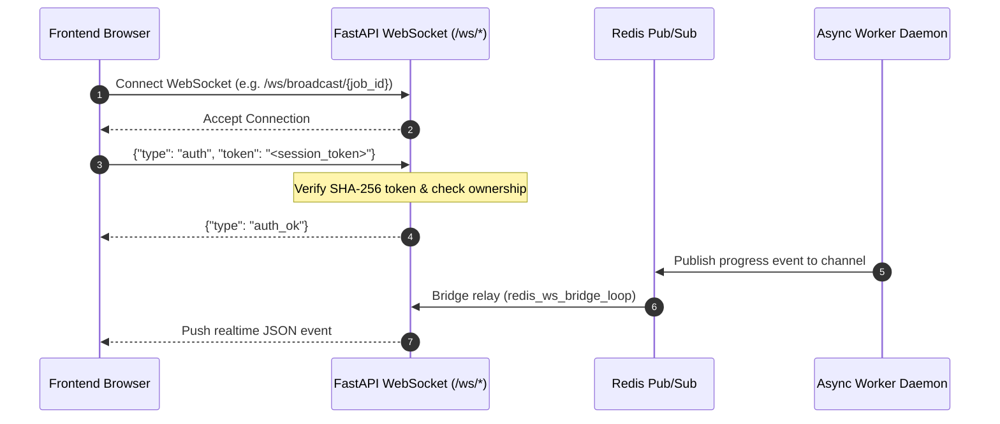

# TeleBos API Contract Specification (`API_CONTRACT.md`)

> **Source of Truth**: Generated via AST analysis and the **Graphify Knowledge Graph** (`graphify-out/graph.json`).
> Cross-referenced with running backend specifications (`/api/docs`, `/api/openapi.json`) and frontend client integrations (`frontend/src/lib/api.ts`).

---

## Table of Contents

1. [Architectural Overview & Standards](#1-architectural-overview--standards)
2. [Authentication & Security Architecture](#2-authentication--security-architecture)
3. [Global Conventions & Error Handling](#3-global-conventions--error-handling)
4. [Graphify Knowledge Graph Mapping](#4-graphify-knowledge-graph-mapping)
5. [API Capability Inventory & Route Index](#5-api-capability-inventory--route-index)
6. [Detailed Endpoint Specifications](#6-detailed-endpoint-specifications)
   - [6.01 Authentication & Session](#601-authentication--session) (3 endpoints)
   - [6.02 Telegram Accounts Management](#602-telegram-accounts-management) (32 endpoints)
   - [6.03 Account Folders](#603-account-folders) (6 endpoints)
   - [6.04 Telegram Registration Date Sync](#604-telegram-registration-date-sync) (2 endpoints)
   - [6.05 Active Devices & Sessions](#605-active-devices--sessions) (3 endpoints)
   - [6.06 Chats & Dialogs](#606-chats--dialogs) (17 endpoints)
   - [6.07 Messages & Scheduling](#607-messages--scheduling) (11 endpoints)
   - [6.08 Message Forwarding](#608-message-forwarding) (1 endpoints)
   - [6.09 Media, Attachments & Streaming](#609-media-attachments--streaming) (7 endpoints)
   - [6.10 Stickers](#610-stickers) (5 endpoints)
   - [6.11 GIFs](#611-gifs) (5 endpoints)
   - [6.12 Reactions](#612-reactions) (2 endpoints)
   - [6.13 Pins](#613-pins) (5 endpoints)
   - [6.14 Polls & Votes](#614-polls--votes) (2 endpoints)
   - [6.15 Contacts & VCF](#615-contacts--vcf) (5 endpoints)
   - [6.16 Group Admin & Member Controls](#616-group-admin--member-controls) (10 endpoints)
   - [6.17 Broadcast Campaigns](#617-broadcast-campaigns) (20 endpoints)
   - [6.18 Bulk Member Invites](#618-bulk-member-invites) (9 endpoints)
   - [6.19 Channel/Group Auto-Join](#619-channelgroup-auto-join) (8 endpoints)
   - [6.19b Channel/Group Auto-Leave](#619b-channelgroup-auto-leave) (9 endpoints)
   - [6.20 Account Marketplace](#620-account-marketplace) (8 endpoints)
   - [6.21 SMM & Account Orders](#621-smm--account-orders) (10 endpoints)
   - [6.22 Voucher & Redeem Codes](#622-voucher--redeem-codes) (3 endpoints)
   - [6.23 Wallet Transactions & Topup](#623-wallet-transactions--topup) (4 endpoints)
   - [6.24 Withdrawals & Step-Up OTP](#624-withdrawals--step-up-otp) (2 endpoints)
   - [6.25 User Bank Accounts](#625-user-bank-accounts) (5 endpoints)
   - [6.26 Payment Webhooks (KlikQRIS)](#626-payment-webhooks-klikqris) (1 endpoints)
   - [6.27 Wallet Settlement & Reconciliation (Admin)](#627-wallet-settlement--reconciliation-admin) (3 endpoints)
   - [6.28 In-App Notifications](#628-in-app-notifications) (5 endpoints)
   - [6.29 Official Telegram Bot Linking](#629-official-telegram-bot-linking) (3 endpoints)
   - [6.30 User & Workspace Settings](#630-user--workspace-settings) (13 endpoints)
   - [6.31 User Onboarding Tour](#631-user-onboarding-tour) (2 endpoints)
   - [6.32 Support Tickets & AI Assistant](#632-support-tickets--ai-assistant) (5 endpoints)
   - [6.33 API Key Management](#633-api-key-management) (3 endpoints)
   - [6.34 Curated Public Integration API](#634-curated-public-integration-api) (13 endpoints)
   - [6.35 Admin System Overview & Stats](#635-admin-system-overview--stats) (2 endpoints)
   - [6.36 Admin User Management & RBAC](#636-admin-user-management--rbac) (6 endpoints)
   - [6.37 Admin Broadcast Oversight](#637-admin-broadcast-oversight) (7 endpoints)
   - [6.38 Admin Auto-Replies Supervision](#638-admin-auto-replies-supervision) (2 endpoints)
   - [6.39 Admin Redeem Code Management](#639-admin-redeem-code-management) (4 endpoints)
   - [6.40 Admin SMM Provider Management](#640-admin-smm-provider-management) (13 endpoints)
   - [6.41 Admin Prefix Pricing Rules](#641-admin-prefix-pricing-rules) (4 endpoints)
   - [6.42 Admin Business Analytics & Trends](#642-admin-business-analytics--trends) (14 endpoints)
   - [6.43 System Status (UptimeRobot)](#643-system-status-uptimerobot) (1 endpoints)
   - [6.44 System Health Check](#644-system-health-check) (1 endpoints)
   - [6.45 Real-time WebSockets](#645-real-time-websockets) (4 endpoints)
7. [Real-time WebSocket Protocol](#7-real-time-websocket-protocol)
8. [Payment Gateway & Webhook Contract (KlikQRIS)](#8-payment-gateway--webhook-contract-klikqris)
9. [External Public Integration API (`/api/public/v1`)](#9-external-public-integration-api-apipublicv1)
10. [Frontend Integration & Hook Mapping](#10-frontend-integration--hook-mapping)

---

## 1. Architectural Overview & Standards

TeleBos provides a unified REST and WebSocket API architecture built on **FastAPI** (Python 3.12, asyncpg, SQLAlchemy) with background processing managed by dedicated async worker daemons and Redis queues.

| Dimension | Specification |
| --- | --- |
| **Base REST URL** | `https://<domain>/api/v1` (Core Application) |
| **Public REST URL** | `https://<domain>/api/public/v1` (Third-Party Integrations) |
| **WebSocket URL** | `wss://<domain>/ws/<channel>/<entity_id>` |
| **Total Endpoints** | **291 Endpoints** across 45 domains |
| **Protocol** | HTTP/1.1 & HTTP/2, WebSocket RFC 6455 |
| **Encoding** | `application/json; charset=utf-8` (Default), `multipart/form-data` (Uploads) |
| **Time Standard** | ISO 8601 UTC (`YYYY-MM-DDTHH:MM:SSZ`) |
| **ID Standard** | UUID v4 (Primary keys), Telegram 64-bit signed integers (Telegram IDs) |

---

## 2. Authentication & Security Architecture

### 2.1 Dual User Model & Better Auth Integration
TeleBos decouples identity management and credentials from domain business entities via a dual-table architecture:

1. **Better Auth Table (`"user"`)**:
   - Managed by Better Auth (TypeScript / Next.js 14 App Router).
   - Primary Key: `TEXT` string.
   - Fields: `"emailVerified"`, `"banReason"`, `"banned"`, credentials stored in `"account"`.
2. **Core Domain Table (`users`)**:
   - Managed by FastAPI & SQLAlchemy.
   - Primary Key: `UUID`.
   - Fields: `balance`, `is_active`, `role`, `ban_reason`, `ban_expires`.
   - All domain entities (`telegram_accounts`, `orders`, `wallet_transactions`, `wallet_ledgers`) reference `users.id`.

### 2.2 Session Transport & Verification
- **Header Injection**: Requests from the browser/frontend pass the Better Auth session token via `x-better-auth-token` header or the `better-auth.session_token` / `__Secure-better-auth.session_token` cookie.
- **Hashing at Rest**: The session token stored in PostgreSQL `session.token_hash` is a SHA-256 digest (`hash_session_token()`). The backend dependency `get_current_user` (`dependencies.py`) hashes incoming tokens before querying `session`, preventing token exposure from read leaks.
- **Resolution**: The backend resolves `session."userId"` to `users.id` by UUID casting (`UUID(row.user_id)`).

### 2.3 RBAC Roles & Commercial Subscription Plans

TeleBos aligns technical database roles (`UserRole` in `models/enums.py`) with commercial subscription tiers as defined in `docs/subscription_plans_monthly_yearly.md` and `frontend/src/data/plans.ts`:

**Naming Structure:** `Free Trial` (`freetrial`) → `Starter` (`basic`) → `Pro` (`pro`) → `Business` (`premium`) → `Owner Access` (`owner`).

#### 2.3.1 Role Hierarchy & Commercial Mapping Table

| Commercial Plan | Database Role (`UserRole`) | Role Level | Monthly Price | Yearly Price (Hemat 16,7%) | Connected Accounts | Watermark Broadcast |
| --- | --- | :---: | ---:| ---:| :---: | :---: |
| **Free Trial** | `freetrial` | 0 | Gratis (5 jam) | — | 1 Akun | ✅ Ya |
| **Starter** | `basic` | 1 | Rp5.000/bulan | Rp50.000/tahun (Rp4.167/bln) | 1 Akun | ✅ Ya |
| **Pro** | `pro` | 2 | Rp10.000/bulan | Rp100.000/tahun (Rp8.333/bln) | 3 Akun | ❌ Tidak |
| **Business** | `premium` | 3 | Rp20.000/bulan | Rp200.000/tahun (Rp16.667/bln) | 5 Akun | ❌ Tidak |
| **Owner Access** | `owner` | 4 | Internal / Superadmin | Internal / Superadmin | 999.999 | ❌ Tidak |

#### 2.3.2 Feature Access Matrix by Plan

| Feature / Capability | Free Trial (`freetrial`) | Starter (`basic`) | Pro (`pro`) | Business (`premium`) | Owner (`owner`) | Required Dependency Check |
| --- | :---: | :---: | :---: | :---: | :---: | --- |
| **Age Checker** | ❌ | ❌ | ✅ | ✅ | ✅ | `require_role(["pro", "premium", "owner"])` |
| **Public Index Groups/Channels** | ❌ | ❌ | ✅ | ✅ | ✅ | `require_role(["pro", "premium", "owner"])` |
| **Auto Join Groups & Channels** | ❌ | ✅ | ✅ | ✅ | ✅ | `require_role(["basic", "pro", "premium", "owner"])` |
| **Auto Reply Responder** | ✅ | ✅ | ✅ | ✅ | ✅ | Standard User Session |
| **Member Inviter & Scraper** | ❌ | ❌ | ✅ | ✅ | ✅ | `require_role(["pro", "premium", "owner"])` |
| **Broadcast Campaigns** | ❌ | ✅ (Watermarked) | ✅ (Clean) | ✅ (Priority) | ✅ (Unlimited) | Enforced via `broadcast_entitlement.py` |
| **Real-time Direct Chats** | ✅ | ✅ | ✅ | ✅ | ✅ | Standard User Session |
| **Contacts & VCF Import/Export** | ❌ | ❌ | ✅ | ✅ | ✅ | `require_role(["pro", "premium", "owner"])` |
| **Marketplace & SMM Ordering** | ✅ | ✅ | ✅ | ✅ | ✅ | Standard User Session |
| **Top Up & Withdraw Balance** | ✅ | ✅ | ✅ | ✅ | ✅ | Standard User Session |
| **System & User Administration** | ❌ | ❌ | ❌ | ❌ | ✅ | `require_role(["owner"])` |

### 2.4 External Integration API Keys
- **Token Scheme**: `Authorization: Bearer tb_live_<random_bytes>`.
- **Scope Enforcement**: Scopes include `accounts:read`, `accounts:write`, `messages:read`, `messages:write`, `broadcast:read`, `broadcast:write`, `wallet:read`.
- **Validation**: Verified by `get_api_principal` and `require_api_scope("<scope>")` dependencies.

---

## 3. Global Conventions & Error Handling

### 3.1 HTTP Status Codes
- `200 OK`: Request succeeded with payload.
- `201 Created`: Resource successfully created.
- `204 No Content`: Resource deleted or mutation completed with empty response.
- `400 Bad Request`: Malformed payload or domain rule violation.
- `401 Unauthorized`: Missing or invalid session token / API key.
- `403 Forbidden`: Insufficient role permissions or resource ownership failure.
- `404 Not Found`: Target entity does not exist or does not belong to the user.
- `409 Conflict`: Resource collision (e.g., account already registered or concurrent update).
- `422 Unprocessable Entity`: Request body failed Pydantic schema validation.
- `429 Too Many Requests`: Rate limit reached (Telegram FloodWait or TeleBos sliding window).
- `500 Internal Server Error`: Server-side unhandled exception or database error.

### 3.2 Error Response Format
```json
{
  "detail": "Descriptive error message"
}
```
For validation errors (HTTP 422):
```json
{
  "detail": [
    {
      "loc": ["body", "field_name"],
      "msg": "field required",
      "type": "value_error.missing"
    }
  ]
}
```

---

## 4. Graphify Knowledge Graph Mapping

This API Contract is linked with the repository's **Graphify Knowledge Graph** (`graphify-out/graph.json`):

- **Graph Scale**: 7,272 AST nodes · 19,945 directed edges · 298 detected communities.
- **God Nodes & Central Hubs**:
  1. `User` (553 edges): Central identity entity in `backend/app/models/user.py`.
  2. `TelegramAccount` (237 edges): Domain model in `backend/app/models/telegram_account.py`.
  3. `sanitize_exception()` (163 edges): Universal security error masking helper.
  4. `decrypt()` (126 edges): AES-256 session string decryption for Telethon MTProto clients.
  5. `get_settings()` (114 edges): Application configuration loader.
- **Community Clustering**:
  - Community `media.py` / `chat.py`: Handles streaming, upload buffers, and chat payload marshalling.
  - Community `account_service.py`: Telegram MTProto connection pools, session migration, health checks.
  - Community `broadcast_service.py`: Broadcast job runner, spin-syntax, task chunking, Redis Pub/Sub.
  - Community `wallet/__init__.py`: Financial ledger, KlikQRIS callbacks, payout settlements.

---

## 5. API Capability Inventory & Route Index

| Category | Endpoints | Base Path | Ownership Module |
| --- | --- | --- | --- |
| **Authentication & Session** | 3 | `/api/v1/auth` | `api/auth.py` |
| **Telegram Accounts Management** | 32 | `/api/v1/accounts` | `api/accounts.py` |
| **Account Folders** | 6 | `/api/v1/account-folders` | `api/account_folders.py` |
| **Telegram Registration Date Sync** | 2 | `/api/v1/telegram-reg-date` | `api/telegram_reg_date.py` |
| **Active Devices & Sessions** | 3 | `/api/v1/accounts` | `api/devices.py` |
| **Chats & Dialogs** | 17 | `/api/v1/accounts` | `api/chats.py` |
| **Messages & Scheduling** | 11 | `/api/v1/accounts` | `api/messages.py` |
| **Message Forwarding** | 1 | `/api/v1/accounts` | `api/forward.py` |
| **Media, Attachments & Streaming** | 7 | `/api/v1/accounts` | `api/media.py` |
| **Stickers** | 5 | `/api/v1/accounts` | `api/stickers.py` |
| **GIFs** | 5 | `/api/v1/accounts` | `api/gifs.py` |
| **Reactions** | 2 | `/api/v1/accounts` | `api/reactions.py` |
| **Pins** | 5 | `/api/v1/accounts` | `api/pins.py` |
| **Polls & Votes** | 2 | `/api/v1/accounts` | `api/polls.py` |
| **Contacts & VCF** | 5 | `/api/v1/accounts` | `api/contacts.py` |
| **Group Admin & Member Controls** | 10 | `/api/v1/accounts` | `api/group_admin.py` |
| **Broadcast Campaigns** | 20 | `/api/v1/group-lists` | `api/broadcast.py` |
| **Bulk Member Invites** | 9 | `/api/v1/invite` | `api/invite.py` |
| **Channel/Group Auto-Join** | 8 | `/api/v1/auto-join` | `api/auto_join.py` |
| **Account Marketplace** | 8 | `/api/v1/marketplace` | `api/marketplace.py` |
| **SMM & Account Orders** | 10 | `/api/v1/orders` | `api/orders.py` |
| **Voucher & Redeem Codes** | 3 | `/api/v1/redeem` | `api/redeem.py` |
| **Wallet Transactions & Topup** | 4 | `/api/v1/wallet` | `api/wallet/transactions.py` |
| **Withdrawals & Step-Up OTP** | 2 | `/api/v1/wallet` | `api/wallet/withdrawals.py` |
| **User Bank Accounts** | 5 | `/api/v1/wallet` | `api/wallet/bank_accounts.py` |
| **Payment Webhooks (KlikQRIS)** | 1 | `/api/v1/wallet` | `api/wallet/webhooks.py` |
| **Wallet Settlement & Reconciliation (Admin)** | 3 | `/api/v1/admin` | `api/wallet/admin_settlement.py` |
| **In-App Notifications** | 5 | `/api/v1/notifications` | `api/notifications.py` |
| **Official Telegram Bot Linking** | 3 | `/api/v1/telegram-bot` | `api/telegram_bot.py` |
| **User & Workspace Settings** | 13 | `/api/v1/accounts` | `api/settings.py` |
| **User Onboarding Tour** | 2 | `/api/v1/onboarding` | `api/onboarding.py` |
| **Support Tickets & AI Assistant** | 5 | `/api/v1/support` | `api/support.py` |
| **API Key Management** | 3 | `/api/v1/api-keys` | `api/api_keys.py` |
| **Curated Public Integration API** | 13 | `/api/public/v1` | `api/public.py` |
| **Admin System Overview & Stats** | 2 | `/api/v1/admin` | `api/admin/system.py` |
| **Admin User Management & RBAC** | 6 | `/api/v1/admin` | `api/admin/users.py` |
| **Admin Broadcast Oversight** | 7 | `/api/v1/admin` | `api/admin/broadcasts.py` |
| **Admin Auto-Replies Supervision** | 2 | `/api/v1/admin` | `api/admin/auto_replies.py` |
| **Admin Redeem Code Management** | 4 | `/api/v1/admin` | `api/admin/redeem.py` |
| **Admin SMM Provider Management** | 13 | `/api/v1/admin` | `api/admin_smm.py` |
| **Admin Prefix Pricing Rules** | 4 | `/api/v1/admin` | `api/admin_account_prices.py` |
| **Admin Business Analytics & Trends** | 14 | `/api/v1/admin` | `api/admin_analytics.py` |
| **System Status (UptimeRobot)** | 1 | `/api/v1/system` | `api/system.py` |
| **System Health Check** | 1 | `/api/v1/health` | `main.py` |
| **Real-time WebSockets** | 4 | `/ws/broadcast` | `api/ws.py` |

---

## 6. Detailed Endpoint Specifications

### 6.01 Authentication & Session
*User authentication, profile retrieval, password modification, and session invalidation.*

| Method | Path | Auth / RBAC | Response Model | Description |
| --- | --- | --- | --- | --- |
| `GET` | `/api/v1/auth/me` | User Session (`x-better-auth-token`) | `UserResponse` | Execute `me`. |
| `POST` | `/api/v1/auth/logout` | None / Public | `LogoutResponse` | Delete the session row from PostgreSQL, fully invalidating the token. |
| `POST` | `/api/v1/auth/change-password` | User Session (`x-better-auth-token`) | `ChangePasswordResponse` | Change the current user's password and invalidate all their sessions. |

#### `GET /api/v1/auth/me`
- **Handler Function**: [`me()`](file:///backend/app/api/auth.py#L35) (`backend/app/api/auth.py:35`)
- **Security & Auth**: User Session (`x-better-auth-token`)
- **Dependencies**: `Depends(get_current_user)`
- **Success Response**: `200 OK` -> `UserResponse`
- **Graphify Context**:
  - Community: `api/auth.py` (ID 150)
  - Services: `track_user_login()`
  - Models: `User`
  - Frontend Consumers: `auth-store.ts`

#### `POST /api/v1/auth/logout`
- **Handler Function**: [`logout()`](file:///backend/app/api/auth.py#L59) (`backend/app/api/auth.py:59`)
- **Security & Auth**: None / Public
- **Description**: Delete the session row from PostgreSQL, fully invalidating the token.

This is defence-in-depth alongside Better Auth's client-side signOut:
the BA sign-out clears cookies and client state, but does not reliably
delete the session row from the database.  This endpoint ensures the
token in the ``session`` table is physically removed, so any subsequent
API request with that token will receive a 401.

The endpoint tolerates missing / already-deleted tokens so callers can
safely invoke it unconditionally on logout.
- **Success Response**: `200/201` -> `LogoutResponse`
- **Graphify Context**:
  - Community: `api/auth.py` (ID 150)
  - Frontend Consumers: `auth-store.ts`

#### `POST /api/v1/auth/change-password`
- **Handler Function**: [`change_password()`](file:///backend/app/api/auth.py#L91) (`backend/app/api/auth.py:91`)
- **Security & Auth**: User Session (`x-better-auth-token`)
- **Dependencies**: `Depends(get_current_user)`
- **Description**: Change the current user's password and invalidate all their sessions.

All sessions for this user are deleted from the ``session`` table so that
an attacker who may have a stolen token is locked out immediately.
- **Success Response**: `200/201` -> `ChangePasswordResponse`
- **Graphify Context**:
  - Community: `api/auth.py` (ID 150)
  - Services: `record_security_audit_event()`, `revoke_all_user_sessions()`
  - Models: `User`

---

### 6.02 Telegram Accounts Management
*Telegram account onboarding (QR / Phone / 2FA / Session Upload), sync, health, proxy assignment, avatar, bio, and privacy settings.*

| Method | Path | Auth / RBAC | Response Model | Description |
| --- | --- | --- | --- | --- |
| `POST` | `/api/v1/accounts/qr-login/init` | User Session (`x-better-auth-token`) | `QRInitResponse` | Initialize a Telegram QR login flow. |
| `GET` | `/api/v1/accounts/qr-login/status/{qr_id}` | User Session (`x-better-auth-token`) | `QRStatusResponse` | Get the current status of a QR login flow. |
| `POST` | `/api/v1/accounts/qr-login/2fa` | User Session (`x-better-auth-token`) | `QRStatusResponse` | Finalize QR login by submitting the 2FA password. |
| `POST` | `/api/v1/accounts/cancel-login` | User Session (`x-better-auth-token`) | `JSON / Any` | Cancel an owned pending login without exposing its Telegram state. |
| `GET` | `/api/v1/accounts/countries` | None / Public | `JSON / Any` | List Telegram supported country calling codes |
| `POST` | `/api/v1/accounts/send-code` | User Session (`x-better-auth-token`) | `SendCodeResponse` | Execute `send_code`. |
| `POST` | `/api/v1/accounts/resend-code` | User Session (`x-better-auth-token`) | `SendCodeResponse` | Execute `resend_code`. |
| `POST` | `/api/v1/accounts/setup-email` | User Session (`x-better-auth-token`) | `SetupLoginEmailResponse` | Execute `setup_login_email`. |
| `POST` | `/api/v1/accounts/setup-email/verify` | User Session (`x-better-auth-token`) | `SendCodeResponse` | Execute `verify_setup_login_email`. |
| `POST` | `/api/v1/accounts/verify-code` | User Session (`x-better-auth-token`) | `VerifyCodeResponse` | Execute `verify_code`. |
| `POST` | `/api/v1/accounts/verify-2fa` | User Session (`x-better-auth-token`) | `VerifyCodeResponse` | Execute `verify_twofa`. |
| `POST` | `/api/v1/accounts/upload-session` | User Session (`x-better-auth-token`) | `AccountResponse` | Execute `upload_session`. |
| `GET` | `/api/v1/accounts` | User Session (`x-better-auth-token`) | `AccountListResponse` | Execute `list_accounts`. |
| `GET` | `/api/v1/accounts/summary` | User Session (`x-better-auth-token`) | `UserAccountsSummaryResponse` | Get high-level summary counts for the current user's accounts. |
| `GET` | `/api/v1/accounts/{account_id}` | User Session (`x-better-auth-token`) | `AccountResponse` | Execute `get_account`. |
| `GET` | `/api/v1/accounts/{account_id}/check-username` | User Session (`x-better-auth-token`) | `CheckUsernameResponse` | Check Telegram username availability in real-time via MTProto. |
| `PUT` | `/api/v1/accounts/{account_id}/profile` | User Session (`x-better-auth-token`) | `AccountResponse` | Execute `update_profile`. |
| `PUT` | `/api/v1/accounts/{account_id}/auto-reply` | RBAC Session (`x-better-auth-token` ['pro', 'premium', 'owner']) | `AccountResponse` | Enable/disable auto-reply and set the reply text for this account. |
| `POST` | `/api/v1/accounts/auto-reply/bulk` | RBAC Session (`x-better-auth-token` ['pro', 'premium', 'owner']) | `JSON / Any` | Enable/disable auto-reply for multiple accounts at once. |
| `POST` | `/api/v1/accounts/{account_id}/photo` | User Session (`x-better-auth-token`) | `JSON / Any` | Execute `upload_profile_photo`. |
| `GET` | `/api/v1/accounts/{account_id}/photo` | None / Public | `JSON / Any` | Get the account's profile photo. |
| `DELETE` | `/api/v1/accounts/{account_id}/photo` | User Session (`x-better-auth-token`) | `JSON / Any` | Delete the account's profile photo from Telegram and remove local cache. |
| `POST` | `/api/v1/accounts/batch-check-spam` | User Session (`x-better-auth-token`) | `JSON / Any` | Trigger background batch spam status check across all accounts. |
| `POST` | `/api/v1/accounts/{account_id}/check-spam` | User Session (`x-better-auth-token`) | `AccountResponse` | Execute `check_spam`. |
| `GET` | `/api/v1/accounts/{account_id}/stats` | User Session (`x-better-auth-token`) | `AccountStatsResponse` | Get aggregate stats for an account: contacts, groups, channels. |
| `POST` | `/api/v1/accounts/{account_id}/stats/refresh` | User Session (`x-better-auth-token`) | `AccountStatsResponse` | Force a manual refresh of the cached dialog statistics for an account. |
| `DELETE` | `/api/v1/accounts/{account_id}` | User Session (`x-better-auth-token`) | `JSON / Any` | Execute `delete_account`. |
| `POST` | `/api/v1/accounts/{account_id}/appeal/start` | User Session (`x-better-auth-token`) | `SpamAppealResponse` | Execute `start_appeal`. |
| `POST` | `/api/v1/accounts/{account_id}/appeal/resume` | User Session (`x-better-auth-token`) | `SpamAppealResponse` | Execute `resume_appeal`. |
| `GET` | `/api/v1/accounts/{account_id}/profile-colors` | User Session (`x-better-auth-token`) | `JSON / Any` | Get the set of accent color palettes available for profile backgrounds. |
| `PUT` | `/api/v1/accounts/{account_id}/profile-color` | User Session (`x-better-auth-token`) | `AccountResponse` | Update profile accent color palette and background pattern on Telegram. |
| `POST` | `/api/v1/accounts/transfer` | User Session (`x-better-auth-token`) | `TransferAccountResponse` | Transfer Telegram accounts to another user by email (Owner only) |

#### `POST /api/v1/accounts/qr-login/init`
- **Handler Function**: [`qr_login_init()`](file:///backend/app/api/accounts.py#L214) (`backend/app/api/accounts.py:214`)
- **Security & Auth**: User Session (`x-better-auth-token`)
- **Dependencies**: `Depends(get_current_user)`
- **Description**: Initialize a Telegram QR login flow.
- **Success Response**: `200/201` -> `QRInitResponse`
- **Graphify Context**:
  - Community: `api/accounts.py` (ID 54)
  - Models: `User`
  - Frontend Consumers: `page.tsx`

#### `GET /api/v1/accounts/qr-login/status/{qr_id}`
- **Handler Function**: [`qr_login_status()`](file:///backend/app/api/accounts.py#L251) (`backend/app/api/accounts.py:251`)
- **Security & Auth**: User Session (`x-better-auth-token`)
- **Dependencies**: `Depends(get_current_user)`
- **Description**: Get the current status of a QR login flow.
- **Path Parameters**:
  - `qr_id: str`
- **Success Response**: `200 OK` -> `QRStatusResponse`
- **Graphify Context**:
  - Community: `api/accounts.py` (ID 54)
  - Models: `User`
  - Frontend Consumers: `page.tsx`

#### `POST /api/v1/accounts/qr-login/2fa`
- **Handler Function**: [`qr_login_2fa()`](file:///backend/app/api/accounts.py#L265) (`backend/app/api/accounts.py:265`)
- **Security & Auth**: User Session (`x-better-auth-token`)
- **Dependencies**: `Depends(get_current_user)`
- **Description**: Finalize QR login by submitting the 2FA password.
- **Success Response**: `200/201` -> `QRStatusResponse`
- **Graphify Context**:
  - Community: `api/accounts.py` (ID 54)
  - Services: `DuplicateAccountError`, `check_account_limit()`, `get_live_2fa_status()`
  - Models: `TelegramAccount`, `User`
  - Frontend Consumers: `page.tsx`

#### `POST /api/v1/accounts/cancel-login`
- **Handler Function**: [`cancel_login()`](file:///backend/app/api/accounts.py#L369) (`backend/app/api/accounts.py:369`)
- **Security & Auth**: User Session (`x-better-auth-token`)
- **Dependencies**: `Depends(get_current_user)`
- **Description**: Cancel an owned pending login without exposing its Telegram state.
- **Success Response**: `200/201` -> `Dict[str, Any]`
- **Graphify Context**:
  - Community: `api/accounts.py` (ID 54)
  - Models: `User`
  - Frontend Consumers: `page.tsx`, `telegram-login-flow.tsx`

#### `GET /api/v1/accounts/countries`
- **Handler Function**: [`get_countries()`](file:///backend/app/api/accounts.py#L379) (`backend/app/api/accounts.py:379`)
- **Security & Auth**: None / Public
- **Description**: Get list of countries supported by Telegram with calling codes, flag emojis, and input patterns.
- **Query Parameters**:
  - `lang_code: str = Query('en', description='ISO 639-1 language code')`
- **Success Response**: `200 OK` -> `Dict[str, Any]`
- **Graphify Context**:
  - Community: `api/accounts.py` (ID 54)
  - Services: `get_countries()`

#### `POST /api/v1/accounts/send-code`
- **Handler Function**: [`send_code()`](file:///backend/app/api/accounts.py#L385) (`backend/app/api/accounts.py:385`)
- **Security & Auth**: User Session (`x-better-auth-token`)
- **Dependencies**: `Depends(get_current_user)`
- **Success Response**: `200/201` -> `SendCodeResponse`
- **Graphify Context**:
  - Community: `api/accounts.py` (ID 54)
  - Services: `start_login()`
  - Models: `User`
  - Frontend Consumers: `page.tsx`, `telegram-login-flow.tsx`

#### `POST /api/v1/accounts/resend-code`
- **Handler Function**: [`resend_code()`](file:///backend/app/api/accounts.py#L399) (`backend/app/api/accounts.py:399`)
- **Security & Auth**: User Session (`x-better-auth-token`)
- **Dependencies**: `Depends(get_current_user)`
- **Success Response**: `200/201` -> `SendCodeResponse`
- **Graphify Context**:
  - Community: `api/accounts.py` (ID 54)
  - Services: `resend_login_code()`
  - Models: `User`
  - Frontend Consumers: `telegram-login-flow.tsx`

#### `POST /api/v1/accounts/setup-email`
- **Handler Function**: [`setup_login_email()`](file:///backend/app/api/accounts.py#L416) (`backend/app/api/accounts.py:416`)
- **Security & Auth**: User Session (`x-better-auth-token`)
- **Dependencies**: `Depends(get_current_user)`
- **Success Response**: `200/201` -> `SetupLoginEmailResponse`
- **Graphify Context**:
  - Community: `api/accounts.py` (ID 54)
  - Services: `send_login_setup_email()`
  - Models: `User`
  - Frontend Consumers: `telegram-login-flow.tsx`

#### `POST /api/v1/accounts/setup-email/verify`
- **Handler Function**: [`verify_setup_login_email()`](file:///backend/app/api/accounts.py#L432) (`backend/app/api/accounts.py:432`)
- **Security & Auth**: User Session (`x-better-auth-token`)
- **Dependencies**: `Depends(get_current_user)`
- **Success Response**: `200/201` -> `SendCodeResponse`
- **Graphify Context**:
  - Community: `api/accounts.py` (ID 54)
  - Services: `verify_login_setup_email()`
  - Models: `User`
  - Frontend Consumers: `telegram-login-flow.tsx`

#### `POST /api/v1/accounts/verify-code`
- **Handler Function**: [`verify_code()`](file:///backend/app/api/accounts.py#L480) (`backend/app/api/accounts.py:480`)
- **Security & Auth**: User Session (`x-better-auth-token`)
- **Dependencies**: `Depends(get_current_user)`
- **Success Response**: `200/201` -> `VerifyCodeResponse`
- **Graphify Context**:
  - Community: `api/accounts.py` (ID 54)
  - Services: `validate_login_code()`, `verify_code()`
  - Models: `User`
  - Frontend Consumers: `page.tsx`, `telegram-login-flow.tsx`

#### `POST /api/v1/accounts/verify-2fa`
- **Handler Function**: [`verify_twofa()`](file:///backend/app/api/accounts.py#L502) (`backend/app/api/accounts.py:502`)
- **Security & Auth**: User Session (`x-better-auth-token`)
- **Dependencies**: `Depends(get_current_user)`
- **Success Response**: `200/201` -> `VerifyCodeResponse`
- **Graphify Context**:
  - Community: `api/accounts.py` (ID 54)
  - Services: `verify_twofa()`
  - Models: `User`
  - Frontend Consumers: `telegram-login-flow.tsx`

#### `POST /api/v1/accounts/upload-session`
- **Handler Function**: [`upload_session()`](file:///backend/app/api/accounts.py#L520) (`backend/app/api/accounts.py:520`)
- **Security & Auth**: User Session (`x-better-auth-token`)
- **Dependencies**: `Depends(get_current_user)`
- **Success Response**: `201 CREATED` -> `AccountResponse`
- **Graphify Context**:
  - Community: `api/accounts.py` (ID 54)
  - Services: `login_with_session()`, `resolve_telegram_id_price()`, `track_account_connected()`
  - Models: `User`
  - Frontend Consumers: `page.tsx`

#### `GET /api/v1/accounts`
- **Handler Function**: [`list_accounts()`](file:///backend/app/api/accounts.py#L583) (`backend/app/api/accounts.py:583`)
- **Security & Auth**: User Session (`x-better-auth-token`)
- **Dependencies**: `Depends(get_current_user)`
- **Query Parameters**:
  - `folder_id: str | None = Query(None)`
  - `page: int | None = Query(None, ge=1)`
  - `limit: int | None = Query(None, ge=1, le=1000)`
  - `search: str | None = Query(None)`
  - `status: str | None = Query(None)`
  - `is_active: bool | None = Query(None)`
- **Success Response**: `200 OK` -> `AccountListResponse`
- **Graphify Context**:
  - Community: `account_service.py` (ID 199)
  - Services: `get_accounts_for_user()`, `get_accounts_in_folder()`, `get_accounts_paginated()`, `resolve_prices_for_accounts()`
  - Models: `User`
  - Frontend Consumers: `use-accounts.ts`

#### `GET /api/v1/accounts/summary`
- **Handler Function**: [`get_accounts_summary()`](file:///backend/app/api/accounts.py#L634) (`backend/app/api/accounts.py:634`)
- **Security & Auth**: User Session (`x-better-auth-token`)
- **Dependencies**: `Depends(get_current_user)`
- **Description**: Get high-level summary counts for the current user's accounts.
- **Success Response**: `200 OK` -> `UserAccountsSummaryResponse`
- **Graphify Context**:
  - Community: `api/accounts.py` (ID 54)
  - Models: `TelegramAccount`, `User`
  - Frontend Consumers: `use-accounts.ts`

#### `GET /api/v1/accounts/{account_id}`
- **Handler Function**: [`get_account()`](file:///backend/app/api/accounts.py#L669) (`backend/app/api/accounts.py:669`)
- **Security & Auth**: User Session (`x-better-auth-token`)
- **Dependencies**: `Depends(get_current_user)`
- **Path Parameters**:
  - `account_id: str`
- **Success Response**: `200 OK` -> `AccountResponse`
- **Graphify Context**:
  - Community: `api/accounts.py` (ID 54)
  - Services: `get_account()`, `resolve_telegram_id_price()`
  - Models: `User`
  - Frontend Consumers: `use-accounts.ts`

#### `GET /api/v1/accounts/{account_id}/check-username`
- **Handler Function**: [`check_username()`](file:///backend/app/api/accounts.py#L694) (`backend/app/api/accounts.py:694`)
- **Security & Auth**: User Session (`x-better-auth-token`)
- **Dependencies**: `Depends(get_current_user)`
- **Description**: Check Telegram username availability in real-time via MTProto.
- **Path Parameters**:
  - `account_id: str`
- **Query Parameters**:
  - `username: str = Query(..., min_length=1, max_length=64, description='Telegram username to check')`
- **Success Response**: `200 OK` -> `CheckUsernameResponse`
- **Graphify Context**:
  - Community: `api/accounts.py` (ID 54)
  - Services: `check_username_availability()`, `get_account()`
  - Models: `User`
  - Frontend Consumers: `account-settings-page.tsx`

#### `PUT /api/v1/accounts/{account_id}/profile`
- **Handler Function**: [`update_profile()`](file:///backend/app/api/accounts.py#L718) (`backend/app/api/accounts.py:718`)
- **Security & Auth**: User Session (`x-better-auth-token`)
- **Dependencies**: `Depends(get_current_user)`
- **Path Parameters**:
  - `account_id: str`
- **Success Response**: `200 OK` -> `AccountResponse`
- **Graphify Context**:
  - Community: `api/accounts.py` (ID 54)
  - Services: `get_account()`, `resolve_telegram_id_price()`, `update_profile()`
  - Models: `User`
  - Frontend Consumers: `account-settings-page.tsx`

#### `PUT /api/v1/accounts/{account_id}/auto-reply`
- **Handler Function**: [`update_auto_reply()`](file:///backend/app/api/accounts.py#L745) (`backend/app/api/accounts.py:745`)
- **Security & Auth**: RBAC Session (`x-better-auth-token` ['pro', 'premium', 'owner'])
- **Dependencies**: `Depends(require_role(['pro', 'premium', 'owner']))`
- **Description**: Enable/disable auto-reply and set the reply text for this account.
- **Path Parameters**:
  - `account_id: str`
- **Success Response**: `200 OK` -> `AccountResponse`
- **Graphify Context**:
  - Community: `api/accounts.py` (ID 54)
  - Services: `get_account()`, `resolve_telegram_id_price()`
  - Models: `User`
  - Frontend Consumers: `use-accounts.ts`

#### `POST /api/v1/accounts/auto-reply/bulk`
- **Handler Function**: [`bulk_update_auto_reply()`](file:///backend/app/api/accounts.py#L779) (`backend/app/api/accounts.py:779`)
- **Security & Auth**: RBAC Session (`x-better-auth-token` ['pro', 'premium', 'owner'])
- **Dependencies**: `Depends(require_role(['pro', 'premium', 'owner']))`
- **Description**: Enable/disable auto-reply for multiple accounts at once.
- **Success Response**: `200/201` -> `Dict[str, Any]`
- **Graphify Context**:
  - Community: `api/accounts.py` (ID 54)
  - Models: `TelegramAccount`, `User`
  - Frontend Consumers: `use-accounts.ts`

#### `POST /api/v1/accounts/{account_id}/photo`
- **Handler Function**: [`upload_profile_photo()`](file:///backend/app/api/accounts.py#L825) (`backend/app/api/accounts.py:825`)
- **Security & Auth**: User Session (`x-better-auth-token`)
- **Dependencies**: `Depends(get_current_user)`
- **Path Parameters**:
  - `account_id: str`
- **Request Body**: `file: UploadFile`
- **Success Response**: `200/201` -> `Dict[str, Any]`
- **Graphify Context**:
  - Community: `api/accounts.py` (ID 54)
  - Services: `get_account()`, `upload_photo()`
  - Models: `User`
  - Frontend Consumers: `use-accounts.ts`

#### `GET /api/v1/accounts/{account_id}/photo`
- **Handler Function**: [`get_profile_photo()`](file:///backend/app/api/accounts.py#L864) (`backend/app/api/accounts.py:864`)
- **Security & Auth**: None / Public
- **Description**: Get the account's profile photo.

Public endpoint — Telegram profile photos are public data.
Protected by per-IP rate limiting and browser
caching (Cache-Control: 1 hour, ETag based on photo_version)
to prevent abuse.
- **Path Parameters**:
  - `account_id: str`
- **Success Response**: `200 OK` -> `Dict[str, Any]`
- **Graphify Context**:
  - Community: `test_path_traversal_hardening.py` (ID 118)
  - Services: `download_and_cache_photo()`, `get_cached_photo_path()`
  - Models: `TelegramAccount`

#### `DELETE /api/v1/accounts/{account_id}/photo`
- **Handler Function**: [`delete_profile_photo()`](file:///backend/app/api/accounts.py#L950) (`backend/app/api/accounts.py:950`)
- **Security & Auth**: User Session (`x-better-auth-token`)
- **Dependencies**: `Depends(get_current_user)`
- **Description**: Delete the account's profile photo from Telegram and remove local cache.
- **Path Parameters**:
  - `account_id: str`
- **Success Response**: `200 OK` -> `Dict[str, Any]`
- **Graphify Context**:
  - Community: `api/accounts.py` (ID 54)
  - Services: `delete_photo()`, `get_account()`
  - Models: `User`
  - Frontend Consumers: `use-accounts.ts`

#### `POST /api/v1/accounts/batch-check-spam`
- **Handler Function**: [`trigger_batch_spam_check()`](file:///backend/app/api/accounts.py#L973) (`backend/app/api/accounts.py:973`)
- **Security & Auth**: User Session (`x-better-auth-token`)
- **Dependencies**: `Depends(get_current_user)`
- **Description**: Trigger background batch spam status check across all accounts.
- **Success Response**: `200/201` -> `Dict[str, Any]`
- **Graphify Context**:
  - Community: `api/accounts.py` (ID 54)
  - Models: `User`

#### `POST /api/v1/accounts/{account_id}/check-spam`
- **Handler Function**: [`check_spam()`](file:///backend/app/api/accounts.py#L988) (`backend/app/api/accounts.py:988`)
- **Security & Auth**: User Session (`x-better-auth-token`)
- **Dependencies**: `Depends(get_current_user)`
- **Path Parameters**:
  - `account_id: str`
- **Success Response**: `200/201` -> `AccountResponse`
- **Graphify Context**:
  - Community: `api/accounts.py` (ID 54)
  - Services: `check_spam_status()`, `get_account()`, `resolve_telegram_id_price()`
  - Models: `User`
  - Frontend Consumers: `use-accounts.ts`

#### `GET /api/v1/accounts/{account_id}/stats`
- **Handler Function**: [`get_account_stats()`](file:///backend/app/api/accounts.py#L1008) (`backend/app/api/accounts.py:1008`)
- **Security & Auth**: User Session (`x-better-auth-token`)
- **Dependencies**: `Depends(get_current_user)`
- **Description**: Get aggregate stats for an account: contacts, groups, channels.

Returns cached values from the database, refreshed daily by a background
task.  Force a manual refresh via ``POST …/stats/refresh``.
- **Path Parameters**:
  - `account_id: str`
- **Success Response**: `200 OK` -> `AccountStatsResponse`
- **Graphify Context**:
  - Community: `User` (ID 6)
  - Services: `get_account()`
  - Models: `User`
  - Frontend Consumers: `use-account-stats.ts`

#### `POST /api/v1/accounts/{account_id}/stats/refresh`
- **Handler Function**: [`refresh_account_stats()`](file:///backend/app/api/accounts.py#L1033) (`backend/app/api/accounts.py:1033`)
- **Security & Auth**: User Session (`x-better-auth-token`)
- **Dependencies**: `Depends(get_current_user)`
- **Description**: Force a manual refresh of the cached dialog statistics for an account.
- **Path Parameters**:
  - `account_id: str`
- **Success Response**: `200/201` -> `AccountStatsResponse`
- **Graphify Context**:
  - Community: `api/accounts.py` (ID 54)
  - Services: `get_account()`
  - Models: `User`
  - Frontend Consumers: `account-card.tsx`

#### `DELETE /api/v1/accounts/{account_id}`
- **Handler Function**: [`delete_account()`](file:///backend/app/api/accounts.py#L1066) (`backend/app/api/accounts.py:1066`)
- **Security & Auth**: User Session (`x-better-auth-token`)
- **Dependencies**: `Depends(get_current_user)`
- **Path Parameters**:
  - `account_id: str`
- **Success Response**: `204 NO CONTENT` -> `Dict[str, Any]`
- **Graphify Context**:
  - Community: `api/accounts.py` (ID 54)
  - Services: `get_account()`, `remove_account()`
  - Models: `User`
  - Frontend Consumers: `page.tsx`, `use-accounts.ts`

#### `POST /api/v1/accounts/{account_id}/appeal/start`
- **Handler Function**: [`start_appeal()`](file:///backend/app/api/accounts.py#L1082) (`backend/app/api/accounts.py:1082`)
- **Security & Auth**: User Session (`x-better-auth-token`)
- **Dependencies**: `Depends(get_current_user)`
- **Path Parameters**:
  - `account_id: str`
- **Success Response**: `200/201` -> `SpamAppealResponse`
- **Graphify Context**:
  - Community: `api/accounts.py` (ID 54)
  - Services: `get_account()`, `start_spam_appeal()`
  - Models: `User`
  - Frontend Consumers: `use-accounts.ts`

#### `POST /api/v1/accounts/{account_id}/appeal/resume`
- **Handler Function**: [`resume_appeal()`](file:///backend/app/api/accounts.py#L1123) (`backend/app/api/accounts.py:1123`)
- **Security & Auth**: User Session (`x-better-auth-token`)
- **Dependencies**: `Depends(get_current_user)`
- **Path Parameters**:
  - `account_id: str`
- **Success Response**: `200/201` -> `SpamAppealResponse`
- **Graphify Context**:
  - Community: `api/accounts.py` (ID 54)
  - Services: `get_account()`, `resume_spam_appeal()`
  - Models: `User`
  - Frontend Consumers: `use-accounts.ts`

#### `GET /api/v1/accounts/{account_id}/profile-colors`
- **Handler Function**: [`get_profile_colors()`](file:///backend/app/api/accounts.py#L1163) (`backend/app/api/accounts.py:1163`)
- **Security & Auth**: User Session (`x-better-auth-token`)
- **Dependencies**: `Depends(get_current_user)`
- **Description**: Get the set of accent color palettes available for profile backgrounds.
- **Path Parameters**:
  - `account_id: str`
- **Success Response**: `200 OK` -> `Dict[str, Any]`
- **Graphify Context**:
  - Community: `User` (ID 6)
  - Services: `get_account()`, `get_profile_colors()`
  - Models: `User`

#### `PUT /api/v1/accounts/{account_id}/profile-color`
- **Handler Function**: [`update_profile_color()`](file:///backend/app/api/accounts.py#L1181) (`backend/app/api/accounts.py:1181`)
- **Security & Auth**: User Session (`x-better-auth-token`)
- **Dependencies**: `Depends(get_current_user)`
- **Description**: Update profile accent color palette and background pattern on Telegram.
- **Path Parameters**:
  - `account_id: str`
- **Success Response**: `200 OK` -> `AccountResponse`
- **Graphify Context**:
  - Community: `api/accounts.py` (ID 54)
  - Services: `get_account()`, `update_profile_color()`
  - Models: `User`

#### `POST /api/v1/accounts/transfer`
- **Handler Function**: [`transfer_accounts()`](file:///backend/app/api/accounts.py#L1207) (`backend/app/api/accounts.py:1207`)
- **Security & Auth**: User Session (`x-better-auth-token`)
- **Dependencies**: `Depends(get_current_user)`
- **Description**: Transfer ownership of one or more Telegram accounts to another user by email. Owner only.
- **Success Response**: `200/201` -> `TransferAccountResponse`
- **Graphify Context**:
  - Community: `api/accounts.py` (ID 54)
  - Services: `transfer_accounts()`
  - Models: `User`
  - Frontend Consumers: `use-accounts.ts`

---

### 6.03 Account Folders
*Logical grouping and color-tagging of Telegram accounts for campaign segmentation.*

| Method | Path | Auth / RBAC | Response Model | Description |
| --- | --- | --- | --- | --- |
| `GET` | `/api/v1/account-folders` | User Session (`x-better-auth-token`) | `AccountFolderListResponse` | List all account folders for the current user. |
| `POST` | `/api/v1/account-folders` | User Session (`x-better-auth-token`) | `AccountFolderResponse` | Create a new account folder. |
| `PUT` | `/api/v1/account-folders/{folder_id}` | User Session (`x-better-auth-token`) | `AccountFolderResponse` | Rename an existing folder. |
| `DELETE` | `/api/v1/account-folders/{folder_id}` | User Session (`x-better-auth-token`) | `JSON / Any` | Delete a folder. Accounts in the folder are not deleted. |
| `POST` | `/api/v1/account-folders/{folder_id}/accounts` | User Session (`x-better-auth-token`) | `AccountFolderResponse` | Add one or more accounts to a folder. |
| `DELETE` | `/api/v1/account-folders/{folder_id}/accounts` | User Session (`x-better-auth-token`) | `AccountFolderResponse` | Remove one or more accounts from a folder. |

#### `GET /api/v1/account-folders`
- **Handler Function**: [`list_folders()`](file:///backend/app/api/account_folders.py#L51) (`backend/app/api/account_folders.py:51`)
- **Security & Auth**: User Session (`x-better-auth-token`)
- **Dependencies**: `Depends(get_current_user)`
- **Description**: List all account folders for the current user.
- **Query Parameters**:
  - `include_accounts: bool = Query(False, alias='include_accounts')`
- **Success Response**: `200 OK` -> `AccountFolderListResponse`
- **Graphify Context**:
  - Community: `account_folders.py` (ID 87)
  - Models: `AccountFolder`, `User`
  - Frontend Consumers: `use-account-folders.ts`

#### `POST /api/v1/account-folders`
- **Handler Function**: [`create_folder()`](file:///backend/app/api/account_folders.py#L87) (`backend/app/api/account_folders.py:87`)
- **Security & Auth**: User Session (`x-better-auth-token`)
- **Dependencies**: `Depends(get_current_user)`
- **Description**: Create a new account folder.
- **Request Body**: `body: AccountFolderCreate`
- **Success Response**: `201 CREATED` -> `AccountFolderResponse`
- **Graphify Context**:
  - Community: `account_folders.py` (ID 87)
  - Models: `AccountFolder`, `User`
  - Frontend Consumers: `use-account-folders.ts`

#### `PUT /api/v1/account-folders/{folder_id}`
- **Handler Function**: [`rename_folder()`](file:///backend/app/api/account_folders.py#L111) (`backend/app/api/account_folders.py:111`)
- **Security & Auth**: User Session (`x-better-auth-token`)
- **Dependencies**: `Depends(get_current_user)`
- **Description**: Rename an existing folder.
- **Path Parameters**:
  - `folder_id: str`
- **Request Body**: `body: AccountFolderUpdate`
- **Success Response**: `200 OK` -> `AccountFolderResponse`
- **Graphify Context**:
  - Community: `account_folders.py` (ID 87)
  - Models: `AccountFolderMember`, `User`
  - Frontend Consumers: `use-account-folders.ts`

#### `DELETE /api/v1/account-folders/{folder_id}`
- **Handler Function**: [`delete_folder()`](file:///backend/app/api/account_folders.py#L141) (`backend/app/api/account_folders.py:141`)
- **Security & Auth**: User Session (`x-better-auth-token`)
- **Dependencies**: `Depends(get_current_user)`
- **Description**: Delete a folder. Accounts in the folder are not deleted.
- **Path Parameters**:
  - `folder_id: str`
- **Success Response**: `204 NO CONTENT` -> `Dict[str, Any]`
- **Graphify Context**:
  - Community: `account_folders.py` (ID 87)
  - Models: `User`
  - Frontend Consumers: `use-account-folders.ts`

#### `POST /api/v1/account-folders/{folder_id}/accounts`
- **Handler Function**: [`add_accounts_to_folder()`](file:///backend/app/api/account_folders.py#L153) (`backend/app/api/account_folders.py:153`)
- **Security & Auth**: User Session (`x-better-auth-token`)
- **Dependencies**: `Depends(get_current_user)`
- **Description**: Add one or more accounts to a folder.
- **Path Parameters**:
  - `folder_id: str`
- **Success Response**: `200/201` -> `AccountFolderResponse`
- **Graphify Context**:
  - Community: `account_folders.py` (ID 87)
  - Models: `AccountFolderMember`, `TelegramAccount`, `User`
  - Frontend Consumers: `use-account-folders.ts`

#### `DELETE /api/v1/account-folders/{folder_id}/accounts`
- **Handler Function**: [`remove_accounts_from_folder()`](file:///backend/app/api/account_folders.py#L221) (`backend/app/api/account_folders.py:221`)
- **Security & Auth**: User Session (`x-better-auth-token`)
- **Dependencies**: `Depends(get_current_user)`
- **Description**: Remove one or more accounts from a folder.
- **Path Parameters**:
  - `folder_id: str`
- **Success Response**: `200 OK` -> `AccountFolderResponse`
- **Graphify Context**:
  - Community: `account_folders.py` (ID 87)
  - Models: `AccountFolderMember`, `User`
  - Frontend Consumers: `use-account-folders.ts`

---

### 6.04 Telegram Registration Date Sync
*Estimation and synchronization of Telegram account creation dates based on Telegram ID ranges.*

| Method | Path | Auth / RBAC | Response Model | Description |
| --- | --- | --- | --- | --- |
| `GET` | `/api/v1/telegram-reg-date/estimate` | RBAC Session (`x-better-auth-token` ['pro', 'premium', 'owner']) | `RegDateEstimateResponse` | Estimate registration date of a Telegram ID |
| `POST` | `/api/v1/telegram-reg-date/sync` | RBAC Session (`x-better-auth-token` ['pro', 'premium', 'owner']) | `RegDateSyncResponse` | Harvest registration date datapoints from account dialogues |

#### `GET /api/v1/telegram-reg-date/estimate`
- **Handler Function**: [`estimate_reg_date()`](file:///backend/app/api/telegram_reg_date.py#L54) (`backend/app/api/telegram_reg_date.py:54`)
- **Security & Auth**: RBAC Session (`x-better-auth-token` ['pro', 'premium', 'owner'])
- **Dependencies**: `Depends(require_role(['pro', 'premium', 'owner']))`
- **Description**: Estimate the creation/registration date of a Telegram ID.
- **Query Parameters**:
  - `telegram_id: int = Query(..., description='The Telegram User/Chat ID to estimate')`
- **Success Response**: `200 OK` -> `RegDateEstimateResponse`
- **Graphify Context**:
  - Community: `test_headless_endpoints.py` (ID 214)
  - Models: `User`
  - Frontend Consumers: `page.tsx`

#### `POST /api/v1/telegram-reg-date/sync`
- **Handler Function**: [`sync_reg_dates()`](file:///backend/app/api/telegram_reg_date.py#L87) (`backend/app/api/telegram_reg_date.py:87`)
- **Security & Auth**: RBAC Session (`x-better-auth-token` ['pro', 'premium', 'owner'])
- **Dependencies**: `Depends(require_role(['pro', 'premium', 'owner']))`
- **Description**: Scan dialogue history of a connected account to harvest exact registration date datapoints.
- **Query Parameters**:
  - `account_id: str = Query(..., description='The Account UUID to scan dialog signup service messages from')`
- **Success Response**: `200 OK` -> `RegDateSyncResponse`
- **Graphify Context**:
  - Community: `test_headless_endpoints.py` (ID 214)
  - Services: `get_account()`
  - Models: `User`

---

### 6.05 Active Devices & Sessions
*Telegram session device inspection and remote session termination.*

| Method | Path | Auth / RBAC | Response Model | Description |
| --- | --- | --- | --- | --- |
| `GET` | `/api/v1/accounts/{account_id}/devices` | User Session (`x-better-auth-token`) | `DeviceListResponse` | Execute `list_devices`. |
| `DELETE` | `/api/v1/accounts/{account_id}/devices/{device_hash}` | User Session (`x-better-auth-token`) | `JSON / Any` | Execute `terminate_device`. |
| `DELETE` | `/api/v1/accounts/{account_id}/devices` | User Session (`x-better-auth-token`) | `JSON / Any` | Execute `terminate_all_other_sessions`. |

#### `GET /api/v1/accounts/{account_id}/devices`
- **Handler Function**: [`list_devices()`](file:///backend/app/api/devices.py#L18) (`backend/app/api/devices.py:18`)
- **Security & Auth**: User Session (`x-better-auth-token`)
- **Dependencies**: `Depends(get_current_user)`
- **Query Parameters**:
  - `account_id: str`
- **Success Response**: `200 OK` -> `DeviceListResponse`
- **Graphify Context**:
  - Community: `User` (ID 6)
  - Services: `get_account()`, `get_devices()`
  - Models: `User`
  - Frontend Consumers: `ChatLeftColumn.tsx`, `page.tsx`

#### `DELETE /api/v1/accounts/{account_id}/devices/{device_hash}`
- **Handler Function**: [`terminate_device()`](file:///backend/app/api/devices.py#L34) (`backend/app/api/devices.py:34`)
- **Security & Auth**: User Session (`x-better-auth-token`)
- **Dependencies**: `Depends(get_current_user)`
- **Path Parameters**:
  - `device_hash: str`
- **Query Parameters**:
  - `account_id: str`
- **Success Response**: `204 NO CONTENT` -> `Dict[str, Any]`
- **Graphify Context**:
  - Community: `User` (ID 6)
  - Services: `get_account()`, `terminate_device()`
  - Models: `User`
  - Frontend Consumers: `ChatLeftColumn.tsx`, `page.tsx`

#### `DELETE /api/v1/accounts/{account_id}/devices`
- **Handler Function**: [`terminate_all_other_sessions()`](file:///backend/app/api/devices.py#L61) (`backend/app/api/devices.py:61`)
- **Security & Auth**: User Session (`x-better-auth-token`)
- **Dependencies**: `Depends(get_current_user)`
- **Query Parameters**:
  - `account_id: str`
- **Success Response**: `204 NO CONTENT` -> `Dict[str, Any]`
- **Graphify Context**:
  - Community: `User` (ID 6)
  - Services: `get_account()`, `terminate_all_other_sessions()`
  - Models: `User`
  - Frontend Consumers: `ChatLeftColumn.tsx`, `page.tsx`

---

### 6.06 Chats & Dialogs
*Telegram dialog retrieval, folder filtering, chat search, unread badge counters, and chat photo caching.*

| Method | Path | Auth / RBAC | Response Model | Description |
| --- | --- | --- | --- | --- |
| `GET` | `/api/v1/accounts/{account_id}/chats` | User Session (`x-better-auth-token`) | `ChatListResponse` | Execute `list_chats`. |
| `POST` | `/api/v1/accounts/{account_id}/chats/{chat_id}/read` | User Session (`x-better-auth-token`) | `JSON / Any` | Mark all messages in a chat as read. |
| `POST` | `/api/v1/accounts/{account_id}/chats/join` | User Session (`x-better-auth-token`) | `JoinChatResponse` | Join a Telegram group or channel via username or invite link. |
| `POST` | `/api/v1/accounts/{account_id}/chats/sync-groups-channels` | User Session (`x-better-auth-token`) | `JSON / Any` | Sync all groups and channels for the account from Telegram and cache in DB. |
| `POST` | `/api/v1/accounts/{account_id}/chats/{chat_id}/archive` | User Session (`x-better-auth-token`) | `JSON / Any` | Move a Telegram chat to the Archived folder. |
| `POST` | `/api/v1/accounts/{account_id}/chats/{chat_id}/unarchive` | User Session (`x-better-auth-token`) | `JSON / Any` | Move a Telegram chat out of the Archived folder back to Main. |
| `DELETE` | `/api/v1/accounts/{account_id}/chats/{chat_id}` | User Session (`x-better-auth-token`) | `JSON / Any` | Delete a Telegram chat / conversation completely. |
| `POST` | `/api/v1/accounts/{account_id}/chats/batch/archive` | User Session (`x-better-auth-token`) | `JSON / Any` | Archive multiple chats at once. |
| `POST` | `/api/v1/accounts/{account_id}/chats/batch/unarchive` | User Session (`x-better-auth-token`) | `JSON / Any` | Unarchive multiple chats at once. |
| `POST` | `/api/v1/accounts/{account_id}/chats/batch/delete` | User Session (`x-better-auth-token`) | `JSON / Any` | Delete multiple chats at once. |
| `GET` | `/api/v1/accounts/{account_id}/folders` | User Session (`x-better-auth-token`) | `FolderListResponse` | Execute `list_folders`. |
| `POST` | `/api/v1/accounts/{account_id}/folders/sync` | User Session (`x-better-auth-token`) | `FolderListResponse` | Execute `sync_folders`. |
| `POST` | `/api/v1/accounts/{account_id}/folders` | User Session (`x-better-auth-token`) | `FolderResponse` | Execute `create_folder`. |
| `PUT` | `/api/v1/accounts/{account_id}/folders/{folder_id}` | User Session (`x-better-auth-token`) | `FolderResponse` | Execute `update_folder`. |
| `DELETE` | `/api/v1/accounts/{account_id}/folders/{folder_id}` | User Session (`x-better-auth-token`) | `JSON / Any` | Execute `delete_folder`. |
| `GET` | `/api/v1/chats/public-index` | RBAC Session (`x-better-auth-token` ['pro', 'premium', 'owner']) | `ChatListResponse` | Get public groups & channels from all accounts, deduplicated by chat_id. |
| `GET` | `/api/v1/chats/public/{username}/photo` | None / Public | `JSON / Any` | Serve public group or channel avatar by username. |

#### `GET /api/v1/accounts/{account_id}/chats`
- **Handler Function**: [`list_chats()`](file:///backend/app/api/chats.py#L30) (`backend/app/api/chats.py:30`)
- **Security & Auth**: User Session (`x-better-auth-token`)
- **Dependencies**: `Depends(get_current_user)`
- **Path Parameters**:
  - `account_id: str`
- **Query Parameters**:
  - `page: int = Query(1, ge=1)`
  - `page_size: int = Query(50, ge=1, le=200)`
  - `chat_type: str | None = Query(None, description='Filter by type: user, group, supergroup, channel. Comma-separated for multiple.')`
- **Success Response**: `200 OK` -> `ChatListResponse`
- **Graphify Context**:
  - Community: `User` (ID 6)
  - Services: `get_account()`, `get_dialogs()`
  - Models: `User`
  - Frontend Consumers: `ChatsContent.tsx`, `ForwardModal.tsx`

#### `POST /api/v1/accounts/{account_id}/chats/{chat_id}/read`
- **Handler Function**: [`mark_read()`](file:///backend/app/api/chats.py#L55) (`backend/app/api/chats.py:55`)
- **Security & Auth**: User Session (`x-better-auth-token`)
- **Dependencies**: `Depends(get_current_user)`
- **Description**: Mark all messages in a chat as read.
- **Path Parameters**:
  - `account_id: str`
  - `chat_id: int`
- **Success Response**: `204 NO CONTENT` -> `Dict[str, Any]`
- **Graphify Context**:
  - Community: `get_settings` (ID 67)
  - Services: `get_account()`, `mark_read()`
  - Models: `User`
  - Frontend Consumers: `MessagePane.tsx`

#### `POST /api/v1/accounts/{account_id}/chats/join`
- **Handler Function**: [`join_chat()`](file:///backend/app/api/chats.py#L75) (`backend/app/api/chats.py:75`)
- **Security & Auth**: User Session (`x-better-auth-token`)
- **Dependencies**: `Depends(get_current_user)`
- **Description**: Join a Telegram group or channel via username or invite link.
- **Path Parameters**:
  - `account_id: str`
- **Success Response**: `200 OK` -> `JoinChatResponse`
- **Graphify Context**:
  - Community: `User` (ID 6)
  - Services: `get_account()`, `join_chat()`
  - Models: `User`
  - Frontend Consumers: `page.tsx`

#### `POST /api/v1/accounts/{account_id}/chats/sync-groups-channels`
- **Handler Function**: [`sync_groups_channels()`](file:///backend/app/api/chats.py#L95) (`backend/app/api/chats.py:95`)
- **Security & Auth**: User Session (`x-better-auth-token`)
- **Dependencies**: `Depends(get_current_user)`
- **Description**: Sync all groups and channels for the account from Telegram and cache in DB.
- **Path Parameters**:
  - `account_id: str`
- **Success Response**: `200 OK` -> `Dict[str, Any]`
- **Graphify Context**:
  - Community: `get_settings` (ID 67)
  - Services: `get_account()`, `sync_groups_channels_to_db()`
  - Models: `User`
  - Frontend Consumers: `page.tsx`

#### `POST /api/v1/accounts/{account_id}/chats/{chat_id}/archive`
- **Handler Function**: [`archive_chat()`](file:///backend/app/api/chats.py#L118) (`backend/app/api/chats.py:118`)
- **Security & Auth**: User Session (`x-better-auth-token`)
- **Dependencies**: `Depends(get_current_user)`
- **Description**: Move a Telegram chat to the Archived folder.
- **Path Parameters**:
  - `account_id: str`
  - `chat_id: int`
- **Success Response**: `204 NO CONTENT` -> `Dict[str, Any]`
- **Graphify Context**:
  - Community: `get_settings` (ID 67)
  - Services: `archive_chat()`, `get_account()`
  - Models: `User`
  - Frontend Consumers: `ChatsContent.tsx`

#### `POST /api/v1/accounts/{account_id}/chats/{chat_id}/unarchive`
- **Handler Function**: [`unarchive_chat()`](file:///backend/app/api/chats.py#L135) (`backend/app/api/chats.py:135`)
- **Security & Auth**: User Session (`x-better-auth-token`)
- **Dependencies**: `Depends(get_current_user)`
- **Description**: Move a Telegram chat out of the Archived folder back to Main.
- **Path Parameters**:
  - `account_id: str`
  - `chat_id: int`
- **Success Response**: `204 NO CONTENT` -> `Dict[str, Any]`
- **Graphify Context**:
  - Community: `get_settings` (ID 67)
  - Services: `get_account()`, `unarchive_chat()`
  - Models: `User`
  - Frontend Consumers: `ChatsContent.tsx`

#### `DELETE /api/v1/accounts/{account_id}/chats/{chat_id}`
- **Handler Function**: [`delete_chat()`](file:///backend/app/api/chats.py#L152) (`backend/app/api/chats.py:152`)
- **Security & Auth**: User Session (`x-better-auth-token`)
- **Dependencies**: `Depends(get_current_user)`
- **Description**: Delete a Telegram chat / conversation completely.
- **Path Parameters**:
  - `account_id: str`
  - `chat_id: int`
- **Success Response**: `204 NO CONTENT` -> `Dict[str, Any]`
- **Graphify Context**:
  - Community: `get_settings` (ID 67)
  - Services: `delete_chat()`, `get_account()`
  - Models: `User`
  - Frontend Consumers: `ChatsContent.tsx`

#### `POST /api/v1/accounts/{account_id}/chats/batch/archive`
- **Handler Function**: [`batch_archive()`](file:///backend/app/api/chats.py#L172) (`backend/app/api/chats.py:172`)
- **Security & Auth**: User Session (`x-better-auth-token`)
- **Dependencies**: `Depends(get_current_user)`
- **Description**: Archive multiple chats at once.
- **Path Parameters**:
  - `account_id: str`
- **Success Response**: `204 NO CONTENT` -> `Dict[str, Any]`
- **Graphify Context**:
  - Community: `User` (ID 6)
  - Services: `batch_archive_chats()`, `get_account()`
  - Models: `User`
  - Frontend Consumers: `ChatsContent.tsx`

#### `POST /api/v1/accounts/{account_id}/chats/batch/unarchive`
- **Handler Function**: [`batch_unarchive()`](file:///backend/app/api/chats.py#L189) (`backend/app/api/chats.py:189`)
- **Security & Auth**: User Session (`x-better-auth-token`)
- **Dependencies**: `Depends(get_current_user)`
- **Description**: Unarchive multiple chats at once.
- **Path Parameters**:
  - `account_id: str`
- **Success Response**: `204 NO CONTENT` -> `Dict[str, Any]`
- **Graphify Context**:
  - Community: `User` (ID 6)
  - Services: `batch_unarchive_chats()`, `get_account()`
  - Models: `User`
  - Frontend Consumers: `ChatsContent.tsx`

#### `POST /api/v1/accounts/{account_id}/chats/batch/delete`
- **Handler Function**: [`batch_delete()`](file:///backend/app/api/chats.py#L206) (`backend/app/api/chats.py:206`)
- **Security & Auth**: User Session (`x-better-auth-token`)
- **Dependencies**: `Depends(get_current_user)`
- **Description**: Delete multiple chats at once.
- **Path Parameters**:
  - `account_id: str`
- **Success Response**: `204 NO CONTENT` -> `Dict[str, Any]`
- **Graphify Context**:
  - Community: `User` (ID 6)
  - Services: `batch_delete_chats()`, `get_account()`
  - Models: `User`
  - Frontend Consumers: `ChatsContent.tsx`

#### `GET /api/v1/accounts/{account_id}/folders`
- **Handler Function**: [`list_folders()`](file:///backend/app/api/chats.py#L224) (`backend/app/api/chats.py:224`)
- **Security & Auth**: User Session (`x-better-auth-token`)
- **Dependencies**: `Depends(get_current_user)`
- **Path Parameters**:
  - `account_id: str`
- **Success Response**: `200 OK` -> `FolderListResponse`
- **Graphify Context**:
  - Community: `media.py` (ID 0)
  - Services: `get_account()`, `get_folders()`
  - Models: `User`
  - Frontend Consumers: `ChatsContent.tsx`

#### `POST /api/v1/accounts/{account_id}/folders/sync`
- **Handler Function**: [`sync_folders()`](file:///backend/app/api/chats.py#L237) (`backend/app/api/chats.py:237`)
- **Security & Auth**: User Session (`x-better-auth-token`)
- **Dependencies**: `Depends(get_current_user)`
- **Path Parameters**:
  - `account_id: str`
- **Success Response**: `200/201` -> `FolderListResponse`
- **Graphify Context**:
  - Community: `User` (ID 6)
  - Services: `get_account()`, `get_folders()`, `sync_folders_from_telegram()`
  - Models: `User`

#### `POST /api/v1/accounts/{account_id}/folders`
- **Handler Function**: [`create_folder()`](file:///backend/app/api/chats.py#L273) (`backend/app/api/chats.py:273`)
- **Security & Auth**: User Session (`x-better-auth-token`)
- **Dependencies**: `Depends(get_current_user)`
- **Path Parameters**:
  - `account_id: str`
- **Request Body**: `payload: FolderCreate`
- **Success Response**: `201 CREATED` -> `FolderResponse`
- **Graphify Context**:
  - Community: `get_settings` (ID 67)
  - Services: `TelegramCommandError`, `execute_telegram_command()`, `get_account()`
  - Models: `ChatFolder`, `User`

#### `PUT /api/v1/accounts/{account_id}/folders/{folder_id}`
- **Handler Function**: [`update_folder()`](file:///backend/app/api/chats.py#L375) (`backend/app/api/chats.py:375`)
- **Security & Auth**: User Session (`x-better-auth-token`)
- **Dependencies**: `Depends(get_current_user)`
- **Path Parameters**:
  - `account_id: str`
  - `folder_id: str`
- **Request Body**: `payload: FolderUpdate`
- **Success Response**: `200 OK` -> `FolderResponse`
- **Graphify Context**:
  - Community: `get_settings` (ID 67)
  - Services: `TelegramCommandError`, `execute_telegram_command()`, `get_account()`
  - Models: `ChatFolder`, `User`

#### `DELETE /api/v1/accounts/{account_id}/folders/{folder_id}`
- **Handler Function**: [`delete_folder()`](file:///backend/app/api/chats.py#L471) (`backend/app/api/chats.py:471`)
- **Security & Auth**: User Session (`x-better-auth-token`)
- **Dependencies**: `Depends(get_current_user)`
- **Path Parameters**:
  - `account_id: str`
  - `folder_id: str`
- **Success Response**: `204 NO CONTENT` -> `Dict[str, Any]`
- **Graphify Context**:
  - Community: `get_settings` (ID 67)
  - Services: `TelegramCommandError`, `execute_telegram_command()`, `get_account()`
  - Models: `ChatFolder`, `User`

#### `GET /api/v1/chats/public-index`
- **Handler Function**: [`list_public_chats_index()`](file:///backend/app/api/chats.py#L526) (`backend/app/api/chats.py:526`)
- **Security & Auth**: RBAC Session (`x-better-auth-token` ['pro', 'premium', 'owner'])
- **Dependencies**: `Depends(require_role(['pro', 'premium', 'owner']))`
- **Description**: Get public groups & channels from all accounts, deduplicated by chat_id.
- **Query Parameters**:
  - `page: int = Query(1, ge=1)`
  - `page_size: int = Query(50, ge=1, le=200)`
  - `search: str | None = Query(None)`
  - `chat_type: str | None = Query(None, description='Filter by type: group, supergroup, channel. Comma-separated.')`
  - `sort_by: str = Query('member_count', description='Sort by: member_count, online_count')`
- **Success Response**: `200 OK` -> `ChatListResponse`
- **Graphify Context**:
  - Community: `media.py` (ID 0)
  - Models: `TelegramChat`, `User`

#### `GET /api/v1/chats/public/{username}/photo`
- **Handler Function**: [`get_public_chat_photo()`](file:///backend/app/api/chats.py#L618) (`backend/app/api/chats.py:618`)
- **Security & Auth**: None / Public
- **Description**: Serve public group or channel avatar by username.

Checks local cache first, then falls back to Telegram public CDN.
Guarded by rate limiting and username validation to prevent traversal.
- **Path Parameters**:
  - `username: str`
- **Success Response**: `200 OK` -> `Dict[str, Any]`
- **Graphify Context**:
  - Community: `test_path_traversal_hardening.py` (ID 118)
  - Models: `TelegramChat`

---

### 6.07 Messages & Scheduling
*Message sending, editing, deletion, scheduled message queue, draft management, and batch operations.*

| Method | Path | Auth / RBAC | Response Model | Description |
| --- | --- | --- | --- | --- |
| `GET` | `/api/v1/accounts/{account_id}/chats/{chat_id}/messages` | User Session (`x-better-auth-token`) | `MessageListResponse` | Get message history for a specific chat. |
| `POST` | `/api/v1/accounts/{account_id}/chats/{chat_id}/messages` | User Session (`x-better-auth-token`) | `SendMessageResponse` | Send a message to a chat. |
| `POST` | `/api/v1/accounts/{account_id}/chats/{chat_id}/messages/{msg_id}/delete` | User Session (`x-better-auth-token`) | `JSON / Any` | Execute `delete_single_message`. |
| `DELETE` | `/api/v1/accounts/{account_id}/chats/{chat_id}/messages/{msg_id}` | User Session (`x-better-auth-token`) | `JSON / Any` | Execute `delete_single_message`. |
| `POST` | `/api/v1/accounts/{account_id}/chats/{chat_id}/messages/batch-delete` | User Session (`x-better-auth-token`) | `JSON / Any` | Execute `delete_multiple_messages`. |
| `PUT` | `/api/v1/accounts/{account_id}/chats/{chat_id}/messages/{msg_id}` | User Session (`x-better-auth-token`) | `JSON / Any` | Execute `edit_single_message`. |
| `GET` | `/api/v1/accounts/{account_id}/chats/{chat_id}/messages/scheduled` | User Session (`x-better-auth-token`) | `JSON / Any` | Execute `list_scheduled_messages`. |
| `POST` | `/api/v1/accounts/{account_id}/chats/{chat_id}/messages/scheduled` | User Session (`x-better-auth-token`) | `JSON / Any` | Execute `send_scheduled_msg`. |
| `DELETE` | `/api/v1/accounts/{account_id}/chats/{chat_id}/messages/scheduled` | User Session (`x-better-auth-token`) | `JSON / Any` | Execute `delete_scheduled_msgs`. |
| `GET` | `/api/v1/accounts/{account_id}/chats/search` | User Session (`x-better-auth-token`) | `ChatSearchResponse` | Execute `search_all_chats`. |
| `GET` | `/api/v1/accounts/{account_id}/chats/{chat_id}/messages/search` | User Session (`x-better-auth-token`) | `JSON / Any` | Execute `search_messages_in_chat`. |

#### `GET /api/v1/accounts/{account_id}/chats/{chat_id}/messages`
- **Handler Function**: [`get_messages()`](file:///backend/app/api/messages.py#L52) (`backend/app/api/messages.py:52`)
- **Security & Auth**: User Session (`x-better-auth-token`)
- **Dependencies**: `Depends(get_current_user)`
- **Description**: Get message history for a specific chat.
- **Path Parameters**:
  - `account_id: str`
  - `chat_id: int`
- **Query Parameters**:
  - `limit: int = Query(50, ge=1, le=100)`
  - `offset_id: int = Query(0, ge=0)`
- **Success Response**: `200 OK` -> `MessageListResponse`
- **Graphify Context**:
  - Community: `User` (ID 6)
  - Services: `get_account()`, `get_messages()`
  - Models: `User`
  - Frontend Consumers: `MessagePane.tsx`

#### `POST /api/v1/accounts/{account_id}/chats/{chat_id}/messages`
- **Handler Function**: [`send_message()`](file:///backend/app/api/messages.py#L74) (`backend/app/api/messages.py:74`)
- **Security & Auth**: User Session (`x-better-auth-token`)
- **Dependencies**: `Depends(get_current_user)`
- **Description**: Send a message to a chat.
- **Path Parameters**:
  - `account_id: str`
  - `chat_id: int`
- **Success Response**: `200/201` -> `SendMessageResponse`
- **Graphify Context**:
  - Community: `User` (ID 6)
  - Services: `get_account()`, `send_message()`
  - Models: `User`
  - Frontend Consumers: `MessagePane.tsx`

#### `POST /api/v1/accounts/{account_id}/chats/{chat_id}/messages/{msg_id}/delete`
- **Handler Function**: [`delete_single_message()`](file:///backend/app/api/messages.py#L101) (`backend/app/api/messages.py:101`)
- **Security & Auth**: User Session (`x-better-auth-token`)
- **Dependencies**: `Depends(get_current_user)`
- **Path Parameters**:
  - `account_id: str`
  - `chat_id: int`
  - `msg_id: int`
- **Success Response**: `204 NO CONTENT` -> `Dict[str, Any]`
- **Graphify Context**:
  - Community: `User` (ID 6)
  - Services: `delete_messages()`, `get_account()`
  - Models: `User`

#### `DELETE /api/v1/accounts/{account_id}/chats/{chat_id}/messages/{msg_id}`
- **Handler Function**: [`delete_single_message()`](file:///backend/app/api/messages.py#L101) (`backend/app/api/messages.py:101`)
- **Security & Auth**: User Session (`x-better-auth-token`)
- **Dependencies**: `Depends(get_current_user)`
- **Path Parameters**:
  - `account_id: str`
  - `chat_id: int`
  - `msg_id: int`
- **Success Response**: `204 NO CONTENT` -> `Dict[str, Any]`
- **Graphify Context**:
  - Community: `User` (ID 6)
  - Services: `delete_messages()`, `get_account()`
  - Models: `User`
  - Frontend Consumers: `MessagePane.tsx`, `ScheduledQueueModal.tsx`

#### `POST /api/v1/accounts/{account_id}/chats/{chat_id}/messages/batch-delete`
- **Handler Function**: [`delete_multiple_messages()`](file:///backend/app/api/messages.py#L119) (`backend/app/api/messages.py:119`)
- **Security & Auth**: User Session (`x-better-auth-token`)
- **Dependencies**: `Depends(get_current_user)`
- **Path Parameters**:
  - `account_id: str`
  - `chat_id: int`
- **Success Response**: `204 NO CONTENT` -> `Dict[str, Any]`
- **Graphify Context**:
  - Community: `User` (ID 6)
  - Services: `delete_messages()`, `get_account()`
  - Models: `User`
  - Frontend Consumers: `MessagePane.tsx`

#### `PUT /api/v1/accounts/{account_id}/chats/{chat_id}/messages/{msg_id}`
- **Handler Function**: [`edit_single_message()`](file:///backend/app/api/messages.py#L138) (`backend/app/api/messages.py:138`)
- **Security & Auth**: User Session (`x-better-auth-token`)
- **Dependencies**: `Depends(get_current_user)`
- **Path Parameters**:
  - `account_id: str`
  - `chat_id: int`
  - `msg_id: int`
- **Success Response**: `200 OK` -> `Dict[str, Any]`
- **Graphify Context**:
  - Community: `User` (ID 6)
  - Services: `edit_message()`, `get_account()`
  - Models: `User`

#### `GET /api/v1/accounts/{account_id}/chats/{chat_id}/messages/scheduled`
- **Handler Function**: [`list_scheduled_messages()`](file:///backend/app/api/messages.py#L159) (`backend/app/api/messages.py:159`)
- **Security & Auth**: User Session (`x-better-auth-token`)
- **Dependencies**: `Depends(get_current_user)`
- **Path Parameters**:
  - `account_id: str`
  - `chat_id: int`
- **Success Response**: `200 OK` -> `Dict[str, Any]`
- **Graphify Context**:
  - Community: `User` (ID 6)
  - Services: `get_account()`, `get_scheduled_messages()`
  - Models: `User`
  - Frontend Consumers: `MessagePane.tsx`

#### `POST /api/v1/accounts/{account_id}/chats/{chat_id}/messages/scheduled`
- **Handler Function**: [`send_scheduled_msg()`](file:///backend/app/api/messages.py#L175) (`backend/app/api/messages.py:175`)
- **Security & Auth**: User Session (`x-better-auth-token`)
- **Dependencies**: `Depends(get_current_user)`
- **Path Parameters**:
  - `account_id: str`
  - `chat_id: int`
- **Success Response**: `200/201` -> `Dict[str, Any]`
- **Graphify Context**:
  - Community: `User` (ID 6)
  - Services: `get_account()`, `send_scheduled_message()`
  - Models: `User`
  - Frontend Consumers: `ScheduleModal.tsx`

#### `DELETE /api/v1/accounts/{account_id}/chats/{chat_id}/messages/scheduled`
- **Handler Function**: [`delete_scheduled_msgs()`](file:///backend/app/api/messages.py#L192) (`backend/app/api/messages.py:192`)
- **Security & Auth**: User Session (`x-better-auth-token`)
- **Dependencies**: `Depends(get_current_user)`
- **Path Parameters**:
  - `account_id: str`
  - `chat_id: int`
- **Query Parameters**:
  - `message_ids: list[int] = Query(...)`
- **Success Response**: `200 OK` -> `Dict[str, Any]`
- **Graphify Context**:
  - Community: `User` (ID 6)
  - Services: `delete_scheduled_messages()`, `get_account()`
  - Models: `User`
  - Frontend Consumers: `ScheduledQueueModal.tsx`

#### `GET /api/v1/accounts/{account_id}/chats/search`
- **Handler Function**: [`search_all_chats()`](file:///backend/app/api/messages.py#L216) (`backend/app/api/messages.py:216`)
- **Security & Auth**: User Session (`x-better-auth-token`)
- **Dependencies**: `Depends(get_current_user)`
- **Path Parameters**:
  - `account_id: str`
- **Query Parameters**:
  - `q: str = Query(..., min_length=1)`
  - `limit: int = 50`
  - `offset_id: int = 0`
  - `global_messages: bool = Query(False)`
- **Success Response**: `200 OK` -> `ChatSearchResponse`
- **Graphify Context**:
  - Community: `User` (ID 6)
  - Services: `get_account()`, `search_global()`, `search_global_messages()`
  - Models: `User`

#### `GET /api/v1/accounts/{account_id}/chats/{chat_id}/messages/search`
- **Handler Function**: [`search_messages_in_chat()`](file:///backend/app/api/messages.py#L239) (`backend/app/api/messages.py:239`)
- **Security & Auth**: User Session (`x-better-auth-token`)
- **Dependencies**: `Depends(get_current_user)`
- **Path Parameters**:
  - `account_id: str`
  - `chat_id: int`
- **Query Parameters**:
  - `q: str | None = Query(None)`
  - `media_type: str | None = Query(None)`
  - `from_user_id: int | None = Query(None)`
  - `date_from: int | None = Query(None)`
  - `date_to: int | None = Query(None)`
  - `limit: int = Query(50, ge=1, le=100)`
  - `offset_id: int = Query(0, ge=0)`
- **Success Response**: `200 OK` -> `Dict[str, Any]`
- **Graphify Context**:
  - Community: `User` (ID 6)
  - Services: `get_account()`, `search_in_chat()`, `search_messages()`
  - Models: `User`
  - Frontend Consumers: `MessagePane.tsx`

---

### 6.08 Message Forwarding
*Forwarding messages across Telegram chats and channels.*

| Method | Path | Auth / RBAC | Response Model | Description |
| --- | --- | --- | --- | --- |
| `POST` | `/api/v1/accounts/{account_id}/chats/{chat_id}/messages/forward` | User Session (`x-better-auth-token`) | `JSON / Any` | Execute `forward_multiple_messages`. |

#### `POST /api/v1/accounts/{account_id}/chats/{chat_id}/messages/forward`
- **Handler Function**: [`forward_multiple_messages()`](file:///backend/app/api/forward.py#L17) (`backend/app/api/forward.py:17`)
- **Security & Auth**: User Session (`x-better-auth-token`)
- **Dependencies**: `Depends(get_current_user)`
- **Path Parameters**:
  - `account_id: str`
  - `chat_id: int`
- **Success Response**: `200/201` -> `Dict[str, Any]`
- **Graphify Context**:
  - Community: `User` (ID 6)
  - Services: `forward_messages()`, `get_account()`
  - Models: `User`
  - Frontend Consumers: `ForwardModal.tsx`

---

### 6.09 Media, Attachments & Streaming
*Media upload, thumbnail generation, voice note processing, shared media queries, and tokenized media streaming.*

| Method | Path | Auth / RBAC | Response Model | Description |
| --- | --- | --- | --- | --- |
| `GET` | `/api/v1/accounts/{account_id}/media-token` | User Session (`x-better-auth-token`) | `JSON / Any` | Mint a short-lived media token for this account. |
| `GET` | `/api/v1/accounts/{account_id}/chats/{chat_id}/photo` | Optional Session (`get_optional_user`) | `JSON / Any` | Serve a versioned chat photo from an account-scoped local cache. |
| `GET` | `/api/v1/accounts/{account_id}/chats/{chat_id}/messages/{message_id}/media` | User Session (`x-better-auth-token`) | `JSON / Any` | Download and cache a message's media (photo, document, voice note, etc.) and return it. |
| `GET` | `/api/v1/accounts/{account_id}/chats/{chat_id}/messages/{message_id}/video/stream` | User Session (`x-better-auth-token`) | `JSON / Any` | Stream video progressive notes/files using HTTP 206 Partial Content range requests. |
| `POST` | `/api/v1/accounts/{account_id}/chats/{chat_id}/media` | User Session (`x-better-auth-token`) | `SendMessageResponse` | Send a media file to a chat. |
| `GET` | `/api/v1/accounts/{account_id}/chats/{chat_id}/shared-media` | User Session (`x-better-auth-token`) | `SharedMediaResponse` | Execute `get_chat_shared_media`. |
| `POST` | `/api/v1/accounts/{account_id}/chats/{chat_id}/voice` | User Session (`x-better-auth-token`) | `JSON / Any` | Execute `upload_and_send_voice`. |

#### `GET /api/v1/accounts/{account_id}/media-token`
- **Handler Function**: [`issue_media_token()`](file:///backend/app/api/media.py#L64) (`backend/app/api/media.py:64`)
- **Security & Auth**: User Session (`x-better-auth-token`)
- **Dependencies**: `Depends(get_current_user)`
- **Description**: Mint a short-lived media token for this account.

/<video>/<audio> tags cannot send an Authorization header, so their URL
must carry a credential. A full session token in a URL leaks into access
logs, browser history and Referer headers, so the frontend asks for this
instead: a 5-minute HMAC token scoped to a single (account, user) pair.
- **Path Parameters**:
  - `account_id: str`
- **Success Response**: `200 OK` -> `Dict[str, Any]`
- **Graphify Context**:
  - Community: `get_chat_photo` (ID 204)
  - Services: `get_account()`
  - Models: `User`
  - Frontend Consumers: `media-token.ts`

#### `GET /api/v1/accounts/{account_id}/chats/{chat_id}/photo`
- **Handler Function**: [`get_chat_photo()`](file:///backend/app/api/media.py#L87) (`backend/app/api/media.py:87`)
- **Security & Auth**: Optional Session (`get_optional_user`)
- **Dependencies**: `Depends(get_optional_user)`
- **Description**: Serve a versioned chat photo from an account-scoped local cache.

Chat sync persists Telegram's photo ID as ``photo_version``. A missing
version is a known no-photo state, so the endpoint can return a fallback
response without opening a Telethon connection or writing sentinel files.

Public endpoint — Telegram chat/profile photos are public data, cached
locally and protected by per-IP rate limiting and ETag checks. If user
context is present, account ownership is validated.
- **Path Parameters**:
  - `account_id: str`
  - `chat_id: int`
- **Success Response**: `200 OK` -> `Dict[str, Any]`
- **Graphify Context**:
  - Community: `get_chat_photo` (ID 204)
  - Services: `TelegramCommandError`, `execute_telegram_command()`, `resolve_chat_entity()`
  - Models: `TelegramAccount`, `TelegramChat`, `User`

#### `GET /api/v1/accounts/{account_id}/chats/{chat_id}/messages/{message_id}/media`
- **Handler Function**: [`get_message_media_endpoint()`](file:///backend/app/api/media.py#L304) (`backend/app/api/media.py:304`)
- **Security & Auth**: User Session (`x-better-auth-token`)
- **Dependencies**: `Depends(get_current_user_for_media)`
- **Description**: Download and cache a message's media (photo, document, voice note, etc.) and return it.
- **Path Parameters**:
  - `account_id: str`
  - `chat_id: int`
  - `message_id: int`
- **Success Response**: `200 OK` -> `Dict[str, Any]`
- **Graphify Context**:
  - Community: `get_chat_photo` (ID 204)
  - Services: `TelegramCommandError`, `execute_telegram_command()`, `get_account()`, `resolve_chat_entity()`
  - Models: `TelegramChat`, `User`

#### `GET /api/v1/accounts/{account_id}/chats/{chat_id}/messages/{message_id}/video/stream`
- **Handler Function**: [`stream_message_video_endpoint()`](file:///backend/app/api/media.py#L435) (`backend/app/api/media.py:435`)
- **Security & Auth**: User Session (`x-better-auth-token`)
- **Dependencies**: `Depends(get_current_user_for_media)`
- **Description**: Stream video progressive notes/files using HTTP 206 Partial Content range requests.
- **Path Parameters**:
  - `account_id: str`
  - `chat_id: int`
  - `message_id: int`
- **Success Response**: `200 OK` -> `Dict[str, Any]`
- **Graphify Context**:
  - Community: `get_chat_photo` (ID 204)
  - Services: `TelegramCommandError`, `execute_telegram_command()`, `get_account()`, `resolve_chat_entity()`
  - Models: `TelegramChat`, `User`

#### `POST /api/v1/accounts/{account_id}/chats/{chat_id}/media`
- **Handler Function**: [`send_media()`](file:///backend/app/api/media.py#L667) (`backend/app/api/media.py:667`)
- **Security & Auth**: User Session (`x-better-auth-token`)
- **Dependencies**: `Depends(get_current_user)`
- **Description**: Send a media file to a chat.
- **Path Parameters**:
  - `account_id: str`
  - `chat_id: int`
- **Request Body**: `reply_to: int | None`
- **Success Response**: `200/201` -> `SendMessageResponse`
- **Graphify Context**:
  - Community: `send_media` (ID 213)
  - Services: `get_account()`, `send_media()`
  - Models: `User`
  - Frontend Consumers: `MessagePane.tsx`

#### `GET /api/v1/accounts/{account_id}/chats/{chat_id}/shared-media`
- **Handler Function**: [`get_chat_shared_media()`](file:///backend/app/api/media.py#L719) (`backend/app/api/media.py:719`)
- **Security & Auth**: User Session (`x-better-auth-token`)
- **Dependencies**: `Depends(get_current_user)`
- **Path Parameters**:
  - `account_id: str`
  - `chat_id: int`
- **Query Parameters**:
  - `media_type: str | None = Query(None)`
  - `limit: int = Query(50, ge=1, le=100)`
  - `offset_id: int = Query(0, ge=0)`
- **Success Response**: `200 OK` -> `SharedMediaResponse`
- **Graphify Context**:
  - Community: `User` (ID 6)
  - Services: `get_account()`, `get_shared_media()`
  - Models: `User`

#### `POST /api/v1/accounts/{account_id}/chats/{chat_id}/voice`
- **Handler Function**: [`upload_and_send_voice()`](file:///backend/app/api/media.py#L747) (`backend/app/api/media.py:747`)
- **Security & Auth**: User Session (`x-better-auth-token`)
- **Dependencies**: `Depends(get_current_user)`
- **Path Parameters**:
  - `account_id: str`
  - `chat_id: int`
- **Request Body**: `file: UploadFile`
- **Success Response**: `200/201` -> `Dict[str, Any]`
- **Graphify Context**:
  - Community: `send_media` (ID 213)
  - Services: `get_account()`, `send_voice_note()`
  - Models: `User`
  - Frontend Consumers: `MessagePane.tsx`

---

### 6.10 Stickers
*Installed sticker sets, recent stickers, and sticker search.*

| Method | Path | Auth / RBAC | Response Model | Description |
| --- | --- | --- | --- | --- |
| `GET` | `/api/v1/accounts/{account_id}/stickers` | User Session (`x-better-auth-token`) | `StickerPacksResponse` | Execute `get_installed_stickers`. |
| `GET` | `/api/v1/accounts/{account_id}/stickers/sets/{set_name}` | User Session (`x-better-auth-token`) | `StickerSetResponse` | Execute `get_sticker_set_details`. |
| `GET` | `/api/v1/accounts/{account_id}/stickers/documents/{document_id}/{access_hash}/download` | User Session (`x-better-auth-token`) | `JSON / Any` | Execute `download_sticker_file`. |
| `POST` | `/api/v1/accounts/{account_id}/chats/{chat_id}/stickers` | User Session (`x-better-auth-token`) | `JSON / Any` | Execute `send_sticker_to_chat`. |
| `GET` | `/api/v1/accounts/{account_id}/stickers/search` | User Session (`x-better-auth-token`) | `StickerSearchResponse` | Execute `search_stickers_endpoint`. |

#### `GET /api/v1/accounts/{account_id}/stickers`
- **Handler Function**: [`get_installed_stickers()`](file:///backend/app/api/stickers.py#L53) (`backend/app/api/stickers.py:53`)
- **Security & Auth**: User Session (`x-better-auth-token`)
- **Dependencies**: `Depends(get_current_user)`
- **Path Parameters**:
  - `account_id: str`
- **Success Response**: `200 OK` -> `StickerPacksResponse`
- **Graphify Context**:
  - Community: `User` (ID 6)
  - Services: `get_account()`, `get_installed_sticker_packs()`
  - Models: `User`
  - Frontend Consumers: `EmojiPicker.tsx`

#### `GET /api/v1/accounts/{account_id}/stickers/sets/{set_name}`
- **Handler Function**: [`get_sticker_set_details()`](file:///backend/app/api/stickers.py#L71) (`backend/app/api/stickers.py:71`)
- **Security & Auth**: User Session (`x-better-auth-token`)
- **Dependencies**: `Depends(get_current_user)`
- **Path Parameters**:
  - `account_id: str`
  - `set_name: str`
- **Success Response**: `200 OK` -> `StickerSetResponse`
- **Graphify Context**:
  - Community: `User` (ID 6)
  - Services: `get_account()`, `get_sticker_set()`
  - Models: `User`
  - Frontend Consumers: `EmojiPicker.tsx`

#### `GET /api/v1/accounts/{account_id}/stickers/documents/{document_id}/{access_hash}/download`
- **Handler Function**: [`download_sticker_file()`](file:///backend/app/api/stickers.py#L91) (`backend/app/api/stickers.py:91`)
- **Security & Auth**: User Session (`x-better-auth-token`)
- **Dependencies**: `Depends(get_current_user_for_media)`
- **Path Parameters**:
  - `account_id: str`
  - `document_id: str`
  - `access_hash: str`
- **Query Parameters**:
  - `file_reference: str | None = Query(None)`
- **Success Response**: `200 OK` -> `Dict[str, Any]`
- **Graphify Context**:
  - Community: `User` (ID 6)
  - Services: `download_sticker()`, `get_account()`
  - Models: `User`

#### `POST /api/v1/accounts/{account_id}/chats/{chat_id}/stickers`
- **Handler Function**: [`send_sticker_to_chat()`](file:///backend/app/api/stickers.py#L114) (`backend/app/api/stickers.py:114`)
- **Security & Auth**: User Session (`x-better-auth-token`)
- **Dependencies**: `Depends(get_current_user)`
- **Path Parameters**:
  - `account_id: str`
  - `chat_id: int`
- **Success Response**: `200/201` -> `Dict[str, Any]`
- **Graphify Context**:
  - Community: `User` (ID 6)
  - Services: `get_account()`, `send_sticker()`
  - Models: `User`
  - Frontend Consumers: `EmojiPicker.tsx`

#### `GET /api/v1/accounts/{account_id}/stickers/search`
- **Handler Function**: [`search_stickers_endpoint()`](file:///backend/app/api/stickers.py#L132) (`backend/app/api/stickers.py:132`)
- **Security & Auth**: User Session (`x-better-auth-token`)
- **Dependencies**: `Depends(get_current_user)`
- **Path Parameters**:
  - `account_id: str`
- **Query Parameters**:
  - `q: str = Query(...)`
- **Success Response**: `200 OK` -> `StickerSearchResponse`
- **Graphify Context**:
  - Community: `User` (ID 6)
  - Services: `get_account()`, `search_stickers()`
  - Models: `User`
  - Frontend Consumers: `EmojiPicker.tsx`

---

### 6.11 GIFs
*Tenor-powered GIF search and inline GIF sharing.*

| Method | Path | Auth / RBAC | Response Model | Description |
| --- | --- | --- | --- | --- |
| `GET` | `/api/v1/accounts/{account_id}/gifs/saved` | User Session (`x-better-auth-token`) | `GifListResponse` | Execute `get_saved_gifs_endpoint`. |
| `GET` | `/api/v1/accounts/{account_id}/gifs/search` | User Session (`x-better-auth-token`) | `GifListResponse` | Execute `search_gifs_endpoint`. |
| `POST` | `/api/v1/accounts/{account_id}/gifs/save` | User Session (`x-better-auth-token`) | `JSON / Any` | Execute `save_gif_endpoint`. |
| `GET` | `/api/v1/accounts/{account_id}/gifs/documents/{document_id}/{access_hash}/download` | User Session (`x-better-auth-token`) | `JSON / Any` | Execute `download_gif_endpoint`. |
| `POST` | `/api/v1/accounts/{account_id}/chats/{chat_id}/gifs` | User Session (`x-better-auth-token`) | `JSON / Any` | Execute `send_gif_to_chat`. |

#### `GET /api/v1/accounts/{account_id}/gifs/saved`
- **Handler Function**: [`get_saved_gifs_endpoint()`](file:///backend/app/api/gifs.py#L23) (`backend/app/api/gifs.py:23`)
- **Security & Auth**: User Session (`x-better-auth-token`)
- **Dependencies**: `Depends(get_current_user)`
- **Path Parameters**:
  - `account_id: str`
- **Success Response**: `200 OK` -> `GifListResponse`
- **Graphify Context**:
  - Community: `User` (ID 6)
  - Services: `get_account()`, `get_saved_gifs()`
  - Models: `User`
  - Frontend Consumers: `EmojiPicker.tsx`

#### `GET /api/v1/accounts/{account_id}/gifs/search`
- **Handler Function**: [`search_gifs_endpoint()`](file:///backend/app/api/gifs.py#L39) (`backend/app/api/gifs.py:39`)
- **Security & Auth**: User Session (`x-better-auth-token`)
- **Dependencies**: `Depends(get_current_user)`
- **Path Parameters**:
  - `account_id: str`
- **Query Parameters**:
  - `q: str = Query(...)`
  - `offset: str = Query('')`
- **Success Response**: `200 OK` -> `GifListResponse`
- **Graphify Context**:
  - Community: `User` (ID 6)
  - Services: `get_account()`, `search_gifs()`
  - Models: `User`
  - Frontend Consumers: `EmojiPicker.tsx`

#### `POST /api/v1/accounts/{account_id}/gifs/save`
- **Handler Function**: [`save_gif_endpoint()`](file:///backend/app/api/gifs.py#L57) (`backend/app/api/gifs.py:57`)
- **Security & Auth**: User Session (`x-better-auth-token`)
- **Dependencies**: `Depends(get_current_user)`
- **Path Parameters**:
  - `account_id: str`
- **Success Response**: `204 NO CONTENT` -> `Dict[str, Any]`
- **Graphify Context**:
  - Community: `User` (ID 6)
  - Services: `get_account()`, `save_gif()`
  - Models: `User`
  - Frontend Consumers: `EmojiPicker.tsx`

#### `GET /api/v1/accounts/{account_id}/gifs/documents/{document_id}/{access_hash}/download`
- **Handler Function**: [`download_gif_endpoint()`](file:///backend/app/api/gifs.py#L73) (`backend/app/api/gifs.py:73`)
- **Security & Auth**: User Session (`x-better-auth-token`)
- **Dependencies**: `Depends(get_current_user_for_media)`
- **Path Parameters**:
  - `account_id: str`
  - `document_id: str`
  - `access_hash: str`
- **Query Parameters**:
  - `file_reference: str | None = Query(None)`
- **Success Response**: `200 OK` -> `Dict[str, Any]`
- **Graphify Context**:
  - Community: `User` (ID 6)
  - Services: `download_gif()`, `get_account()`
  - Models: `User`

#### `POST /api/v1/accounts/{account_id}/chats/{chat_id}/gifs`
- **Handler Function**: [`send_gif_to_chat()`](file:///backend/app/api/gifs.py#L94) (`backend/app/api/gifs.py:94`)
- **Security & Auth**: User Session (`x-better-auth-token`)
- **Dependencies**: `Depends(get_current_user)`
- **Path Parameters**:
  - `account_id: str`
  - `chat_id: int`
- **Success Response**: `200/201` -> `Dict[str, Any]`
- **Graphify Context**:
  - Community: `User` (ID 6)
  - Services: `get_account()`, `send_gif()`
  - Models: `User`
  - Frontend Consumers: `EmojiPicker.tsx`

---

### 6.12 Reactions
*Message emoji reactions and reaction state tracking.*

| Method | Path | Auth / RBAC | Response Model | Description |
| --- | --- | --- | --- | --- |
| `POST` | `/api/v1/accounts/{account_id}/chats/{chat_id}/messages/{msg_id}/reaction` | User Session (`x-better-auth-token`) | `JSON / Any` | Send or retract emoji reaction on a message |
| `GET` | `/api/v1/accounts/{account_id}/chats/{chat_id}/messages/{msg_id}/reactions` | User Session (`x-better-auth-token`) | `MessageReactionsResponse` | Get recent reactions and reactors for a message |

#### `POST /api/v1/accounts/{account_id}/chats/{chat_id}/messages/{msg_id}/reaction`
- **Handler Function**: [`send_message_reaction()`](file:///backend/app/api/reactions.py#L37) (`backend/app/api/reactions.py:37`)
- **Security & Auth**: User Session (`x-better-auth-token`)
- **Dependencies**: `Depends(get_current_user)`
- **Description**: Submit an emoji reaction or remove reaction from a specified Telegram message.
- **Path Parameters**:
  - `account_id: str`
  - `chat_id: int`
  - `msg_id: int`
- **Success Response**: `204 NO CONTENT` -> `Dict[str, Any]`
- **Graphify Context**:
  - Community: `test_headless_endpoints.py` (ID 214)
  - Services: `get_account()`, `send_reaction()`
  - Models: `User`

#### `GET /api/v1/accounts/{account_id}/chats/{chat_id}/messages/{msg_id}/reactions`
- **Handler Function**: [`get_message_reactions()`](file:///backend/app/api/reactions.py#L80) (`backend/app/api/reactions.py:80`)
- **Security & Auth**: User Session (`x-better-auth-token`)
- **Dependencies**: `Depends(get_current_user)`
- **Description**: Retrieve message emoji reactions and reactors.
- **Path Parameters**:
  - `account_id: str`
  - `chat_id: int`
  - `msg_id: int`
- **Success Response**: `200 OK` -> `MessageReactionsResponse`
- **Graphify Context**:
  - Community: `test_headless_endpoints.py` (ID 214)
  - Services: `get_account()`, `get_reactions()`
  - Models: `User`

---

### 6.13 Pins
*Chat pin/unpin operations and pinned message listing.*

| Method | Path | Auth / RBAC | Response Model | Description |
| --- | --- | --- | --- | --- |
| `POST` | `/api/v1/accounts/{account_id}/chats/{chat_id}/messages/{msg_id}/pin` | User Session (`x-better-auth-token`) | `JSON / Any` | Execute `pin_chat_message`. |
| `POST` | `/api/v1/accounts/{account_id}/chats/{chat_id}/messages/{msg_id}/unpin` | User Session (`x-better-auth-token`) | `JSON / Any` | Execute `unpin_chat_message`. |
| `GET` | `/api/v1/accounts/{account_id}/chats/{chat_id}/pinned` | User Session (`x-better-auth-token`) | `JSON / Any` | Execute `get_pinned_chat_messages`. |
| `POST` | `/api/v1/accounts/{account_id}/chats/{chat_id}/pin` | User Session (`x-better-auth-token`) | `JSON / Any` | Execute `pin_chat_dialog`. |
| `POST` | `/api/v1/accounts/{account_id}/chats/{chat_id}/unpin` | User Session (`x-better-auth-token`) | `JSON / Any` | Execute `unpin_chat_dialog`. |

#### `POST /api/v1/accounts/{account_id}/chats/{chat_id}/messages/{msg_id}/pin`
- **Handler Function**: [`pin_chat_message()`](file:///backend/app/api/pins.py#L52) (`backend/app/api/pins.py:52`)
- **Security & Auth**: User Session (`x-better-auth-token`)
- **Dependencies**: `Depends(get_current_user)`
- **Path Parameters**:
  - `account_id: str`
  - `chat_id: int`
  - `msg_id: int`
- **Success Response**: `204 NO CONTENT` -> `Dict[str, Any]`
- **Graphify Context**:
  - Community: `User` (ID 6)
  - Services: `get_account()`, `pin_message()`
  - Models: `User`
  - Frontend Consumers: `MessagePane.tsx`

#### `POST /api/v1/accounts/{account_id}/chats/{chat_id}/messages/{msg_id}/unpin`
- **Handler Function**: [`unpin_chat_message()`](file:///backend/app/api/pins.py#L70) (`backend/app/api/pins.py:70`)
- **Security & Auth**: User Session (`x-better-auth-token`)
- **Dependencies**: `Depends(get_current_user)`
- **Path Parameters**:
  - `account_id: str`
  - `chat_id: int`
  - `msg_id: int`
- **Success Response**: `204 NO CONTENT` -> `Dict[str, Any]`
- **Graphify Context**:
  - Community: `User` (ID 6)
  - Services: `get_account()`, `unpin_message()`
  - Models: `User`
  - Frontend Consumers: `MessagePane.tsx`

#### `GET /api/v1/accounts/{account_id}/chats/{chat_id}/pinned`
- **Handler Function**: [`get_pinned_chat_messages()`](file:///backend/app/api/pins.py#L87) (`backend/app/api/pins.py:87`)
- **Security & Auth**: User Session (`x-better-auth-token`)
- **Dependencies**: `Depends(get_current_user)`
- **Path Parameters**:
  - `account_id: str`
  - `chat_id: int`
- **Query Parameters**:
  - `limit: int = Query(50, ge=1, le=100)`
- **Success Response**: `200 OK` -> `Dict[str, Any]`
- **Graphify Context**:
  - Community: `User` (ID 6)
  - Services: `get_account()`, `get_pinned_messages()`
  - Models: `User`
  - Frontend Consumers: `MessagePane.tsx`

#### `POST /api/v1/accounts/{account_id}/chats/{chat_id}/pin`
- **Handler Function**: [`pin_chat_dialog()`](file:///backend/app/api/pins.py#L105) (`backend/app/api/pins.py:105`)
- **Security & Auth**: User Session (`x-better-auth-token`)
- **Dependencies**: `Depends(get_current_user)`
- **Path Parameters**:
  - `account_id: str`
  - `chat_id: int`
- **Success Response**: `204 NO CONTENT` -> `Dict[str, Any]`
- **Graphify Context**:
  - Community: `User` (ID 6)
  - Services: `get_account()`, `pin_chat()`
  - Models: `User`
  - Frontend Consumers: `ChatsContent.tsx`

#### `POST /api/v1/accounts/{account_id}/chats/{chat_id}/unpin`
- **Handler Function**: [`unpin_chat_dialog()`](file:///backend/app/api/pins.py#L121) (`backend/app/api/pins.py:121`)
- **Security & Auth**: User Session (`x-better-auth-token`)
- **Dependencies**: `Depends(get_current_user)`
- **Path Parameters**:
  - `account_id: str`
  - `chat_id: int`
- **Success Response**: `204 NO CONTENT` -> `Dict[str, Any]`
- **Graphify Context**:
  - Community: `User` (ID 6)
  - Services: `get_account()`, `pin_chat()`
  - Models: `User`
  - Frontend Consumers: `ChatsContent.tsx`

---

### 6.14 Polls & Votes
*Poll creation and vote cast management.*

| Method | Path | Auth / RBAC | Response Model | Description |
| --- | --- | --- | --- | --- |
| `POST` | `/api/v1/accounts/{account_id}/chats/{chat_id}/polls` | User Session (`x-better-auth-token`) | `JSON / Any` | Execute `send_chat_poll`. |
| `POST` | `/api/v1/accounts/{account_id}/chats/{chat_id}/messages/{message_id}/votes` | User Session (`x-better-auth-token`) | `JSON / Any` | Execute `vote_in_poll`. |

#### `POST /api/v1/accounts/{account_id}/chats/{chat_id}/polls`
- **Handler Function**: [`send_chat_poll()`](file:///backend/app/api/polls.py#L52) (`backend/app/api/polls.py:52`)
- **Security & Auth**: User Session (`x-better-auth-token`)
- **Dependencies**: `Depends(get_current_user)`
- **Path Parameters**:
  - `account_id: str`
  - `chat_id: int`
- **Success Response**: `200/201` -> `Dict[str, Any]`
- **Graphify Context**:
  - Community: `User` (ID 6)
  - Services: `get_account()`, `send_poll()`
  - Models: `User`
  - Frontend Consumers: `PollDialog.tsx`

#### `POST /api/v1/accounts/{account_id}/chats/{chat_id}/messages/{message_id}/votes`
- **Handler Function**: [`vote_in_poll()`](file:///backend/app/api/polls.py#L78) (`backend/app/api/polls.py:78`)
- **Security & Auth**: User Session (`x-better-auth-token`)
- **Dependencies**: `Depends(get_current_user)`
- **Path Parameters**:
  - `account_id: str`
  - `chat_id: int`
  - `message_id: int`
- **Success Response**: `204 NO CONTENT` -> `Dict[str, Any]`
- **Graphify Context**:
  - Community: `User` (ID 6)
  - Services: `get_account()`, `vote_poll()`
  - Models: `User`
  - Frontend Consumers: `MessagePane.tsx`

---

### 6.15 Contacts & VCF
*Telegram address book contacts listing, individual contact deletion, and VCF batch import/export.*

| Method | Path | Auth / RBAC | Response Model | Description |
| --- | --- | --- | --- | --- |
| `GET` | `/api/v1/accounts/{account_id}/contacts` | RBAC Session (`x-better-auth-token` ['pro', 'premium', 'owner']) | `ContactListResponse` | List Telegram contacts for an account, with optional search & pagination. |
| `POST` | `/api/v1/accounts/{account_id}/contacts/import` | RBAC Session (`x-better-auth-token` ['pro', 'premium', 'owner']) | `ContactImportResponse` | Import phone contacts into the Telegram address book. |
| `GET` | `/api/v1/accounts/{account_id}/contacts/export` | RBAC Session (`x-better-auth-token` ['pro', 'premium', 'owner']) | `JSON / Any` | Export all Telegram contacts in CSV, VCF, or JSON format. |
| `GET` | `/api/v1/accounts/{account_id}/contacts/{contact_id}` | RBAC Session (`x-better-auth-token` ['pro', 'premium', 'owner']) | `ContactDetail` | Get full contact detail including bio and common chats count. |
| `DELETE` | `/api/v1/accounts/{account_id}/contacts/{contact_id}` | RBAC Session (`x-better-auth-token` ['pro', 'premium', 'owner']) | `JSON / Any` | Delete a contact from the Telegram address book. |

#### `GET /api/v1/accounts/{account_id}/contacts`
- **Handler Function**: [`list_contacts()`](file:///backend/app/api/contacts.py#L26) (`backend/app/api/contacts.py:26`)
- **Security & Auth**: RBAC Session (`x-better-auth-token` ['pro', 'premium', 'owner'])
- **Dependencies**: `Depends(require_role(['pro', 'premium', 'owner']))`
- **Description**: List Telegram contacts for an account, with optional search & pagination.
- **Path Parameters**:
  - `account_id: str`
- **Query Parameters**:
  - `page: int = Query(1, ge=1)`
  - `page_size: int = Query(50, ge=1, le=200)`
  - `search: str | None = Query(None, max_length=100)`
- **Success Response**: `200 OK` -> `ContactListResponse`
- **Graphify Context**:
  - Community: `contacts.py` (ID 57)
  - Services: `get_account()`, `get_contacts()`
  - Models: `User`
  - Frontend Consumers: `use-contacts.ts`

#### `POST /api/v1/accounts/{account_id}/contacts/import`
- **Handler Function**: [`import_contacts()`](file:///backend/app/api/contacts.py#L55) (`backend/app/api/contacts.py:55`)
- **Security & Auth**: RBAC Session (`x-better-auth-token` ['pro', 'premium', 'owner'])
- **Dependencies**: `Depends(require_role(['pro', 'premium', 'owner']))`
- **Description**: Import phone contacts into the Telegram address book.
- **Path Parameters**:
  - `account_id: str`
- **Success Response**: `200/201` -> `ContactImportResponse`
- **Graphify Context**:
  - Community: `contacts.py` (ID 57)
  - Services: `get_account()`, `import_contacts()`
  - Models: `User`
  - Frontend Consumers: `use-contacts.ts`

#### `GET /api/v1/accounts/{account_id}/contacts/export`
- **Handler Function**: [`export_contacts()`](file:///backend/app/api/contacts.py#L85) (`backend/app/api/contacts.py:85`)
- **Security & Auth**: RBAC Session (`x-better-auth-token` ['pro', 'premium', 'owner'])
- **Dependencies**: `Depends(require_role(['pro', 'premium', 'owner']))`
- **Description**: Export all Telegram contacts in CSV, VCF, or JSON format.
- **Path Parameters**:
  - `account_id: str`
- **Query Parameters**:
  - `format: str = Query('csv')`
- **Success Response**: `200 OK` -> `Dict[str, Any]`
- **Graphify Context**:
  - Community: `contacts.py` (ID 57)
  - Services: `get_account()`, `get_all_contacts()`
  - Models: `User`
  - Frontend Consumers: `use-contacts.ts`

#### `GET /api/v1/accounts/{account_id}/contacts/{contact_id}`
- **Handler Function**: [`get_contact_detail()`](file:///backend/app/api/contacts.py#L165) (`backend/app/api/contacts.py:165`)
- **Security & Auth**: RBAC Session (`x-better-auth-token` ['pro', 'premium', 'owner'])
- **Dependencies**: `Depends(require_role(['pro', 'premium', 'owner']))`
- **Description**: Get full contact detail including bio and common chats count.
- **Path Parameters**:
  - `account_id: str`
  - `contact_id: int`
- **Success Response**: `200 OK` -> `ContactDetail`
- **Graphify Context**:
  - Community: `contacts.py` (ID 57)
  - Services: `get_account()`, `get_contact_detail()`
  - Models: `User`
  - Frontend Consumers: `use-contacts.ts`

#### `DELETE /api/v1/accounts/{account_id}/contacts/{contact_id}`
- **Handler Function**: [`delete_contact()`](file:///backend/app/api/contacts.py#L188) (`backend/app/api/contacts.py:188`)
- **Security & Auth**: RBAC Session (`x-better-auth-token` ['pro', 'premium', 'owner'])
- **Dependencies**: `Depends(require_role(['pro', 'premium', 'owner']))`
- **Description**: Delete a contact from the Telegram address book.
- **Path Parameters**:
  - `account_id: str`
  - `contact_id: int`
- **Success Response**: `204 NO CONTENT` -> `Dict[str, Any]`
- **Graphify Context**:
  - Community: `contacts.py` (ID 57)
  - Services: `delete_contact()`, `get_account()`
  - Models: `User`
  - Frontend Consumers: `use-contacts.ts`

---

### 6.16 Group Admin & Member Controls
*Supergroup administration: member lists, kick/ban/unban, permissions, invite links, and group metadata edits.*

| Method | Path | Auth / RBAC | Response Model | Description |
| --- | --- | --- | --- | --- |
| `GET` | `/api/v1/accounts/{account_id}/chats/{chat_id}/members` | User Session (`x-better-auth-token`) | `GroupMemberListResponse` | Execute `get_chat_members_list`. |
| `POST` | `/api/v1/accounts/{account_id}/chats/{chat_id}/members/{user_id}/promote` | User Session (`x-better-auth-token`) | `JSON / Any` | Execute `promote_chat_member`. |
| `POST` | `/api/v1/accounts/{account_id}/chats/{chat_id}/members/{user_id}/kick` | User Session (`x-better-auth-token`) | `JSON / Any` | Execute `kick_chat_member`. |
| `POST` | `/api/v1/accounts/{account_id}/chats/{chat_id}/mute` | User Session (`x-better-auth-token`) | `JSON / Any` | Execute `mute_chat_notifications`. |
| `POST` | `/api/v1/accounts/{account_id}/chats/{chat_id}/unmute` | User Session (`x-better-auth-token`) | `JSON / Any` | Execute `unmute_chat_notifications`. |
| `PUT` | `/api/v1/accounts/{account_id}/chats/{chat_id}/info` | User Session (`x-better-auth-token`) | `JSON / Any` | Execute `edit_group_info`. |
| `GET` | `/api/v1/accounts/{account_id}/chats/{chat_id}/permissions` | User Session (`x-better-auth-token`) | `GroupPermissionsResponse` | Execute `get_default_group_permissions`. |
| `PUT` | `/api/v1/accounts/{account_id}/chats/{chat_id}/permissions` | User Session (`x-better-auth-token`) | `JSON / Any` | Execute `update_default_group_permissions`. |
| `GET` | `/api/v1/accounts/{account_id}/chats/{chat_id}/invite-links` | User Session (`x-better-auth-token`) | `InviteLinkListResponse` | Execute `list_exported_invite_links`. |
| `POST` | `/api/v1/accounts/{account_id}/chats/{chat_id}/invite-links` | User Session (`x-better-auth-token`) | `InviteLinkItem` | Execute `create_chat_invite_link`. |

#### `GET /api/v1/accounts/{account_id}/chats/{chat_id}/members`
- **Handler Function**: [`get_chat_members_list()`](file:///backend/app/api/group_admin.py#L52) (`backend/app/api/group_admin.py:52`)
- **Security & Auth**: User Session (`x-better-auth-token`)
- **Dependencies**: `Depends(get_current_user)`
- **Path Parameters**:
  - `account_id: str`
  - `chat_id: int`
- **Query Parameters**:
  - `q: str | None = Query(None)`
  - `page: int = Query(1, ge=1)`
  - `page_size: int = Query(50, ge=1, le=100)`
- **Success Response**: `200 OK` -> `GroupMemberListResponse`
- **Graphify Context**:
  - Community: `User` (ID 6)
  - Services: `get_account()`, `get_group_members()`
  - Models: `User`
  - Frontend Consumers: `ChatRightColumn.tsx`, `MessagePane.tsx`

#### `POST /api/v1/accounts/{account_id}/chats/{chat_id}/members/{user_id}/promote`
- **Handler Function**: [`promote_chat_member()`](file:///backend/app/api/group_admin.py#L74) (`backend/app/api/group_admin.py:74`)
- **Security & Auth**: User Session (`x-better-auth-token`)
- **Dependencies**: `Depends(get_current_user)`
- **Path Parameters**:
  - `account_id: str`
  - `chat_id: int`
  - `user_id: int`
- **Success Response**: `204 NO CONTENT` -> `Dict[str, Any]`
- **Graphify Context**:
  - Community: `User` (ID 6)
  - Services: `get_account()`, `promote_member()`
  - Models: `User`

#### `POST /api/v1/accounts/{account_id}/chats/{chat_id}/members/{user_id}/kick`
- **Handler Function**: [`kick_chat_member()`](file:///backend/app/api/group_admin.py#L93) (`backend/app/api/group_admin.py:93`)
- **Security & Auth**: User Session (`x-better-auth-token`)
- **Dependencies**: `Depends(get_current_user)`
- **Path Parameters**:
  - `account_id: str`
  - `chat_id: int`
  - `user_id: int`
- **Success Response**: `204 NO CONTENT` -> `Dict[str, Any]`
- **Graphify Context**:
  - Community: `User` (ID 6)
  - Services: `get_account()`, `kick_member()`
  - Models: `User`

#### `POST /api/v1/accounts/{account_id}/chats/{chat_id}/mute`
- **Handler Function**: [`mute_chat_notifications()`](file:///backend/app/api/group_admin.py#L111) (`backend/app/api/group_admin.py:111`)
- **Security & Auth**: User Session (`x-better-auth-token`)
- **Dependencies**: `Depends(get_current_user)`
- **Path Parameters**:
  - `account_id: str`
  - `chat_id: int`
- **Success Response**: `204 NO CONTENT` -> `Dict[str, Any]`
- **Graphify Context**:
  - Community: `User` (ID 6)
  - Services: `get_account()`, `mute_chat()`
  - Models: `User`
  - Frontend Consumers: `ChatsContent.tsx`

#### `POST /api/v1/accounts/{account_id}/chats/{chat_id}/unmute`
- **Handler Function**: [`unmute_chat_notifications()`](file:///backend/app/api/group_admin.py#L128) (`backend/app/api/group_admin.py:128`)
- **Security & Auth**: User Session (`x-better-auth-token`)
- **Dependencies**: `Depends(get_current_user)`
- **Path Parameters**:
  - `account_id: str`
  - `chat_id: int`
- **Success Response**: `204 NO CONTENT` -> `Dict[str, Any]`
- **Graphify Context**:
  - Community: `User` (ID 6)
  - Services: `get_account()`, `unmute_chat()`
  - Models: `User`
  - Frontend Consumers: `ChatsContent.tsx`

#### `PUT /api/v1/accounts/{account_id}/chats/{chat_id}/info`
- **Handler Function**: [`edit_group_info()`](file:///backend/app/api/group_admin.py#L145) (`backend/app/api/group_admin.py:145`)
- **Security & Auth**: User Session (`x-better-auth-token`)
- **Dependencies**: `Depends(get_current_user)`
- **Path Parameters**:
  - `account_id: str`
  - `chat_id: int`
- **Success Response**: `204 NO CONTENT` -> `Dict[str, Any]`
- **Graphify Context**:
  - Community: `User` (ID 6)
  - Services: `edit_chat_info()`, `get_account()`
  - Models: `User`

#### `GET /api/v1/accounts/{account_id}/chats/{chat_id}/permissions`
- **Handler Function**: [`get_default_group_permissions()`](file:///backend/app/api/group_admin.py#L163) (`backend/app/api/group_admin.py:163`)
- **Security & Auth**: User Session (`x-better-auth-token`)
- **Dependencies**: `Depends(get_current_user)`
- **Path Parameters**:
  - `account_id: str`
  - `chat_id: int`
- **Success Response**: `200 OK` -> `GroupPermissionsResponse`
- **Graphify Context**:
  - Community: `User` (ID 6)
  - Services: `get_account()`, `get_group_permissions()`
  - Models: `User`
  - Frontend Consumers: `ChatRightColumn.tsx`

#### `PUT /api/v1/accounts/{account_id}/chats/{chat_id}/permissions`
- **Handler Function**: [`update_default_group_permissions()`](file:///backend/app/api/group_admin.py#L179) (`backend/app/api/group_admin.py:179`)
- **Security & Auth**: User Session (`x-better-auth-token`)
- **Dependencies**: `Depends(get_current_user)`
- **Path Parameters**:
  - `account_id: str`
  - `chat_id: int`
- **Success Response**: `204 NO CONTENT` -> `Dict[str, Any]`
- **Graphify Context**:
  - Community: `User` (ID 6)
  - Services: `get_account()`, `update_group_permissions()`
  - Models: `User`

#### `GET /api/v1/accounts/{account_id}/chats/{chat_id}/invite-links`
- **Handler Function**: [`list_exported_invite_links()`](file:///backend/app/api/group_admin.py#L198) (`backend/app/api/group_admin.py:198`)
- **Security & Auth**: User Session (`x-better-auth-token`)
- **Dependencies**: `Depends(get_current_user)`
- **Path Parameters**:
  - `account_id: str`
  - `chat_id: int`
- **Success Response**: `200 OK` -> `InviteLinkListResponse`
- **Graphify Context**:
  - Community: `User` (ID 6)
  - Services: `get_account()`, `get_invite_links()`
  - Models: `User`

#### `POST /api/v1/accounts/{account_id}/chats/{chat_id}/invite-links`
- **Handler Function**: [`create_chat_invite_link()`](file:///backend/app/api/group_admin.py#L215) (`backend/app/api/group_admin.py:215`)
- **Security & Auth**: User Session (`x-better-auth-token`)
- **Dependencies**: `Depends(get_current_user)`
- **Path Parameters**:
  - `account_id: str`
  - `chat_id: int`
- **Success Response**: `200/201` -> `InviteLinkItem`
- **Graphify Context**:
  - Community: `User` (ID 6)
  - Services: `create_invite_link()`, `get_account()`
  - Models: `User`

---

### 6.17 Broadcast Campaigns
*Bulk message broadcasting with account sharding, spin-syntax, dynamic delay, and pause/resume lifecycle.*

| Method | Path | Auth / RBAC | Response Model | Description |
| --- | --- | --- | --- | --- |
| `GET` | `/api/v1/group-lists` | User Session (`x-better-auth-token`) | `list[GroupListResponse]` | Execute `list_group_lists`. |
| `POST` | `/api/v1/group-lists` | User Session (`x-better-auth-token`) | `GroupListResponse` | Execute `create_group_list`. |
| `PUT` | `/api/v1/group-lists/{gl_id}` | User Session (`x-better-auth-token`) | `GroupListResponse` | Execute `update_group_list`. |
| `DELETE` | `/api/v1/group-lists/{gl_id}` | User Session (`x-better-auth-token`) | `JSON / Any` | Execute `delete_group_list`. |
| `GET` | `/api/v1/text-lists` | User Session (`x-better-auth-token`) | `list[TextListResponse]` | Execute `list_text_lists`. |
| `POST` | `/api/v1/text-lists` | User Session (`x-better-auth-token`) | `TextListResponse` | Execute `create_text_list`. |
| `PUT` | `/api/v1/text-lists/{tl_id}` | User Session (`x-better-auth-token`) | `TextListResponse` | Execute `update_text_list`. |
| `DELETE` | `/api/v1/text-lists/{tl_id}` | User Session (`x-better-auth-token`) | `JSON / Any` | Execute `delete_text_list`. |
| `POST` | `/api/v1/broadcast/start` | User Session (`x-better-auth-token`) | `BroadcastJobResponse` | Execute `start_broadcast`. |
| `GET` | `/api/v1/broadcast/history` | User Session (`x-better-auth-token`) | `list[BroadcastJobResponse]` | Execute `job_history`. |
| `GET` | `/api/v1/broadcast/summary` | User Session (`x-better-auth-token`) | `BroadcastUserSummaryResponse` | Get aggregate broadcast summary metrics for current user. |
| `GET` | `/api/v1/broadcast/entitlement` | User Session (`x-better-auth-token`) | `BroadcastEntitlementResponse` | Get the current user's broadcast allowance and watermark state. |
| `GET` | `/api/v1/broadcast/{job_id}` | User Session (`x-better-auth-token`) | `BroadcastJobResponse` | Execute `get_job`. |
| `POST` | `/api/v1/broadcast/{job_id}/pause` | User Session (`x-better-auth-token`) | `JSON / Any` | Execute `pause_job`. |
| `POST` | `/api/v1/broadcast/{job_id}/resume` | User Session (`x-better-auth-token`) | `JSON / Any` | Execute `resume_job`. |
| `POST` | `/api/v1/broadcast/{job_id}/stop` | User Session (`x-better-auth-token`) | `JSON / Any` | Execute `stop_job`. |
| `DELETE` | `/api/v1/broadcast/{job_id}` | User Session (`x-better-auth-token`) | `JSON / Any` | Delete a broadcast job from history. Only terminal-status jobs can be deleted. |
| `POST` | `/api/v1/broadcast/{job_id}/retry` | User Session (`x-better-auth-token`) | `BroadcastJobResponse` | Reset and re-queue a completed, cancelled, or failed broadcast job. |
| `GET` | `/api/v1/broadcast/{job_id}/logs` | User Session (`x-better-auth-token`) | `list[BroadcastLogResponse]` | Execute `get_logs`. |
| `GET` | `/api/v1/broadcast/{job_id}/logs/export` | User Session (`x-better-auth-token`) | `JSON / Any` | Export broadcast logs as CSV or JSON. |

#### `GET /api/v1/group-lists`
- **Handler Function**: [`list_group_lists()`](file:///backend/app/api/broadcast.py#L33) (`backend/app/api/broadcast.py:33`)
- **Security & Auth**: User Session (`x-better-auth-token`)
- **Dependencies**: `Depends(get_current_user)`
- **Success Response**: `200 OK` -> `list[GroupListResponse]`
- **Graphify Context**:
  - Community: `api/broadcast.py` (ID 49)
  - Services: `get_group_lists()`
  - Models: `User`
  - Frontend Consumers: `use-broadcast.ts`

#### `POST /api/v1/group-lists`
- **Handler Function**: [`create_group_list()`](file:///backend/app/api/broadcast.py#L42) (`backend/app/api/broadcast.py:42`)
- **Security & Auth**: User Session (`x-better-auth-token`)
- **Dependencies**: `Depends(get_current_user)`
- **Request Body**: `payload: GroupListCreate`
- **Success Response**: `201 CREATED` -> `GroupListResponse`
- **Graphify Context**:
  - Community: `api/broadcast.py` (ID 49)
  - Services: `create_group_list()`
  - Models: `User`
  - Frontend Consumers: `use-broadcast.ts`

#### `PUT /api/v1/group-lists/{gl_id}`
- **Handler Function**: [`update_group_list()`](file:///backend/app/api/broadcast.py#L52) (`backend/app/api/broadcast.py:52`)
- **Security & Auth**: User Session (`x-better-auth-token`)
- **Dependencies**: `Depends(get_current_user)`
- **Path Parameters**:
  - `gl_id: UuidPath`
- **Request Body**: `payload: GroupListUpdate`
- **Success Response**: `200 OK` -> `GroupListResponse`
- **Graphify Context**:
  - Community: `api/broadcast.py` (ID 49)
  - Services: `update_group_list()`
  - Models: `User`
  - Frontend Consumers: `use-broadcast.ts`

#### `DELETE /api/v1/group-lists/{gl_id}`
- **Handler Function**: [`delete_group_list()`](file:///backend/app/api/broadcast.py#L68) (`backend/app/api/broadcast.py:68`)
- **Security & Auth**: User Session (`x-better-auth-token`)
- **Dependencies**: `Depends(get_current_user)`
- **Path Parameters**:
  - `gl_id: UuidPath`
- **Success Response**: `204 NO CONTENT` -> `Dict[str, Any]`
- **Graphify Context**:
  - Community: `api/broadcast.py` (ID 49)
  - Services: `delete_group_list()`
  - Models: `User`
  - Frontend Consumers: `use-broadcast.ts`

#### `GET /api/v1/text-lists`
- **Handler Function**: [`list_text_lists()`](file:///backend/app/api/broadcast.py#L83) (`backend/app/api/broadcast.py:83`)
- **Security & Auth**: User Session (`x-better-auth-token`)
- **Dependencies**: `Depends(get_current_user)`
- **Success Response**: `200 OK` -> `list[TextListResponse]`
- **Graphify Context**:
  - Community: `api/broadcast.py` (ID 49)
  - Services: `get_text_lists()`
  - Models: `User`
  - Frontend Consumers: `use-broadcast.ts`

#### `POST /api/v1/text-lists`
- **Handler Function**: [`create_text_list()`](file:///backend/app/api/broadcast.py#L92) (`backend/app/api/broadcast.py:92`)
- **Security & Auth**: User Session (`x-better-auth-token`)
- **Dependencies**: `Depends(get_current_user)`
- **Request Body**: `payload: TextListCreate`
- **Success Response**: `201 CREATED` -> `TextListResponse`
- **Graphify Context**:
  - Community: `api/broadcast.py` (ID 49)
  - Services: `create_text_list()`
  - Models: `User`
  - Frontend Consumers: `use-broadcast.ts`

#### `PUT /api/v1/text-lists/{tl_id}`
- **Handler Function**: [`update_text_list()`](file:///backend/app/api/broadcast.py#L101) (`backend/app/api/broadcast.py:101`)
- **Security & Auth**: User Session (`x-better-auth-token`)
- **Dependencies**: `Depends(get_current_user)`
- **Path Parameters**:
  - `tl_id: UuidPath`
- **Request Body**: `payload: TextListUpdate`
- **Success Response**: `200 OK` -> `TextListResponse`
- **Graphify Context**:
  - Community: `api/broadcast.py` (ID 49)
  - Services: `update_text_list()`
  - Models: `User`
  - Frontend Consumers: `use-broadcast.ts`

#### `DELETE /api/v1/text-lists/{tl_id}`
- **Handler Function**: [`delete_text_list()`](file:///backend/app/api/broadcast.py#L116) (`backend/app/api/broadcast.py:116`)
- **Security & Auth**: User Session (`x-better-auth-token`)
- **Dependencies**: `Depends(get_current_user)`
- **Path Parameters**:
  - `tl_id: UuidPath`
- **Success Response**: `204 NO CONTENT` -> `Dict[str, Any]`
- **Graphify Context**:
  - Community: `api/broadcast.py` (ID 49)
  - Services: `delete_text_list()`
  - Models: `User`
  - Frontend Consumers: `use-broadcast.ts`

#### `POST /api/v1/broadcast/start`
- **Handler Function**: [`start_broadcast()`](file:///backend/app/api/broadcast.py#L131) (`backend/app/api/broadcast.py:131`)
- **Security & Auth**: User Session (`x-better-auth-token`)
- **Dependencies**: `Depends(get_current_user)`
- **Success Response**: `201 CREATED` -> `BroadcastJobResponse`
- **Graphify Context**:
  - Community: `api/broadcast.py` (ID 49)
  - Services: `start_broadcast()`
  - Models: `User`
  - Frontend Consumers: `use-broadcast.ts`

#### `GET /api/v1/broadcast/history`
- **Handler Function**: [`job_history()`](file:///backend/app/api/broadcast.py#L170) (`backend/app/api/broadcast.py:170`)
- **Security & Auth**: User Session (`x-better-auth-token`)
- **Dependencies**: `Depends(get_current_user)`
- **Query Parameters**:
  - `limit: int = Query(20, ge=1, le=100)`
- **Success Response**: `200 OK` -> `list[BroadcastJobResponse]`
- **Graphify Context**:
  - Community: `api/broadcast.py` (ID 49)
  - Services: `get_jobs_for_user()`
  - Models: `User`
  - Frontend Consumers: `page.tsx`

#### `GET /api/v1/broadcast/summary`
- **Handler Function**: [`job_summary()`](file:///backend/app/api/broadcast.py#L180) (`backend/app/api/broadcast.py:180`)
- **Security & Auth**: User Session (`x-better-auth-token`)
- **Dependencies**: `Depends(get_current_user)`
- **Description**: Get aggregate broadcast summary metrics for current user.
- **Success Response**: `200 OK` -> `BroadcastUserSummaryResponse`
- **Graphify Context**:
  - Community: `api/broadcast.py` (ID 49)
  - Services: `get_broadcast_summary_for_user()`
  - Models: `User`
  - Frontend Consumers: `use-broadcast.ts`

#### `GET /api/v1/broadcast/entitlement`
- **Handler Function**: [`broadcast_entitlement()`](file:///backend/app/api/broadcast.py#L190) (`backend/app/api/broadcast.py:190`)
- **Security & Auth**: User Session (`x-better-auth-token`)
- **Dependencies**: `Depends(get_current_user)`
- **Description**: Get the current user's broadcast allowance and watermark state.
- **Success Response**: `200 OK` -> `BroadcastEntitlementResponse`
- **Graphify Context**:
  - Community: `test_broadcast_entitlement.py` (ID 63)
  - Services: `get_free_daily_limit()`, `get_remaining_broadcast_seconds()`, `get_watermark_config()`, `is_subscription_active()`, `render_watermark()`, `requires_watermark()`
  - Models: `User`
  - Frontend Consumers: `use-broadcast.ts`

#### `GET /api/v1/broadcast/{job_id}`
- **Handler Function**: [`get_job()`](file:///backend/app/api/broadcast.py#L219) (`backend/app/api/broadcast.py:219`)
- **Security & Auth**: User Session (`x-better-auth-token`)
- **Dependencies**: `Depends(get_current_user)`
- **Path Parameters**:
  - `job_id: UuidPath`
- **Success Response**: `200 OK` -> `BroadcastJobResponse`
- **Graphify Context**:
  - Community: `api/broadcast.py` (ID 49)
  - Services: `get_job()`
  - Models: `User`
  - Frontend Consumers: `page.tsx`, `use-broadcast.ts`

#### `POST /api/v1/broadcast/{job_id}/pause`
- **Handler Function**: [`pause_job()`](file:///backend/app/api/broadcast.py#L231) (`backend/app/api/broadcast.py:231`)
- **Security & Auth**: User Session (`x-better-auth-token`)
- **Dependencies**: `Depends(get_current_user)`
- **Path Parameters**:
  - `job_id: UuidPath`
- **Success Response**: `200/201` -> `Dict[str, Any]`
- **Graphify Context**:
  - Community: `api/broadcast.py` (ID 49)
  - Services: `get_job()`, `update_job_status()`
  - Models: `User`

#### `POST /api/v1/broadcast/{job_id}/resume`
- **Handler Function**: [`resume_job()`](file:///backend/app/api/broadcast.py#L249) (`backend/app/api/broadcast.py:249`)
- **Security & Auth**: User Session (`x-better-auth-token`)
- **Dependencies**: `Depends(get_current_user)`
- **Path Parameters**:
  - `job_id: UuidPath`
- **Success Response**: `200/201` -> `Dict[str, Any]`
- **Graphify Context**:
  - Community: `api/broadcast.py` (ID 49)
  - Services: `get_job()`, `update_job_status()`
  - Models: `User`

#### `POST /api/v1/broadcast/{job_id}/stop`
- **Handler Function**: [`stop_job()`](file:///backend/app/api/broadcast.py#L267) (`backend/app/api/broadcast.py:267`)
- **Security & Auth**: User Session (`x-better-auth-token`)
- **Dependencies**: `Depends(get_current_user)`
- **Path Parameters**:
  - `job_id: UuidPath`
- **Success Response**: `200/201` -> `Dict[str, Any]`
- **Graphify Context**:
  - Community: `api/broadcast.py` (ID 49)
  - Services: `get_job()`, `update_job_status()`
  - Models: `User`

#### `DELETE /api/v1/broadcast/{job_id}`
- **Handler Function**: [`delete_job()`](file:///backend/app/api/broadcast.py#L285) (`backend/app/api/broadcast.py:285`)
- **Security & Auth**: User Session (`x-better-auth-token`)
- **Dependencies**: `Depends(get_current_user)`
- **Description**: Delete a broadcast job from history. Only terminal-status jobs can be deleted.
- **Path Parameters**:
  - `job_id: UuidPath`
- **Success Response**: `204 NO CONTENT` -> `Dict[str, Any]`
- **Graphify Context**:
  - Community: `api/broadcast.py` (ID 49)
  - Services: `delete_job()`
  - Models: `User`
  - Frontend Consumers: `use-broadcast.ts`

#### `POST /api/v1/broadcast/{job_id}/retry`
- **Handler Function**: [`retry_job()`](file:///backend/app/api/broadcast.py#L298) (`backend/app/api/broadcast.py:298`)
- **Security & Auth**: User Session (`x-better-auth-token`)
- **Dependencies**: `Depends(get_current_user)`
- **Description**: Reset and re-queue a completed, cancelled, or failed broadcast job.
- **Path Parameters**:
  - `job_id: UuidPath`
- **Success Response**: `200/201` -> `BroadcastJobResponse`
- **Graphify Context**:
  - Community: `api/broadcast.py` (ID 49)
  - Services: `retry_job()`
  - Models: `User`
  - Frontend Consumers: `use-broadcast.ts`

#### `GET /api/v1/broadcast/{job_id}/logs`
- **Handler Function**: [`get_logs()`](file:///backend/app/api/broadcast.py#L315) (`backend/app/api/broadcast.py:315`)
- **Security & Auth**: User Session (`x-better-auth-token`)
- **Dependencies**: `Depends(get_current_user)`
- **Path Parameters**:
  - `job_id: UuidPath`
- **Query Parameters**:
  - `status_filter: str | None = Query(None, alias='status')`
  - `error_type: str | None = Query(None)`
  - `search: str | None = Query(None)`
  - `cycle: int | None = Query(None)`
  - `limit: int = Query(100, ge=1, le=500)`
  - `offset: int = Query(0, ge=0)`
- **Success Response**: `200 OK` -> `list[BroadcastLogResponse]`
- **Graphify Context**:
  - Community: `api/broadcast.py` (ID 49)
  - Services: `get_job()`, `get_job_logs()`
  - Models: `User`
  - Frontend Consumers: `page.tsx`, `use-broadcast.ts`

#### `GET /api/v1/broadcast/{job_id}/logs/export`
- **Handler Function**: [`export_logs()`](file:///backend/app/api/broadcast.py#L344) (`backend/app/api/broadcast.py:344`)
- **Security & Auth**: User Session (`x-better-auth-token`)
- **Dependencies**: `Depends(get_current_user)`
- **Description**: Export broadcast logs as CSV or JSON.
- **Path Parameters**:
  - `job_id: UuidPath`
- **Query Parameters**:
  - `format: str = Query('csv', pattern='^(csv|json)$')`
- **Success Response**: `200 OK` -> `Dict[str, Any]`
- **Graphify Context**:
  - Community: `api/broadcast.py` (ID 49)
  - Services: `get_job()`, `get_job_logs()`
  - Models: `User`

---

### 6.18 Bulk Member Invites
*Automated peer scraper and member inviter into target supergroups/channels.*

| Method | Path | Auth / RBAC | Response Model | Description |
| --- | --- | --- | --- | --- |
| `POST` | `/api/v1/invite/start` | RBAC Session (`x-better-auth-token` ['pro', 'premium', 'owner']) | `InviteJobResponse` | Execute `start_invite`. |
| `GET` | `/api/v1/invite/history` | RBAC Session (`x-better-auth-token` ['pro', 'premium', 'owner']) | `list[InviteJobResponse]` | Execute `invite_history`. |
| `GET` | `/api/v1/invite/{job_id}` | RBAC Session (`x-better-auth-token` ['pro', 'premium', 'owner']) | `InviteJobResponse` | Execute `get_invite_job`. |
| `POST` | `/api/v1/invite/{job_id}/pause` | RBAC Session (`x-better-auth-token` ['pro', 'premium', 'owner']) | `JSON / Any` | Execute `pause_invite_job`. |
| `POST` | `/api/v1/invite/{job_id}/resume` | RBAC Session (`x-better-auth-token` ['pro', 'premium', 'owner']) | `JSON / Any` | Execute `resume_invite_job`. |
| `POST` | `/api/v1/invite/{job_id}/stop` | RBAC Session (`x-better-auth-token` ['pro', 'premium', 'owner']) | `JSON / Any` | Execute `stop_invite_job`. |
| `DELETE` | `/api/v1/invite/{job_id}` | RBAC Session (`x-better-auth-token` ['pro', 'premium', 'owner']) | `JSON / Any` | Execute `delete_invite_job`. |
| `POST` | `/api/v1/invite/{job_id}/retry` | RBAC Session (`x-better-auth-token` ['pro', 'premium', 'owner']) | `InviteJobResponse` | Execute `retry_invite_job`. |
| `GET` | `/api/v1/invite/{job_id}/logs` | RBAC Session (`x-better-auth-token` ['pro', 'premium', 'owner']) | `list[InviteLogResponse]` | Execute `get_invite_logs`. |

#### `POST /api/v1/invite/start`
- **Handler Function**: [`start_invite()`](file:///backend/app/api/invite.py#L32) (`backend/app/api/invite.py:32`)
- **Security & Auth**: RBAC Session (`x-better-auth-token` ['pro', 'premium', 'owner'])
- **Dependencies**: `Depends(require_role(['pro', 'premium', 'owner']))`
- **Request Body**: `payload: InviteJobCreate`
- **Success Response**: `201 CREATED` -> `InviteJobResponse`
- **Graphify Context**:
  - Community: `api/invite.py` (ID 193)
  - Services: `start_invite()`
  - Models: `User`
  - Frontend Consumers: `use-invite.ts`

#### `GET /api/v1/invite/history`
- **Handler Function**: [`invite_history()`](file:///backend/app/api/invite.py#L68) (`backend/app/api/invite.py:68`)
- **Security & Auth**: RBAC Session (`x-better-auth-token` ['pro', 'premium', 'owner'])
- **Dependencies**: `Depends(require_role(['pro', 'premium', 'owner']))`
- **Query Parameters**:
  - `limit: int = Query(20, ge=1, le=100)`
- **Success Response**: `200 OK` -> `list[InviteJobResponse]`
- **Graphify Context**:
  - Community: `api/invite.py` (ID 193)
  - Services: `get_invite_jobs()`
  - Models: `User`
  - Frontend Consumers: `use-invite.ts`

#### `GET /api/v1/invite/{job_id}`
- **Handler Function**: [`get_invite_job()`](file:///backend/app/api/invite.py#L78) (`backend/app/api/invite.py:78`)
- **Security & Auth**: RBAC Session (`x-better-auth-token` ['pro', 'premium', 'owner'])
- **Dependencies**: `Depends(require_role(['pro', 'premium', 'owner']))`
- **Path Parameters**:
  - `job_id: UuidPath`
- **Success Response**: `200 OK` -> `InviteJobResponse`
- **Graphify Context**:
  - Community: `api/invite.py` (ID 193)
  - Services: `get_invite_job()`
  - Models: `User`
  - Frontend Consumers: `use-invite.ts`

#### `POST /api/v1/invite/{job_id}/pause`
- **Handler Function**: [`pause_invite_job()`](file:///backend/app/api/invite.py#L90) (`backend/app/api/invite.py:90`)
- **Security & Auth**: RBAC Session (`x-better-auth-token` ['pro', 'premium', 'owner'])
- **Dependencies**: `Depends(require_role(['pro', 'premium', 'owner']))`
- **Path Parameters**:
  - `job_id: UuidPath`
- **Success Response**: `200/201` -> `Dict[str, Any]`
- **Graphify Context**:
  - Community: `api/invite.py` (ID 193)
  - Services: `get_invite_job()`
  - Models: `User`

#### `POST /api/v1/invite/{job_id}/resume`
- **Handler Function**: [`resume_invite_job()`](file:///backend/app/api/invite.py#L108) (`backend/app/api/invite.py:108`)
- **Security & Auth**: RBAC Session (`x-better-auth-token` ['pro', 'premium', 'owner'])
- **Dependencies**: `Depends(require_role(['pro', 'premium', 'owner']))`
- **Path Parameters**:
  - `job_id: UuidPath`
- **Success Response**: `200/201` -> `Dict[str, Any]`
- **Graphify Context**:
  - Community: `api/invite.py` (ID 193)
  - Services: `get_invite_job()`
  - Models: `User`

#### `POST /api/v1/invite/{job_id}/stop`
- **Handler Function**: [`stop_invite_job()`](file:///backend/app/api/invite.py#L126) (`backend/app/api/invite.py:126`)
- **Security & Auth**: RBAC Session (`x-better-auth-token` ['pro', 'premium', 'owner'])
- **Dependencies**: `Depends(require_role(['pro', 'premium', 'owner']))`
- **Path Parameters**:
  - `job_id: UuidPath`
- **Success Response**: `200/201` -> `Dict[str, Any]`
- **Graphify Context**:
  - Community: `api/invite.py` (ID 193)
  - Services: `get_invite_job()`
  - Models: `User`

#### `DELETE /api/v1/invite/{job_id}`
- **Handler Function**: [`delete_invite_job()`](file:///backend/app/api/invite.py#L144) (`backend/app/api/invite.py:144`)
- **Security & Auth**: RBAC Session (`x-better-auth-token` ['pro', 'premium', 'owner'])
- **Dependencies**: `Depends(require_role(['pro', 'premium', 'owner']))`
- **Path Parameters**:
  - `job_id: UuidPath`
- **Success Response**: `204 NO CONTENT` -> `Dict[str, Any]`
- **Graphify Context**:
  - Community: `api/invite.py` (ID 193)
  - Services: `delete_invite_job()`
  - Models: `User`
  - Frontend Consumers: `use-invite.ts`

#### `POST /api/v1/invite/{job_id}/retry`
- **Handler Function**: [`retry_invite_job()`](file:///backend/app/api/invite.py#L156) (`backend/app/api/invite.py:156`)
- **Security & Auth**: RBAC Session (`x-better-auth-token` ['pro', 'premium', 'owner'])
- **Dependencies**: `Depends(require_role(['pro', 'premium', 'owner']))`
- **Path Parameters**:
  - `job_id: UuidPath`
- **Success Response**: `200/201` -> `InviteJobResponse`
- **Graphify Context**:
  - Community: `api/invite.py` (ID 193)
  - Services: `retry_invite_job()`
  - Models: `User`
  - Frontend Consumers: `use-invite.ts`

#### `GET /api/v1/invite/{job_id}/logs`
- **Handler Function**: [`get_invite_logs()`](file:///backend/app/api/invite.py#L172) (`backend/app/api/invite.py:172`)
- **Security & Auth**: RBAC Session (`x-better-auth-token` ['pro', 'premium', 'owner'])
- **Dependencies**: `Depends(require_role(['pro', 'premium', 'owner']))`
- **Path Parameters**:
  - `job_id: UuidPath`
- **Query Parameters**:
  - `status_filter: str | None = Query(None, alias='status')`
  - `error_type: str | None = Query(None)`
  - `search: str | None = Query(None)`
  - `limit: int = Query(100, ge=1, le=500)`
  - `offset: int = Query(0, ge=0)`
- **Success Response**: `200 OK` -> `list[InviteLogResponse]`
- **Graphify Context**:
  - Community: `api/invite.py` (ID 193)
  - Services: `get_invite_job()`, `get_invite_logs()`
  - Models: `User`
  - Frontend Consumers: `use-invite.ts`

---

### 6.19 Channel/Group Auto-Join
*Automated scheduled channel/group joiner with captcha solving and flood-wait management.*

| Method | Path | Auth / RBAC | Response Model | Description |
| --- | --- | --- | --- | --- |
| `POST` | `/api/v1/auto-join/start` | RBAC Session (`x-better-auth-token` ['basic', 'pro', 'premium', 'owner']) | `AutoJoinJobResponse` | Execute `start_auto_join`. |
| `GET` | `/api/v1/auto-join/history` | RBAC Session (`x-better-auth-token` ['basic', 'pro', 'premium', 'owner']) | `list[AutoJoinJobResponse]` | Execute `auto_join_history`. |
| `GET` | `/api/v1/auto-join/{job_id}` | RBAC Session (`x-better-auth-token` ['basic', 'pro', 'premium', 'owner']) | `AutoJoinJobResponse` | Execute `get_auto_join`. |
| `POST` | `/api/v1/auto-join/{job_id}/pause` | RBAC Session (`x-better-auth-token` ['basic', 'pro', 'premium', 'owner']) | `JSON / Any` | Execute `pause_auto_join`. |
| `POST` | `/api/v1/auto-join/{job_id}/resume` | RBAC Session (`x-better-auth-token` ['basic', 'pro', 'premium', 'owner']) | `JSON / Any` | Execute `resume_auto_join`. |
| `POST` | `/api/v1/auto-join/{job_id}/stop` | RBAC Session (`x-better-auth-token` ['basic', 'pro', 'premium', 'owner']) | `JSON / Any` | Execute `stop_auto_join`. |
| `DELETE` | `/api/v1/auto-join/{job_id}` | RBAC Session (`x-better-auth-token` ['basic', 'pro', 'premium', 'owner']) | `JSON / Any` | Execute `delete_auto_join`. |
| `GET` | `/api/v1/auto-join/{job_id}/logs` | RBAC Session (`x-better-auth-token` ['basic', 'pro', 'premium', 'owner']) | `list[AutoJoinLogResponse]` | Execute `auto_join_logs`. |

#### `POST /api/v1/auto-join/start`
- **Handler Function**: [`start_auto_join()`](file:///backend/app/api/auto_join.py#L26) (`backend/app/api/auto_join.py:26`)
- **Security & Auth**: RBAC Session (`x-better-auth-token` ['basic', 'pro', 'premium', 'owner'])
- **Dependencies**: `Depends(require_role(['basic', 'pro', 'premium', 'owner']))`
- **Request Body**: `payload: AutoJoinJobCreate`
- **Success Response**: `201 CREATED` -> `AutoJoinJobResponse`
- **Graphify Context**:
  - Community: `api/auto_join.py` (ID 127)
  - Services: `start_auto_join()`
  - Models: `User`
  - Frontend Consumers: `use-auto-join.ts`

#### `GET /api/v1/auto-join/history`
- **Handler Function**: [`auto_join_history()`](file:///backend/app/api/auto_join.py#L60) (`backend/app/api/auto_join.py:60`)
- **Security & Auth**: RBAC Session (`x-better-auth-token` ['basic', 'pro', 'premium', 'owner'])
- **Dependencies**: `Depends(require_role(['basic', 'pro', 'premium', 'owner']))`
- **Query Parameters**:
  - `limit: int = Query(20, ge=1, le=100)`
- **Success Response**: `200 OK` -> `list[AutoJoinJobResponse]`
- **Graphify Context**:
  - Community: `api/auto_join.py` (ID 127)
  - Services: `get_auto_join_jobs()`
  - Models: `User`
  - Frontend Consumers: `use-auto-join.ts`

#### `GET /api/v1/auto-join/{job_id}`
- **Handler Function**: [`get_auto_join()`](file:///backend/app/api/auto_join.py#L69) (`backend/app/api/auto_join.py:69`)
- **Security & Auth**: RBAC Session (`x-better-auth-token` ['basic', 'pro', 'premium', 'owner'])
- **Dependencies**: `Depends(require_role(['basic', 'pro', 'premium', 'owner']))`
- **Path Parameters**:
  - `job_id: UuidPath`
- **Success Response**: `200 OK` -> `AutoJoinJobResponse`
- **Graphify Context**:
  - Community: `api/auto_join.py` (ID 127)
  - Services: `get_auto_join_job()`
  - Models: `User`
  - Frontend Consumers: `use-auto-join.ts`

#### `POST /api/v1/auto-join/{job_id}/pause`
- **Handler Function**: [`pause_auto_join()`](file:///backend/app/api/auto_join.py#L81) (`backend/app/api/auto_join.py:81`)
- **Security & Auth**: RBAC Session (`x-better-auth-token` ['basic', 'pro', 'premium', 'owner'])
- **Dependencies**: `Depends(require_role(['basic', 'pro', 'premium', 'owner']))`
- **Path Parameters**:
  - `job_id: UuidPath`
- **Success Response**: `200/201` -> `Dict[str, Any]`
- **Graphify Context**:
  - Community: `api/auto_join.py` (ID 127)
  - Services: `get_auto_join_job()`, `update_auto_join_job_status()`
  - Models: `User`

#### `POST /api/v1/auto-join/{job_id}/resume`
- **Handler Function**: [`resume_auto_join()`](file:///backend/app/api/auto_join.py#L101) (`backend/app/api/auto_join.py:101`)
- **Security & Auth**: RBAC Session (`x-better-auth-token` ['basic', 'pro', 'premium', 'owner'])
- **Dependencies**: `Depends(require_role(['basic', 'pro', 'premium', 'owner']))`
- **Path Parameters**:
  - `job_id: UuidPath`
- **Success Response**: `200/201` -> `Dict[str, Any]`
- **Graphify Context**:
  - Community: `api/auto_join.py` (ID 127)
  - Services: `get_auto_join_job()`, `update_auto_join_job_status()`
  - Models: `User`

#### `POST /api/v1/auto-join/{job_id}/stop`
- **Handler Function**: [`stop_auto_join()`](file:///backend/app/api/auto_join.py#L121) (`backend/app/api/auto_join.py:121`)
- **Security & Auth**: RBAC Session (`x-better-auth-token` ['basic', 'pro', 'premium', 'owner'])
- **Dependencies**: `Depends(require_role(['basic', 'pro', 'premium', 'owner']))`
- **Path Parameters**:
  - `job_id: UuidPath`
- **Success Response**: `200/201` -> `Dict[str, Any]`
- **Graphify Context**:
  - Community: `api/auto_join.py` (ID 127)
  - Services: `get_auto_join_job()`, `update_auto_join_job_status()`
  - Models: `User`

#### `DELETE /api/v1/auto-join/{job_id}`
- **Handler Function**: [`delete_auto_join()`](file:///backend/app/api/auto_join.py#L141) (`backend/app/api/auto_join.py:141`)
- **Security & Auth**: RBAC Session (`x-better-auth-token` ['basic', 'pro', 'premium', 'owner'])
- **Dependencies**: `Depends(require_role(['basic', 'pro', 'premium', 'owner']))`
- **Path Parameters**:
  - `job_id: UuidPath`
- **Success Response**: `204 NO CONTENT` -> `Dict[str, Any]`
- **Graphify Context**:
  - Community: `api/auto_join.py` (ID 127)
  - Services: `delete_auto_join_job()`
  - Models: `User`
  - Frontend Consumers: `use-auto-join.ts`

#### `GET /api/v1/auto-join/{job_id}/logs`
- **Handler Function**: [`auto_join_logs()`](file:///backend/app/api/auto_join.py#L153) (`backend/app/api/auto_join.py:153`)
- **Security & Auth**: RBAC Session (`x-better-auth-token` ['basic', 'pro', 'premium', 'owner'])
- **Dependencies**: `Depends(require_role(['basic', 'pro', 'premium', 'owner']))`
- **Path Parameters**:
  - `job_id: UuidPath`
- **Query Parameters**:
  - `limit: int = Query(200, ge=1, le=1000)`
  - `offset: int = Query(0, ge=0)`
- **Success Response**: `200 OK` -> `list[AutoJoinLogResponse]`
- **Graphify Context**:
  - Community: `api/auto_join.py` (ID 127)
  - Services: `get_auto_join_job()`, `get_auto_join_logs()`
  - Models: `User`
  - Frontend Consumers: `use-auto-join.ts`

---

### 6.19b Channel/Group Auto-Leave
*Automated bulk leave for Telegram groups and/or channels with live dialog scanning, parallel jobs, and smart flood-wait recovery. Available to all user tiers including `freetrial`.*

| Method | Path | Auth / RBAC | Response Model | Description |
| --- | --- | --- | --- | --- |
| `POST` | `/api/v1/auto-leave/scan` | RBAC Session (`x-better-auth-token` ['freetrial', 'basic', 'pro', 'premium', 'owner']) | `AutoLeaveScanResponse` | Scan dialogs and count groups/channels across selected accounts. |
| `POST` | `/api/v1/auto-leave/start` | RBAC Session (`x-better-auth-token` ['freetrial', 'basic', 'pro', 'premium', 'owner']) | `AutoLeaveJobResponse` | Start auto-leave job(s) for selected accounts. |
| `GET` | `/api/v1/auto-leave/history` | RBAC Session (`x-better-auth-token` ['freetrial', 'basic', 'pro', 'premium', 'owner']) | `list[AutoLeaveJobResponse]` | Retrieve auto-leave job history for current user. |
| `GET` | `/api/v1/auto-leave/{job_id}` | RBAC Session (`x-better-auth-token` ['freetrial', 'basic', 'pro', 'premium', 'owner']) | `AutoLeaveJobResponse` | Get status and progress of a specific auto-leave job. |
| `POST` | `/api/v1/auto-leave/{job_id}/pause` | RBAC Session (`x-better-auth-token` ['freetrial', 'basic', 'pro', 'premium', 'owner']) | `JSON / Any` | Pause an active auto-leave job. |
| `POST` | `/api/v1/auto-leave/{job_id}/resume` | RBAC Session (`x-better-auth-token` ['freetrial', 'basic', 'pro', 'premium', 'owner']) | `JSON / Any` | Resume a paused auto-leave job. |
| `POST` | `/api/v1/auto-leave/{job_id}/stop` | RBAC Session (`x-better-auth-token` ['freetrial', 'basic', 'pro', 'premium', 'owner']) | `JSON / Any` | Cancel/stop an active or paused auto-leave job. |
| `DELETE` | `/api/v1/auto-leave/{job_id}` | RBAC Session (`x-better-auth-token` ['freetrial', 'basic', 'pro', 'premium', 'owner']) | `204 NO CONTENT` | Delete an auto-leave job record and its logs. |
| `GET` | `/api/v1/auto-leave/{job_id}/logs` | RBAC Session (`x-better-auth-token` ['freetrial', 'basic', 'pro', 'premium', 'owner']) | `list[AutoLeaveLogResponse]` | Get execution audit logs for an auto-leave job. |

#### `POST /api/v1/auto-leave/scan`
- **Handler Function**: [`scan_auto_leave()`](file:///backend/app/api/auto_leave.py#L27) (`backend/app/api/auto_leave.py:27`)
- **Security & Auth**: RBAC Session (`x-better-auth-token` ['freetrial', 'basic', 'pro', 'premium', 'owner'])
- **Request Body**: `payload: AutoLeaveScanRequest`
- **Success Response**: `200 OK` -> `AutoLeaveScanResponse`
- **Frontend Consumers**: `use-auto-leave.ts` (`useAutoLeaveScan`)

#### `POST /api/v1/auto-leave/start`
- **Handler Function**: [`start_auto_leave()`](file:///backend/app/api/auto_leave.py#L52) (`backend/app/api/auto_leave.py:52`)
- **Security & Auth**: RBAC Session (`x-better-auth-token` ['freetrial', 'basic', 'pro', 'premium', 'owner'])
- **Request Body**: `payload: AutoLeaveJobCreate`
- **Success Response**: `201 CREATED` -> `AutoLeaveJobResponse`
- **Frontend Consumers**: `use-auto-leave.ts` (`useStartAutoLeave`)

#### `GET /api/v1/auto-leave/history`
- **Handler Function**: [`auto_leave_history()`](file:///backend/app/api/auto_leave.py#L87) (`backend/app/api/auto_leave.py:87`)
- **Security & Auth**: RBAC Session (`x-better-auth-token` ['freetrial', 'basic', 'pro', 'premium', 'owner'])
- **Query Parameters**: `limit: int = Query(20, ge=1, le=100)`
- **Success Response**: `200 OK` -> `list[AutoLeaveJobResponse]`

#### `GET /api/v1/auto-leave/{job_id}`
- **Handler Function**: [`get_auto_leave()`](file:///backend/app/api/auto_leave.py#L96) (`backend/app/api/auto_leave.py:96`)
- **Security & Auth**: RBAC Session (`x-better-auth-token` ['freetrial', 'basic', 'pro', 'premium', 'owner'])
- **Path Parameters**: `job_id: UuidPath`
- **Success Response**: `200 OK` -> `AutoLeaveJobResponse`

#### `POST /api/v1/auto-leave/{job_id}/pause`
- **Handler Function**: [`pause_auto_leave()`](file:///backend/app/api/auto_leave.py#L108) (`backend/app/api/auto_leave.py:108`)
- **Security & Auth**: RBAC Session (`x-better-auth-token` ['freetrial', 'basic', 'pro', 'premium', 'owner'])

#### `POST /api/v1/auto-leave/{job_id}/resume`
- **Handler Function**: [`resume_auto_leave()`](file:///backend/app/api/auto_leave.py#L128) (`backend/app/api/auto_leave.py:128`)
- **Security & Auth**: RBAC Session (`x-better-auth-token` ['freetrial', 'basic', 'pro', 'premium', 'owner'])

#### `POST /api/v1/auto-leave/{job_id}/stop`
- **Handler Function**: [`stop_auto_leave()`](file:///backend/app/api/auto_leave.py#L148) (`backend/app/api/auto_leave.py:148`)
- **Security & Auth**: RBAC Session (`x-better-auth-token` ['freetrial', 'basic', 'pro', 'premium', 'owner'])

#### `DELETE /api/v1/auto-leave/{job_id}`
- **Handler Function**: [`delete_auto_leave()`](file:///backend/app/api/auto_leave.py#L168) (`backend/app/api/auto_leave.py:168`)
- **Security & Auth**: RBAC Session (`x-better-auth-token` ['freetrial', 'basic', 'pro', 'premium', 'owner'])
- **Success Response**: `204 NO CONTENT`

#### `GET /api/v1/auto-leave/{job_id}/logs`
- **Handler Function**: [`auto_leave_logs()`](file:///backend/app/api/auto_leave.py#L179) (`backend/app/api/auto_leave.py:179`)
- **Security & Auth**: RBAC Session (`x-better-auth-token` ['freetrial', 'basic', 'pro', 'premium', 'owner'])
- **Query Parameters**: `limit: int = Query(200, ge=1, le=1000)`
- **Success Response**: `200 OK` -> `list[AutoLeaveLogResponse]`

---

### 6.20 Account Marketplace
*Listing and purchasing pre-aged, verified Telegram accounts with seller balances and escrow.*

| Method | Path | Auth / RBAC | Response Model | Description |
| --- | --- | --- | --- | --- |
| `GET` | `/api/v1/marketplace/pricing` | User Session (`x-better-auth-token`) | `MarketplacePricingResponse` | Retrieve current buy and sell prices for Telegram accounts. |
| `GET` | `/api/v1/marketplace/sell-eligible` | User Session (`x-better-auth-token`) | `list[AccountResponse]` | Retrieve all of your connected Telegram accounts eligible for sale. |
| `POST` | `/api/v1/marketplace/sell` | User Session (`x-better-auth-token`) | `MarketplaceSellResponse` | List one or more Telegram accounts for sale. |
| `GET` | `/api/v1/marketplace/stock` | User Session (`x-better-auth-token`) | `list[MarketplaceStockCategory]` | Get all ready account stock categorized by country code prefix. |
| `GET` | `/api/v1/marketplace/stock/{country_code}/accounts` | User Session (`x-better-auth-token`) | `list[MarketplaceAccountSummary]` | Get list of accounts available in a country category (limited details). |
| `POST` | `/api/v1/marketplace/buy/{account_id}` | User Session (`x-better-auth-token`) | `MarketplaceBuyResponse` | Purchase a specific Telegram account from the marketplace pool. |
| `POST` | `/api/v1/marketplace/cancel/{account_id}` | User Session (`x-better-auth-token`) | `AccountResponse` | Cancel listed Telegram account from the marketplace pool. |
| `GET` | `/api/v1/marketplace/history` | User Session (`x-better-auth-token`) | `list[AccountAuditLogResponse]` | Retrieve history of listed, bought, sold, and cancelled Telegram accounts for the current user. |

#### `GET /api/v1/marketplace/pricing`
- **Handler Function**: [`get_marketplace_pricing()`](file:///backend/app/api/marketplace.py#L35) (`backend/app/api/marketplace.py:35`)
- **Security & Auth**: User Session (`x-better-auth-token`)
- **Dependencies**: `Depends(get_current_user)`
- **Description**: Retrieve current buy and sell prices for Telegram accounts.
- **Success Response**: `200 OK` -> `MarketplacePricingResponse`
- **Graphify Context**:
  - Community: `api/marketplace.py` (ID 24)
  - Services: `get_marketplace_prices()`
  - Models: `User`
  - Frontend Consumers: `use-marketplace.ts`

#### `GET /api/v1/marketplace/sell-eligible`
- **Handler Function**: [`get_sell_eligible_accounts()`](file:///backend/app/api/marketplace.py#L45) (`backend/app/api/marketplace.py:45`)
- **Security & Auth**: User Session (`x-better-auth-token`)
- **Dependencies**: `Depends(get_current_user)`
- **Description**: Retrieve all of your connected Telegram accounts eligible for sale.
- **Success Response**: `200 OK` -> `list[AccountResponse]`
- **Graphify Context**:
  - Community: `api/marketplace.py` (ID 24)
  - Services: `get_sell_eligible_accounts()`
  - Models: `User`
  - Frontend Consumers: `use-marketplace.ts`

#### `POST /api/v1/marketplace/sell`
- **Handler Function**: [`sell_accounts()`](file:///backend/app/api/marketplace.py#L55) (`backend/app/api/marketplace.py:55`)
- **Security & Auth**: User Session (`x-better-auth-token`)
- **Dependencies**: `Depends(get_current_user)`
- **Description**: List one or more Telegram accounts for sale.

The sell price is auto-determined from owner-configured pricing per user.
You will be credited the sale amount only when a buyer purchases your account.
- **Success Response**: `200/201` -> `MarketplaceSellResponse`
- **Graphify Context**:
  - Community: `api/marketplace.py` (ID 24)
  - Services: `MarketplaceProfilePreparationRateLimitError`, `MarketplaceProfilePreparationTimeoutError`, `schedule_post_sale_cleanup()`, `sell_accounts()`
  - Models: `User`
  - Frontend Consumers: `use-marketplace.ts`

#### `GET /api/v1/marketplace/stock`
- **Handler Function**: [`get_stock_categories()`](file:///backend/app/api/marketplace.py#L91) (`backend/app/api/marketplace.py:91`)
- **Security & Auth**: User Session (`x-better-auth-token`)
- **Dependencies**: `Depends(get_current_user)`
- **Description**: Get all ready account stock categorized by country code prefix.
- **Success Response**: `200 OK` -> `list[MarketplaceStockCategory]`
- **Graphify Context**:
  - Community: `api/marketplace.py` (ID 24)
  - Services: `get_stock_categories()`
  - Models: `User`
  - Frontend Consumers: `use-marketplace.ts`

#### `GET /api/v1/marketplace/stock/{country_code}/accounts`
- **Handler Function**: [`get_stock_accounts()`](file:///backend/app/api/marketplace.py#L101) (`backend/app/api/marketplace.py:101`)
- **Security & Auth**: User Session (`x-better-auth-token`)
- **Dependencies**: `Depends(get_current_user)`
- **Description**: Get list of accounts available in a country category (limited details).
- **Path Parameters**:
  - `country_code: str`
- **Success Response**: `200 OK` -> `list[MarketplaceAccountSummary]`
- **Graphify Context**:
  - Community: `api/marketplace.py` (ID 24)
  - Services: `get_stock_accounts()`
  - Models: `User`
  - Frontend Consumers: `use-marketplace.ts`

#### `POST /api/v1/marketplace/buy/{account_id}`
- **Handler Function**: [`buy_account()`](file:///backend/app/api/marketplace.py#L112) (`backend/app/api/marketplace.py:112`)
- **Security & Auth**: User Session (`x-better-auth-token`)
- **Dependencies**: `Depends(get_current_user)`
- **Description**: Purchase a specific Telegram account from the marketplace pool.

The seller will be credited the sale amount when the purchase completes.
- **Path Parameters**:
  - `account_id: str`
- **Success Response**: `200/201` -> `MarketplaceBuyResponse`
- **Graphify Context**:
  - Community: `api/marketplace.py` (ID 24)
  - Services: `buy_account()`, `validate_listing_session()`
  - Models: `User`
  - Frontend Consumers: `use-marketplace.ts`

#### `POST /api/v1/marketplace/cancel/{account_id}`
- **Handler Function**: [`cancel_sell_account()`](file:///backend/app/api/marketplace.py#L195) (`backend/app/api/marketplace.py:195`)
- **Security & Auth**: User Session (`x-better-auth-token`)
- **Dependencies**: `Depends(get_current_user)`
- **Description**: Cancel listed Telegram account from the marketplace pool.
- **Path Parameters**:
  - `account_id: str`
- **Success Response**: `200/201` -> `AccountResponse`
- **Graphify Context**:
  - Community: `api/marketplace.py` (ID 24)
  - Services: `cancel_sell_account()`
  - Models: `User`
  - Frontend Consumers: `use-marketplace.ts`

#### `GET /api/v1/marketplace/history`
- **Handler Function**: [`get_marketplace_history()`](file:///backend/app/api/marketplace.py#L229) (`backend/app/api/marketplace.py:229`)
- **Security & Auth**: User Session (`x-better-auth-token`)
- **Dependencies**: `Depends(get_current_user)`
- **Description**: Retrieve history of listed, bought, sold, and cancelled Telegram accounts for the current user.
- **Success Response**: `200 OK` -> `list[AccountAuditLogResponse]`
- **Graphify Context**:
  - Community: `api/marketplace.py` (ID 24)
  - Models: `AccountAuditLog`, `User`
  - Frontend Consumers: `use-marketplace.ts`

---

### 6.21 SMM & Account Orders
*Direct BuzzerPanel SMM service orders, refill requests, status checking, and account purchase history.*

| Method | Path | Auth / RBAC | Response Model | Description |
| --- | --- | --- | --- | --- |
| `GET` | `/api/v1/orders/services` | User Session (`x-better-auth-token`) | `JSON / Any` | List only allowed Telegram and Telegram Reactions services from local cache (auto-synced). |
| `GET` | `/api/v1/orders/services/all` | User Session (`x-better-auth-token`) | `JSON / Any` | List all allowed SMM panel services from local cache (auto-synced). |
| `POST` | `/api/v1/orders` | User Session (`x-better-auth-token`) | `OrderResponse` | Place a single order. |
| `POST` | `/api/v1/orders/mass` | User Session (`x-better-auth-token`) | `list[OrderResponse]` | Place multiple orders at once (mass order). |
| `GET` | `/api/v1/orders` | User Session (`x-better-auth-token`) | `list[OrderResponse]` | View order history for the current user. |
| `GET` | `/api/v1/orders/activity-history` | User Session (`x-better-auth-token`) | `ActivityHistoryResponse` | Retrieve unified activity history across SMM, accounts, and wallet with server-side pagination and metrics. |
| `GET` | `/api/v1/user/activity-history` | User Session (`x-better-auth-token`) | `ActivityHistoryResponse` | Retrieve unified activity history across SMM, accounts, and wallet with server-side pagination and metrics. |
| `GET` | `/api/v1/orders/{order_id}` | User Session (`x-better-auth-token`) | `OrderResponse` | Get a single order detail. |
| `POST` | `/api/v1/orders/{order_id}/refresh` | User Session (`x-better-auth-token`) | `OrderResponse` | Refresh order status from SMM panel. |
| `POST` | `/api/v1/orders/refresh-all` | User Session (`x-better-auth-token`) | `JSON / Any` | Refresh status of all pending/processing orders. |

#### `GET /api/v1/orders/services`
- **Handler Function**: [`list_telegram_services()`](file:///backend/app/api/orders.py#L35) (`backend/app/api/orders.py:35`)
- **Security & Auth**: User Session (`x-better-auth-token`)
- **Dependencies**: `Depends(get_current_user)`
- **Description**: List only allowed Telegram and Telegram Reactions services from local cache (auto-synced).
- **Success Response**: `200 OK` -> `Dict[str, Any]`
- **Graphify Context**:
  - Community: `get_activity_history` (ID 189)
  - Models: `SmmService`, `SmmSetting`, `User`
  - Frontend Consumers: `use-orders.ts`

#### `GET /api/v1/orders/services/all`
- **Handler Function**: [`list_all_services()`](file:///backend/app/api/orders.py#L83) (`backend/app/api/orders.py:83`)
- **Security & Auth**: User Session (`x-better-auth-token`)
- **Dependencies**: `Depends(get_current_user)`
- **Description**: List all allowed SMM panel services from local cache (auto-synced).
- **Success Response**: `200 OK` -> `Dict[str, Any]`
- **Graphify Context**:
  - Community: `get_activity_history` (ID 189)
  - Models: `SmmService`, `SmmSetting`, `User`
  - Frontend Consumers: `use-orders.ts`

#### `POST /api/v1/orders`
- **Handler Function**: [`place_single_order()`](file:///backend/app/api/orders.py#L130) (`backend/app/api/orders.py:130`)
- **Security & Auth**: User Session (`x-better-auth-token`)
- **Dependencies**: `Depends(get_current_user)`
- **Description**: Place a single order.
- **Query Parameters**:
  - `x_idempotency_key: str | None = Header(None, alias='X-Idempotency-Key')`
- **Request Body**: `payload: OrderCreate`
- **Success Response**: `201 CREATED` -> `OrderResponse`
- **Graphify Context**:
  - Community: `test_sec09_idempotency_fail_closed.py` (ID 37)
  - Services: `get_order_by_id()`, `place_order()`
  - Models: `User`
  - Frontend Consumers: `use-orders.ts`

#### `POST /api/v1/orders/mass`
- **Handler Function**: [`place_mass_order()`](file:///backend/app/api/orders.py#L237) (`backend/app/api/orders.py:237`)
- **Security & Auth**: User Session (`x-better-auth-token`)
- **Dependencies**: `Depends(get_current_user)`
- **Description**: Place multiple orders at once (mass order).
- **Query Parameters**:
  - `x_idempotency_key: str | None = Header(None, alias='X-Idempotency-Key')`
- **Request Body**: `payload: MassOrderCreate`
- **Success Response**: `201 CREATED` -> `list[OrderResponse]`
- **Graphify Context**:
  - Community: `test_sec09_idempotency_fail_closed.py` (ID 37)
  - Services: `get_order_by_id()`, `place_mass_orders()`
  - Models: `User`
  - Frontend Consumers: `use-orders.ts`

#### `GET /api/v1/orders`
- **Handler Function**: [`get_order_history()`](file:///backend/app/api/orders.py#L348) (`backend/app/api/orders.py:348`)
- **Security & Auth**: User Session (`x-better-auth-token`)
- **Dependencies**: `Depends(get_current_user)`
- **Description**: View order history for the current user.
- **Query Parameters**:
  - `limit: int = Query(50, ge=1, le=200)`
  - `offset: int = Query(0, ge=0)`
  - `category: str | None = Query(None)`
- **Success Response**: `200 OK` -> `list[OrderResponse]`
- **Graphify Context**:
  - Community: `get_activity_history` (ID 189)
  - Services: `get_order_history()`
  - Models: `User`
  - Frontend Consumers: `use-orders.ts`

#### `GET /api/v1/orders/activity-history`
- **Handler Function**: [`get_activity_history()`](file:///backend/app/api/orders.py#L364) (`backend/app/api/orders.py:364`)
- **Security & Auth**: User Session (`x-better-auth-token`)
- **Dependencies**: `Depends(get_current_user)`
- **Description**: Retrieve unified activity history across SMM, accounts, and wallet with server-side pagination and metrics.
- **Query Parameters**:
  - `tab: str = Query('all', pattern='^(all|smm|accounts|deposits|withdrawals|balance)$')`
  - `search: str | None = Query(None)`
  - `status: str = Query('all')`
  - `start_date: datetime | None = Query(None)`
  - `end_date: datetime | None = Query(None)`
  - `sort_by: str = Query('date', pattern='^(date|price|status)$')`
  - `sort_order: str = Query('desc', pattern='^(asc|desc)$')`
  - `page: int = Query(1, ge=1)`
  - `page_size: int = Query(20, ge=1, le=100)`
  - `locale: str = Query('id', pattern='^(id|en)$')`
- **Success Response**: `200 OK` -> `ActivityHistoryResponse`
- **Graphify Context**:
  - Community: `get_activity_history` (ID 189)
  - Services: `get_user_activity_history()`
  - Models: `User`
  - Frontend Consumers: `use-activity-history.ts`

#### `GET /api/v1/user/activity-history`
- **Handler Function**: [`get_activity_history()`](file:///backend/app/api/orders.py#L364) (`backend/app/api/orders.py:364`)
- **Security & Auth**: User Session (`x-better-auth-token`)
- **Dependencies**: `Depends(get_current_user)`
- **Description**: Retrieve unified activity history across SMM, accounts, and wallet with server-side pagination and metrics.
- **Query Parameters**:
  - `tab: str = Query('all', pattern='^(all|smm|accounts|deposits|withdrawals|balance)$')`
  - `search: str | None = Query(None)`
  - `status: str = Query('all')`
  - `start_date: datetime | None = Query(None)`
  - `end_date: datetime | None = Query(None)`
  - `sort_by: str = Query('date', pattern='^(date|price|status)$')`
  - `sort_order: str = Query('desc', pattern='^(asc|desc)$')`
  - `page: int = Query(1, ge=1)`
  - `page_size: int = Query(20, ge=1, le=100)`
  - `locale: str = Query('id', pattern='^(id|en)$')`
- **Success Response**: `200 OK` -> `ActivityHistoryResponse`
- **Graphify Context**:
  - Community: `get_activity_history` (ID 189)
  - Services: `get_user_activity_history()`
  - Models: `User`

#### `GET /api/v1/orders/{order_id}`
- **Handler Function**: [`get_order_detail()`](file:///backend/app/api/orders.py#L396) (`backend/app/api/orders.py:396`)
- **Security & Auth**: User Session (`x-better-auth-token`)
- **Dependencies**: `Depends(get_current_user)`
- **Description**: Get a single order detail.
- **Path Parameters**:
  - `order_id: str`
- **Success Response**: `200 OK` -> `OrderResponse`
- **Graphify Context**:
  - Community: `get_activity_history` (ID 189)
  - Services: `get_order_by_id()`
  - Models: `User`
  - Frontend Consumers: `use-activity-history.ts`, `use-orders.ts`

#### `POST /api/v1/orders/{order_id}/refresh`
- **Handler Function**: [`refresh_order_status()`](file:///backend/app/api/orders.py#L414) (`backend/app/api/orders.py:414`)
- **Security & Auth**: User Session (`x-better-auth-token`)
- **Dependencies**: `Depends(get_current_user)`
- **Description**: Refresh order status from SMM panel.
- **Path Parameters**:
  - `order_id: str`
- **Success Response**: `200/201` -> `OrderResponse`
- **Graphify Context**:
  - Community: `User` (ID 6)
  - Services: `get_order_by_id()`, `refresh_order_status()`
  - Models: `User`
  - Frontend Consumers: `use-orders.ts`

#### `POST /api/v1/orders/refresh-all`
- **Handler Function**: [`refresh_all_orders()`](file:///backend/app/api/orders.py#L437) (`backend/app/api/orders.py:437`)
- **Security & Auth**: User Session (`x-better-auth-token`)
- **Dependencies**: `Depends(get_current_user)`
- **Description**: Refresh status of all pending/processing orders.
- **Success Response**: `200/201` -> `Dict[str, Any]`
- **Graphify Context**:
  - Community: `get_activity_history` (ID 189)
  - Services: `refresh_all_pending_orders()`
  - Models: `User`
  - Frontend Consumers: `use-orders.ts`

---

### 6.22 Voucher & Redeem Codes
*Claiming balance and subscription voucher codes.*

| Method | Path | Auth / RBAC | Response Model | Description |
| --- | --- | --- | --- | --- |
| `POST` | `/api/v1/redeem` | User Session (`x-better-auth-token`) | `RedeemResponse` | Redeem a code for balance or subscription upgrade. |
| `GET` | `/api/v1/subscriptions/me` | User Session (`x-better-auth-token`) | `SubscriptionInfoResponse` | Get current user's subscription info. |
| `POST` | `/api/v1/subscriptions/checkout` | User Session (`x-better-auth-token`) | `CheckoutResponse` | Checkout a subscription plan using wallet balance or KlikQRIS invoice. |

#### `POST /api/v1/redeem`
- **Handler Function**: [`redeem_code_endpoint()`](file:///backend/app/api/redeem.py#L35) (`backend/app/api/redeem.py:35`)
- **Security & Auth**: User Session (`x-better-auth-token`)
- **Dependencies**: `Depends(get_current_user)`
- **Description**: Redeem a code for balance or subscription upgrade.
- **Success Response**: `200/201` -> `RedeemResponse`
- **Graphify Context**:
  - Community: `admin/redeem.py` (ID 73)
  - Services: `redeem_code()`
  - Models: `User`
  - Frontend Consumers: `use-subscriptions.ts`

#### `GET /api/v1/subscriptions/me`
- **Handler Function**: [`get_my_subscription()`](file:///backend/app/api/redeem.py#L55) (`backend/app/api/redeem.py:55`)
- **Security & Auth**: User Session (`x-better-auth-token`)
- **Dependencies**: `Depends(get_current_user)`
- **Description**: Get current user's subscription info.
- **Success Response**: `200 OK` -> `SubscriptionInfoResponse`
- **Graphify Context**:
  - Community: `admin/redeem.py` (ID 73)
  - Services: `auto_downgrade_if_expired()`
  - Models: `User`
  - Frontend Consumers: `use-subscriptions.ts`

#### `POST /api/v1/subscriptions/checkout`
- **Handler Function**: [`checkout_subscription()`](file:///backend/app/api/redeem.py#L93) (`backend/app/api/redeem.py:93`)
- **Security & Auth**: User Session (`x-better-auth-token`)
- **Dependencies**: `Depends(get_current_user)`
- **Description**: Checkout a subscription plan using wallet balance or KlikQRIS invoice.
- **Success Response**: `200/201` -> `CheckoutResponse`
- **Graphify Context**:
  - Community: `WalletTransaction` (ID 14)
  - Services: `create_notification()`, `create_qris_transaction()`, `is_klikqris_configured()`, `record_ledger_entry()`
  - Models: `User`, `WalletTransaction`, `generate_wallet_tx_id()`
  - Frontend Consumers: `use-subscriptions.ts`

---

### 6.23 Wallet Transactions & Topup
*Dynamic QRIS top-up creation, transaction histories, and immutable ledger queries.*

| Method | Path | Auth / RBAC | Response Model | Description |
| --- | --- | --- | --- | --- |
| `GET` | `/api/v1/wallet/transactions` | User Session (`x-better-auth-token`) | `WalletTransactionListResponse` | Get current user's wallet transactions. |
| `POST` | `/api/v1/wallet/topup` | User Session (`x-better-auth-token`) | `dict` | Create a new top-up invoice (dynamic QRIS via KlikQRIS or mock fallback). |
| `GET` | `/api/v1/wallet/topup/{order_id}/status` | User Session (`x-better-auth-token`) | `TopupStatusCheckResponse` | Check payment status for a specific top-up/subscription/order invoice. |
| `GET` | `/api/v1/wallet/ledger` | User Session (`x-better-auth-token`) | `WalletLedgerListResponse` | Get the immutable audit ledger entries (rekening koran) for the current user. |

#### `GET /api/v1/wallet/transactions`
- **Handler Function**: [`get_my_transactions()`](file:///backend/app/api/wallet/transactions.py#L53) (`backend/app/api/wallet/transactions.py:53`)
- **Security & Auth**: User Session (`x-better-auth-token`)
- **Dependencies**: `Depends(get_current_user)`
- **Description**: Get current user's wallet transactions.
- **Query Parameters**:
  - `type: str | None = Query(None, description='topup, withdraw, redeem, admin_adjustment')`
  - `status: str | None = Query(None, description='pending, approved, rejected')`
  - `limit: int = Query(50, ge=1, le=100)`
  - `offset: int = Query(0, ge=0)`
- **Success Response**: `200 OK` -> `WalletTransactionListResponse`
- **Graphify Context**:
  - Community: `database.py` (ID 52)
  - Models: `User`, `WalletTransaction`

#### `POST /api/v1/wallet/topup`
- **Handler Function**: [`request_topup()`](file:///backend/app/api/wallet/transactions.py#L104) (`backend/app/api/wallet/transactions.py:104`)
- **Security & Auth**: User Session (`x-better-auth-token`)
- **Dependencies**: `Depends(get_current_user)`
- **Description**: Create a new top-up invoice (dynamic QRIS via KlikQRIS or mock fallback).
- **Success Response**: `200/201` -> `dict`
- **Graphify Context**:
  - Community: `request_topup` (ID 221)
  - Services: `create_notification()`, `create_qris_transaction()`, `generate_qris_string()`
  - Models: `User`, `WalletTransaction`, `generate_wallet_tx_id()`
  - Frontend Consumers: `use-wallet.ts`

#### `GET /api/v1/wallet/topup/{order_id}/status`
- **Handler Function**: [`check_topup_status()`](file:///backend/app/api/wallet/transactions.py#L247) (`backend/app/api/wallet/transactions.py:247`)
- **Security & Auth**: User Session (`x-better-auth-token`)
- **Dependencies**: `Depends(get_current_user)`
- **Description**: Check payment status for a specific top-up/subscription/order invoice.

Actively checks with KlikQRIS gateway if status is still pending.
- **Path Parameters**:
  - `order_id: str`
- **Success Response**: `200 OK` -> `TopupStatusCheckResponse`
- **Graphify Context**:
  - Community: `request_topup` (ID 221)
  - Services: `check_qris_status()`, `create_notification()`, `fulfill_wallet_transaction()`
  - Models: `User`, `WalletTransaction`
  - Frontend Consumers: `use-wallet.ts`

#### `GET /api/v1/wallet/ledger`
- **Handler Function**: [`get_my_ledger()`](file:///backend/app/api/wallet/transactions.py#L318) (`backend/app/api/wallet/transactions.py:318`)
- **Security & Auth**: User Session (`x-better-auth-token`)
- **Dependencies**: `Depends(get_current_user)`
- **Description**: Get the immutable audit ledger entries (rekening koran) for the current user.
- **Query Parameters**:
  - `category: str | None = Query(None, description='topup, withdraw, order_smm, marketplace_buy, etc.')`
  - `entry_type: str | None = Query(None, description='DEBIT or CREDIT')`
  - `limit: int = Query(50, ge=1, le=100)`
  - `offset: int = Query(0, ge=0)`
- **Success Response**: `200 OK` -> `WalletLedgerListResponse`
- **Graphify Context**:
  - Community: `record_ledger_entry` (ID 3)
  - Services: `get_user_ledger_entries()`
  - Models: `User`

---

### 6.24 Withdrawals & Step-Up OTP
*User balance withdrawal requests with mandatory email OTP step-up verification.*

| Method | Path | Auth / RBAC | Response Model | Description |
| --- | --- | --- | --- | --- |
| `POST` | `/api/v1/wallet/withdraw/otp/request` | User Session (`x-better-auth-token`) | `WithdrawOtpResponse` | Request an email OTP for step-up verification on balance withdrawal. |
| `POST` | `/api/v1/wallet/withdraw` | User Session (`x-better-auth-token`) | `WalletTransactionResponse` | Request a withdrawal from balance requiring Step-Up Email OTP verification. |

#### `POST /api/v1/wallet/withdraw/otp/request`
- **Handler Function**: [`request_withdraw_otp()`](file:///backend/app/api/wallet/withdrawals.py#L35) (`backend/app/api/wallet/withdrawals.py:35`)
- **Security & Auth**: User Session (`x-better-auth-token`)
- **Dependencies**: `Depends(get_current_user)`
- **Description**: Request an email OTP for step-up verification on balance withdrawal.
- **Success Response**: `200/201` -> `WithdrawOtpResponse`
- **Graphify Context**:
  - Community: `test_sec07_withdraw_email_otp.py` (ID 18)
  - Services: `mask_email()`
  - Models: `User`
  - Frontend Consumers: `use-wallet.ts`

#### `POST /api/v1/wallet/withdraw`
- **Handler Function**: [`request_withdraw()`](file:///backend/app/api/wallet/withdrawals.py#L118) (`backend/app/api/wallet/withdrawals.py:118`)
- **Security & Auth**: User Session (`x-better-auth-token`)
- **Dependencies**: `Depends(get_current_user)`
- **Description**: Request a withdrawal from balance requiring Step-Up Email OTP verification.
- **Success Response**: `200/201` -> `WalletTransactionResponse`
- **Graphify Context**:
  - Community: `test_sec07_withdraw_email_otp.py` (ID 18)
  - Services: `create_notification()`, `record_ledger_entry()`
  - Models: `User`, `WalletTransaction`, `generate_wallet_tx_id()`
  - Frontend Consumers: `use-wallet.ts`

---

### 6.25 User Bank Accounts
*Bank and e-wallet destination accounts for payouts with ownership enforcement.*

| Method | Path | Auth / RBAC | Response Model | Description |
| --- | --- | --- | --- | --- |
| `GET` | `/api/v1/wallet/bank-accounts` | User Session (`x-better-auth-token`) | `list[BankAccountResponse]` | List saved withdrawal bank accounts for current user with decrypted account numbers. |
| `POST` | `/api/v1/wallet/bank-accounts` | User Session (`x-better-auth-token`) | `BankAccountResponse` | Add a new withdrawal bank account. Encrypts the raw account number before storing. |
| `PUT` | `/api/v1/wallet/bank-accounts/{account_id}/default` | User Session (`x-better-auth-token`) | `BankAccountResponse` | Set the specified bank account as the default withdrawal account. |
| `PUT` | `/api/v1/wallet/bank-accounts/{account_id}` | User Session (`x-better-auth-token`) | `BankAccountResponse` | Update bank account details. |
| `DELETE` | `/api/v1/wallet/bank-accounts/{account_id}` | User Session (`x-better-auth-token`) | `JSON / Any` | Delete a saved bank account. If it was default, reassigns default to remaining account. |

#### `GET /api/v1/wallet/bank-accounts`
- **Handler Function**: [`list_bank_accounts()`](file:///backend/app/api/wallet/bank_accounts.py#L25) (`backend/app/api/wallet/bank_accounts.py:25`)
- **Security & Auth**: User Session (`x-better-auth-token`)
- **Dependencies**: `Depends(get_current_user)`
- **Description**: List saved withdrawal bank accounts for current user with decrypted account numbers.
- **Success Response**: `200 OK` -> `list[BankAccountResponse]`
- **Graphify Context**:
  - Community: `wallet/__init__.py` (ID 10)
  - Models: `User`, `UserBankAccount`
  - Frontend Consumers: `bank-account-store.ts`

#### `POST /api/v1/wallet/bank-accounts`
- **Handler Function**: [`create_bank_account()`](file:///backend/app/api/wallet/bank_accounts.py#L61) (`backend/app/api/wallet/bank_accounts.py:61`)
- **Security & Auth**: User Session (`x-better-auth-token`)
- **Dependencies**: `Depends(get_current_user)`
- **Description**: Add a new withdrawal bank account. Encrypts the raw account number before storing.
- **Success Response**: `201 CREATED` -> `BankAccountResponse`
- **Graphify Context**:
  - Community: `wallet/__init__.py` (ID 10)
  - Models: `User`, `UserBankAccount`
  - Frontend Consumers: `bank-account-store.ts`

#### `PUT /api/v1/wallet/bank-accounts/{account_id}/default`
- **Handler Function**: [`set_default_bank_account()`](file:///backend/app/api/wallet/bank_accounts.py#L121) (`backend/app/api/wallet/bank_accounts.py:121`)
- **Security & Auth**: User Session (`x-better-auth-token`)
- **Dependencies**: `Depends(get_current_user)`
- **Description**: Set the specified bank account as the default withdrawal account.
- **Path Parameters**:
  - `account_id: UUID`
- **Success Response**: `200 OK` -> `BankAccountResponse`
- **Graphify Context**:
  - Community: `wallet/__init__.py` (ID 10)
  - Models: `User`, `UserBankAccount`
  - Frontend Consumers: `bank-account-store.ts`

#### `PUT /api/v1/wallet/bank-accounts/{account_id}`
- **Handler Function**: [`update_bank_account()`](file:///backend/app/api/wallet/bank_accounts.py#L162) (`backend/app/api/wallet/bank_accounts.py:162`)
- **Security & Auth**: User Session (`x-better-auth-token`)
- **Dependencies**: `Depends(get_current_user)`
- **Description**: Update bank account details.
- **Path Parameters**:
  - `account_id: UUID`
- **Success Response**: `200 OK` -> `BankAccountResponse`
- **Graphify Context**:
  - Community: `wallet/__init__.py` (ID 10)
  - Models: `User`, `UserBankAccount`
  - Frontend Consumers: `bank-account-store.ts`

#### `DELETE /api/v1/wallet/bank-accounts/{account_id}`
- **Handler Function**: [`delete_bank_account()`](file:///backend/app/api/wallet/bank_accounts.py#L221) (`backend/app/api/wallet/bank_accounts.py:221`)
- **Security & Auth**: User Session (`x-better-auth-token`)
- **Dependencies**: `Depends(get_current_user)`
- **Description**: Delete a saved bank account. If it was default, reassigns default to remaining account.
- **Path Parameters**:
  - `account_id: UUID`
- **Success Response**: `200 OK` -> `Dict[str, Any]`
- **Graphify Context**:
  - Community: `wallet/__init__.py` (ID 10)
  - Models: `User`, `UserBankAccount`
  - Frontend Consumers: `bank-account-store.ts`

---

### 6.26 Payment Webhooks (KlikQRIS)
*Asynchronous payment fulfillment webhooks with HMAC-SHA256 signature verification.*

| Method | Path | Auth / RBAC | Response Model | Description |
| --- | --- | --- | --- | --- |
| `POST` | `/api/v1/wallet/webhook/klikqris` | HMAC Webhook Signature (`verify_signature`) | `JSON / Any` | Webhook callback endpoint for KlikQRIS payment notifications. |

#### `POST /api/v1/wallet/webhook/klikqris`
- **Handler Function**: [`klikqris_webhook()`](file:///backend/app/api/wallet/webhooks.py#L25) (`backend/app/api/wallet/webhooks.py:25`)
- **Security & Auth**: HMAC Webhook Signature (`verify_signature`)
- **Description**: Webhook callback endpoint for KlikQRIS payment notifications.

KlikQRIS POSTs to this endpoint when payment is SUCCESS (PAID) or EXPIRED.
Must always respond with HTTP 200 OK to acknowledge receipt.
- **Success Response**: `200/201` -> `Dict[str, Any]`
- **Graphify Context**:
  - Community: `WalletTransaction` (ID 14)
  - Services: `create_notification()`, `fulfill_wallet_transaction()`, `verify_signature()`
  - Models: `User`, `WalletTransaction`

---

### 6.27 Wallet Settlement & Reconciliation (Admin)
*Admin review of manual withdrawals, status updates, and user balance ledger reconciliation.*

| Method | Path | Auth / RBAC | Response Model | Description |
| --- | --- | --- | --- | --- |
| `GET` | `/api/v1/admin/transactions` | RBAC Session (`x-better-auth-token` ['owner']) | `WalletTransactionListResponse` | List all wallet transactions across all users. Owner only. |
| `PUT` | `/api/v1/admin/transactions/{tx_id}/status` | RBAC Session (`x-better-auth-token` ['owner']) | `WalletTransactionResponse` | Approve or reject a wallet transaction. Owner only. |
| `GET` | `/api/v1/admin/wallet/reconcile/{user_id}` | RBAC Session (`x-better-auth-token` ['owner']) | `BalanceReconciliationResponse` | Verify mathematical reconciliation: sum(CREDIT) - sum(DEBIT) == user.balance. |

#### `GET /api/v1/admin/transactions`
- **Handler Function**: [`admin_list_transactions()`](file:///backend/app/api/wallet/admin_settlement.py#L35) (`backend/app/api/wallet/admin_settlement.py:35`)
- **Security & Auth**: RBAC Session (`x-better-auth-token` ['owner'])
- **Dependencies**: `Depends(require_role(['owner']))`
- **Description**: List all wallet transactions across all users. Owner only.
- **Query Parameters**:
  - `type: str | None = Query(None)`
  - `status: str | None = Query(None)`
  - `search: str | None = Query(None)`
  - `limit: int = Query(50, ge=1, le=200)`
  - `offset: int = Query(0, ge=0)`
- **Success Response**: `200 OK` -> `WalletTransactionListResponse`
- **Graphify Context**:
  - Community: `admin_list_transactions` (ID 283)
  - Models: `User`, `WalletTransaction`

#### `PUT /api/v1/admin/transactions/{tx_id}/status`
- **Handler Function**: [`admin_update_transaction_status()`](file:///backend/app/api/wallet/admin_settlement.py#L101) (`backend/app/api/wallet/admin_settlement.py:101`)
- **Security & Auth**: RBAC Session (`x-better-auth-token` ['owner'])
- **Dependencies**: `Depends(require_role(['owner']))`
- **Description**: Approve or reject a wallet transaction. Owner only.
- **Path Parameters**:
  - `tx_id: str`
- **Request Body**: `payload: AdminTransactionStatusUpdate`
- **Success Response**: `200 OK` -> `WalletTransactionResponse`
- **Graphify Context**:
  - Community: `wallet.py` (ID 30)
  - Services: `create_notification()`, `fulfill_wallet_transaction()`, `record_ledger_entry()`
  - Models: `User`, `WalletTransaction`
  - Frontend Consumers: `use-wallet.ts`

#### `GET /api/v1/admin/wallet/reconcile/{user_id}`
- **Handler Function**: [`admin_reconcile_user_balance()`](file:///backend/app/api/wallet/admin_settlement.py#L232) (`backend/app/api/wallet/admin_settlement.py:232`)
- **Security & Auth**: RBAC Session (`x-better-auth-token` ['owner'])
- **Dependencies**: `Depends(require_role(['owner']))`
- **Description**: Verify mathematical reconciliation: sum(CREDIT) - sum(DEBIT) == user.balance.
- **Path Parameters**:
  - `user_id: UUID`
- **Success Response**: `200 OK` -> `BalanceReconciliationResponse`
- **Graphify Context**:
  - Community: `record_ledger_entry` (ID 3)
  - Services: `reconcile_user_balance()`
  - Models: `User`

---

### 6.28 In-App Notifications
*User notification stream, unread count, and mark-as-read controls.*

| Method | Path | Auth / RBAC | Response Model | Description |
| --- | --- | --- | --- | --- |
| `GET` | `/api/v1/notifications` | User Session (`x-better-auth-token`) | `NotificationListResponse` | Execute `get_notifications`. |
| `PATCH` | `/api/v1/notifications/read-all` | User Session (`x-better-auth-token`) | `JSON / Any` | Execute `mark_all_notifications_read`. |
| `PATCH` | `/api/v1/notifications/{notification_id}/read` | User Session (`x-better-auth-token`) | `JSON / Any` | Execute `mark_notification_read`. |
| `DELETE` | `/api/v1/notifications` | User Session (`x-better-auth-token`) | `JSON / Any` | Execute `delete_all_notifications`. |
| `DELETE` | `/api/v1/notifications/{notification_id}` | User Session (`x-better-auth-token`) | `JSON / Any` | Execute `delete_notification`. |

#### `GET /api/v1/notifications`
- **Handler Function**: [`get_notifications()`](file:///backend/app/api/notifications.py#L18) (`backend/app/api/notifications.py:18`)
- **Security & Auth**: User Session (`x-better-auth-token`)
- **Dependencies**: `Depends(get_current_user)`
- **Query Parameters**:
  - `limit: int = Query(50, ge=1, le=100)`
- **Success Response**: `200 OK` -> `NotificationListResponse`
- **Graphify Context**:
  - Community: `notifications.py` (ID 216)
  - Services: `list_notifications()`
  - Models: `User`
  - Frontend Consumers: `use-notifications.ts`

#### `PATCH /api/v1/notifications/read-all`
- **Handler Function**: [`mark_all_notifications_read()`](file:///backend/app/api/notifications.py#L33) (`backend/app/api/notifications.py:33`)
- **Security & Auth**: User Session (`x-better-auth-token`)
- **Dependencies**: `Depends(get_current_user)`
- **Success Response**: `204 NO CONTENT` -> `Dict[str, Any]`
- **Graphify Context**:
  - Community: `notifications.py` (ID 216)
  - Services: `mark_all_read()`
  - Models: `User`
  - Frontend Consumers: `use-notifications.ts`

#### `PATCH /api/v1/notifications/{notification_id}/read`
- **Handler Function**: [`mark_notification_read()`](file:///backend/app/api/notifications.py#L41) (`backend/app/api/notifications.py:41`)
- **Security & Auth**: User Session (`x-better-auth-token`)
- **Dependencies**: `Depends(get_current_user)`
- **Path Parameters**:
  - `notification_id: UUID`
- **Success Response**: `204 NO CONTENT` -> `Dict[str, Any]`
- **Graphify Context**:
  - Community: `notifications.py` (ID 216)
  - Services: `mark_read()`
  - Models: `User`
  - Frontend Consumers: `use-notifications.ts`

#### `DELETE /api/v1/notifications`
- **Handler Function**: [`delete_all_notifications()`](file:///backend/app/api/notifications.py#L50) (`backend/app/api/notifications.py:50`)
- **Security & Auth**: User Session (`x-better-auth-token`)
- **Dependencies**: `Depends(get_current_user)`
- **Success Response**: `204 NO CONTENT` -> `Dict[str, Any]`
- **Graphify Context**:
  - Community: `notifications.py` (ID 216)
  - Services: `clear_notifications()`
  - Models: `User`
  - Frontend Consumers: `use-notifications.ts`

#### `DELETE /api/v1/notifications/{notification_id}`
- **Handler Function**: [`delete_notification()`](file:///backend/app/api/notifications.py#L58) (`backend/app/api/notifications.py:58`)
- **Security & Auth**: User Session (`x-better-auth-token`)
- **Dependencies**: `Depends(get_current_user)`
- **Path Parameters**:
  - `notification_id: UUID`
- **Success Response**: `204 NO CONTENT` -> `Dict[str, Any]`
- **Graphify Context**:
  - Community: `notifications.py` (ID 216)
  - Services: `remove_notification()`
  - Models: `User`
  - Frontend Consumers: `use-notifications.ts`

---

### 6.29 Official Telegram Bot Linking
*Deep-linking user accounts to the official TeleBos Telegram bot for OTPs and system alerts.*

| Method | Path | Auth / RBAC | Response Model | Description |
| --- | --- | --- | --- | --- |
| `GET` | `/api/v1/telegram-bot/status` | User Session (`x-better-auth-token`) | `TelegramStatusResponse` | Get current user's Telegram connection status and bot details. |
| `POST` | `/api/v1/telegram-bot/token` | User Session (`x-better-auth-token`) | `TelegramTokenResponse` | Generate a single-use authenticator-style token to connect Telegram bot. |
| `POST` | `/api/v1/telegram-bot/unlink` | User Session (`x-better-auth-token`) | `TelegramUnlinkResponse` | Unlink the user's Telegram chat ID from their TeleBos account. |

#### `GET /api/v1/telegram-bot/status`
- **Handler Function**: [`get_status()`](file:///backend/app/api/telegram_bot.py#L41) (`backend/app/api/telegram_bot.py:41`)
- **Security & Auth**: User Session (`x-better-auth-token`)
- **Dependencies**: `Depends(get_current_user)`
- **Description**: Get current user's Telegram connection status and bot details.
- **Success Response**: `200 OK` -> `TelegramStatusResponse`
- **Graphify Context**:
  - Community: `generate_linking_token` (ID 17)
  - Services: `get_telegram_status()`
  - Models: `User`
  - Frontend Consumers: `settings-summary-cards.tsx`, `telegram-bot-section.tsx`

#### `POST /api/v1/telegram-bot/token`
- **Handler Function**: [`generate_token()`](file:///backend/app/api/telegram_bot.py#L58) (`backend/app/api/telegram_bot.py:58`)
- **Security & Auth**: User Session (`x-better-auth-token`)
- **Dependencies**: `Depends(get_current_user)`
- **Description**: Generate a single-use authenticator-style token to connect Telegram bot.
- **Success Response**: `200/201` -> `TelegramTokenResponse`
- **Graphify Context**:
  - Community: `generate_linking_token` (ID 17)
  - Services: `generate_linking_token()`
  - Models: `User`
  - Frontend Consumers: `telegram-bot-section.tsx`

#### `POST /api/v1/telegram-bot/unlink`
- **Handler Function**: [`unlink()`](file:///backend/app/api/telegram_bot.py#L80) (`backend/app/api/telegram_bot.py:80`)
- **Security & Auth**: User Session (`x-better-auth-token`)
- **Dependencies**: `Depends(get_current_user)`
- **Description**: Unlink the user's Telegram chat ID from their TeleBos account.
- **Success Response**: `200/201` -> `TelegramUnlinkResponse`
- **Graphify Context**:
  - Community: `generate_linking_token` (ID 17)
  - Services: `unlink_telegram()`
  - Models: `User`
  - Frontend Consumers: `telegram-bot-section.tsx`

---

### 6.30 User & Workspace Settings
*User profile settings, auto-reply master rules, notification preferences, and proxy defaults.*

| Method | Path | Auth / RBAC | Response Model | Description |
| --- | --- | --- | --- | --- |
| `GET` | `/api/v1/accounts/{account_id}/privacy` | User Session (`x-better-auth-token`) | `PrivacySettingsResponse` | Execute `get_privacy`. |
| `PUT` | `/api/v1/accounts/{account_id}/privacy` | User Session (`x-better-auth-token`) | `PrivacySettingsResponse` | Execute `update_privacy`. |
| `POST` | `/api/v1/accounts/{account_id}/sync-contacts` | User Session (`x-better-auth-token`) | `JSON / Any` | Execute `delete_synced_contacts`. |
| `GET` | `/api/v1/accounts/{account_id}/2fa` | User Session (`x-better-auth-token`) | `TwoFAStatusResponse` | Execute `get_2fa_status`. |
| `POST` | `/api/v1/accounts/{account_id}/2fa/enable` | User Session (`x-better-auth-token`) | `JSON / Any` | Execute `enable_2fa`. |
| `POST` | `/api/v1/accounts/{account_id}/2fa/disable` | User Session (`x-better-auth-token`) | `JSON / Any` | Execute `disable_2fa`. |
| `POST` | `/api/v1/accounts/{account_id}/2fa/email` | User Session (`x-better-auth-token`) | `TwoFAEmailResponse` | Execute `set_2fa_email`. |
| `POST` | `/api/v1/accounts/{account_id}/2fa/email/confirm` | User Session (`x-better-auth-token`) | `JSON / Any` | Execute `confirm_2fa_email`. |
| `POST` | `/api/v1/accounts/{account_id}/2fa/change-password` | User Session (`x-better-auth-token`) | `JSON / Any` | Execute `change_2fa_password`. |
| `POST` | `/api/v1/accounts/{account_id}/2fa/request-recovery` | User Session (`x-better-auth-token`) | `TwoFARequestRecoveryResponse` | Execute `request_2fa_recovery`. |
| `POST` | `/api/v1/accounts/{account_id}/2fa/recover` | User Session (`x-better-auth-token`) | `JSON / Any` | Execute `recover_2fa`. |
| `POST` | `/api/v1/accounts/{account_id}/login-email/send-code` | User Session (`x-better-auth-token`) | `JSON / Any` | Execute `send_login_email_code`. |
| `POST` | `/api/v1/accounts/{account_id}/login-email/verify` | User Session (`x-better-auth-token`) | `JSON / Any` | Execute `verify_login_email`. |

#### `GET /api/v1/accounts/{account_id}/privacy`
- **Handler Function**: [`get_privacy()`](file:///backend/app/api/settings.py#L40) (`backend/app/api/settings.py:40`)
- **Security & Auth**: User Session (`x-better-auth-token`)
- **Dependencies**: `Depends(get_current_user)`
- **Query Parameters**:
  - `account_id: str`
- **Success Response**: `200 OK` -> `PrivacySettingsResponse`
- **Graphify Context**:
  - Community: `api/settings.py` (ID 38)
  - Services: `get_privacy_settings()`
  - Models: `User`
  - Frontend Consumers: `account-settings-page.tsx`

#### `PUT /api/v1/accounts/{account_id}/privacy`
- **Handler Function**: [`update_privacy()`](file:///backend/app/api/settings.py#L54) (`backend/app/api/settings.py:54`)
- **Security & Auth**: User Session (`x-better-auth-token`)
- **Dependencies**: `Depends(get_current_user)`
- **Query Parameters**:
  - `account_id: str`
- **Request Body**: `payload: PrivacySettingsUpdate`
- **Success Response**: `200 OK` -> `PrivacySettingsResponse`
- **Graphify Context**:
  - Community: `api/settings.py` (ID 38)
  - Services: `update_privacy_settings()`
  - Models: `User`
  - Frontend Consumers: `account-settings-page.tsx`

#### `POST /api/v1/accounts/{account_id}/sync-contacts`
- **Handler Function**: [`delete_synced_contacts()`](file:///backend/app/api/settings.py#L72) (`backend/app/api/settings.py:72`)
- **Security & Auth**: User Session (`x-better-auth-token`)
- **Dependencies**: `Depends(get_current_user)`
- **Query Parameters**:
  - `account_id: str`
- **Success Response**: `204 NO CONTENT` -> `Dict[str, Any]`
- **Graphify Context**:
  - Community: `api/settings.py` (ID 38)
  - Services: `delete_synced_contacts()`
  - Models: `User`
  - Frontend Consumers: `account-settings-page.tsx`

#### `GET /api/v1/accounts/{account_id}/2fa`
- **Handler Function**: [`get_2fa_status()`](file:///backend/app/api/settings.py#L88) (`backend/app/api/settings.py:88`)
- **Security & Auth**: User Session (`x-better-auth-token`)
- **Dependencies**: `Depends(get_current_user)`
- **Query Parameters**:
  - `account_id: str`
- **Success Response**: `200 OK` -> `TwoFAStatusResponse`
- **Graphify Context**:
  - Community: `api/settings.py` (ID 38)
  - Services: `get_2fa_status()`
  - Models: `User`
  - Frontend Consumers: `use-accounts.ts`

#### `POST /api/v1/accounts/{account_id}/2fa/enable`
- **Handler Function**: [`enable_2fa()`](file:///backend/app/api/settings.py#L103) (`backend/app/api/settings.py:103`)
- **Security & Auth**: User Session (`x-better-auth-token`)
- **Dependencies**: `Depends(get_current_user)`
- **Query Parameters**:
  - `account_id: str`
- **Success Response**: `200 OK` -> `Dict[str, Any]`
- **Graphify Context**:
  - Community: `api/settings.py` (ID 38)
  - Services: `broadcast_cached_twofa_status()`, `enable_2fa()`, `mask_phone_number()`, `record_security_audit_event()`
  - Models: `User`
  - Frontend Consumers: `account-settings-page.tsx`

#### `POST /api/v1/accounts/{account_id}/2fa/disable`
- **Handler Function**: [`disable_2fa()`](file:///backend/app/api/settings.py#L145) (`backend/app/api/settings.py:145`)
- **Security & Auth**: User Session (`x-better-auth-token`)
- **Dependencies**: `Depends(get_current_user)`
- **Query Parameters**:
  - `account_id: str`
- **Success Response**: `200 OK` -> `Dict[str, Any]`
- **Graphify Context**:
  - Community: `api/settings.py` (ID 38)
  - Services: `broadcast_cached_twofa_status()`, `disable_2fa()`, `mask_phone_number()`, `record_security_audit_event()`
  - Models: `User`
  - Frontend Consumers: `account-settings-page.tsx`

#### `POST /api/v1/accounts/{account_id}/2fa/email`
- **Handler Function**: [`set_2fa_email()`](file:///backend/app/api/settings.py#L187) (`backend/app/api/settings.py:187`)
- **Security & Auth**: User Session (`x-better-auth-token`)
- **Dependencies**: `Depends(get_current_user)`
- **Query Parameters**:
  - `account_id: str`
- **Success Response**: `200/201` -> `TwoFAEmailResponse`
- **Graphify Context**:
  - Community: `api/settings.py` (ID 38)
  - Services: `set_2fa_email()`
  - Models: `User`
  - Frontend Consumers: `account-settings-page.tsx`

#### `POST /api/v1/accounts/{account_id}/2fa/email/confirm`
- **Handler Function**: [`confirm_2fa_email()`](file:///backend/app/api/settings.py#L211) (`backend/app/api/settings.py:211`)
- **Security & Auth**: User Session (`x-better-auth-token`)
- **Dependencies**: `Depends(get_current_user)`
- **Query Parameters**:
  - `account_id: str`
- **Success Response**: `200 OK` -> `Dict[str, Any]`
- **Graphify Context**:
  - Community: `api/settings.py` (ID 38)
  - Services: `confirm_2fa_email()`
  - Models: `User`
  - Frontend Consumers: `account-settings-page.tsx`

#### `POST /api/v1/accounts/{account_id}/2fa/change-password`
- **Handler Function**: [`change_2fa_password()`](file:///backend/app/api/settings.py#L235) (`backend/app/api/settings.py:235`)
- **Security & Auth**: User Session (`x-better-auth-token`)
- **Dependencies**: `Depends(get_current_user)`
- **Query Parameters**:
  - `account_id: str`
- **Success Response**: `200 OK` -> `Dict[str, Any]`
- **Graphify Context**:
  - Community: `api/settings.py` (ID 38)
  - Services: `change_2fa_password()`, `mask_phone_number()`, `record_security_audit_event()`
  - Models: `User`
  - Frontend Consumers: `account-settings-page.tsx`

#### `POST /api/v1/accounts/{account_id}/2fa/request-recovery`
- **Handler Function**: [`request_2fa_recovery()`](file:///backend/app/api/settings.py#L277) (`backend/app/api/settings.py:277`)
- **Security & Auth**: User Session (`x-better-auth-token`)
- **Dependencies**: `Depends(get_current_user)`
- **Query Parameters**:
  - `account_id: str`
- **Success Response**: `200/201` -> `TwoFARequestRecoveryResponse`
- **Graphify Context**:
  - Community: `api/settings.py` (ID 38)
  - Services: `request_2fa_recovery()`
  - Models: `User`
  - Frontend Consumers: `account-settings-page.tsx`

#### `POST /api/v1/accounts/{account_id}/2fa/recover`
- **Handler Function**: [`recover_2fa()`](file:///backend/app/api/settings.py#L299) (`backend/app/api/settings.py:299`)
- **Security & Auth**: User Session (`x-better-auth-token`)
- **Dependencies**: `Depends(get_current_user)`
- **Query Parameters**:
  - `account_id: str`
- **Success Response**: `200 OK` -> `Dict[str, Any]`
- **Graphify Context**:
  - Community: `api/settings.py` (ID 38)
  - Services: `recover_2fa()`
  - Models: `User`
  - Frontend Consumers: `account-settings-page.tsx`

#### `POST /api/v1/accounts/{account_id}/login-email/send-code`
- **Handler Function**: [`send_login_email_code()`](file:///backend/app/api/settings.py#L323) (`backend/app/api/settings.py:323`)
- **Security & Auth**: User Session (`x-better-auth-token`)
- **Dependencies**: `Depends(get_current_user)`
- **Query Parameters**:
  - `account_id: str`
- **Success Response**: `200 OK` -> `Dict[str, Any]`
- **Graphify Context**:
  - Community: `api/settings.py` (ID 38)
  - Services: `set_login_email()`
  - Models: `User`
  - Frontend Consumers: `account-settings-page.tsx`

#### `POST /api/v1/accounts/{account_id}/login-email/verify`
- **Handler Function**: [`verify_login_email()`](file:///backend/app/api/settings.py#L350) (`backend/app/api/settings.py:350`)
- **Security & Auth**: User Session (`x-better-auth-token`)
- **Dependencies**: `Depends(get_current_user)`
- **Query Parameters**:
  - `account_id: str`
- **Success Response**: `200 OK` -> `Dict[str, Any]`
- **Graphify Context**:
  - Community: `api/settings.py` (ID 38)
  - Services: `verify_login_email()`
  - Models: `User`
  - Frontend Consumers: `account-settings-page.tsx`

---

### 6.31 User Onboarding Tour
*Guided tour progress and onboarding step completion tracking.*

| Method | Path | Auth / RBAC | Response Model | Description |
| --- | --- | --- | --- | --- |
| `GET` | `/api/v1/onboarding/status` | User Session (`x-better-auth-token`) | `OnboardingStatusResponse` | Retrieve the current user's onboarding completion status and survey answers. |
| `POST` | `/api/v1/onboarding` | User Session (`x-better-auth-token`) | `OnboardingStatusResponse` | Save onboarding survey responses or record user skip, persisting to database. |

#### `GET /api/v1/onboarding/status`
- **Handler Function**: [`get_onboarding_status()`](file:///backend/app/api/onboarding.py#L21) (`backend/app/api/onboarding.py:21`)
- **Security & Auth**: User Session (`x-better-auth-token`)
- **Dependencies**: `Depends(get_current_user)`
- **Description**: Retrieve the current user's onboarding completion status and survey answers.
- **Success Response**: `200 OK` -> `OnboardingStatusResponse`
- **Graphify Context**:
  - Community: `admin/system.py` (ID 82)
  - Models: `OnboardingSurvey`, `User`

#### `POST /api/v1/onboarding`
- **Handler Function**: [`submit_onboarding_survey()`](file:///backend/app/api/onboarding.py#L38) (`backend/app/api/onboarding.py:38`)
- **Security & Auth**: User Session (`x-better-auth-token`)
- **Dependencies**: `Depends(get_current_user)`
- **Description**: Save onboarding survey responses or record user skip, persisting to database.
- **Success Response**: `200/201` -> `OnboardingStatusResponse`
- **Graphify Context**:
  - Community: `admin/system.py` (ID 82)
  - Models: `OnboardingSurvey`, `User`
  - Frontend Consumers: `onboarding-prompt-modal.tsx`, `page.tsx`

---

### 6.32 Support Tickets & AI Assistant
*Customer support ticketing system with integrated AI-assisted response generation.*

| Method | Path | Auth / RBAC | Response Model | Description |
| --- | --- | --- | --- | --- |
| `POST` | `/api/v1/support/chat` | Optional Session (`get_optional_user`) | `SupportChatResponse` | Interact with TeleBos AI Support Assistant with order context and security guardrails. |
| `POST` | `/api/v1/support/escalate` | Optional Session (`get_optional_user`) | `SupportTicketResponse` | Escalate unresolved issue to human admin support as a ticket. |
| `GET` | `/api/v1/support/tickets/my` | User Session (`x-better-auth-token`) | `list[SupportTicketResponse]` | Get support tickets belonging to the authenticated user. |
| `GET` | `/api/v1/support/admin/tickets` | RBAC Session (`x-better-auth-token` ['owner']) | `list[SupportTicketResponse]` | Owner admin endpoint to list and filter all support tickets. |
| `PATCH` | `/api/v1/support/admin/tickets/{ticket_id}` | RBAC Session (`x-better-auth-token` ['owner']) | `SupportTicketResponse` | Owner admin endpoint to update ticket status or add admin notes. |

#### `POST /api/v1/support/chat`
- **Handler Function**: [`chat_with_support_ai()`](file:///backend/app/api/support.py#L29) (`backend/app/api/support.py:29`)
- **Security & Auth**: Optional Session (`get_optional_user`)
- **Dependencies**: `Depends(get_optional_user)`
- **Description**: Interact with TeleBos AI Support Assistant with order context and security guardrails.
- **Success Response**: `200/201` -> `SupportChatResponse`
- **Graphify Context**:
  - Community: `escalate_to_admin` (ID 88)
  - Services: `handle_support_chat()`
  - Models: `User`
  - Frontend Consumers: `page.tsx`

#### `POST /api/v1/support/escalate`
- **Handler Function**: [`escalate_to_admin()`](file:///backend/app/api/support.py#L64) (`backend/app/api/support.py:64`)
- **Security & Auth**: Optional Session (`get_optional_user`)
- **Dependencies**: `Depends(get_optional_user)`
- **Description**: Escalate unresolved issue to human admin support as a ticket.
- **Success Response**: `201 CREATED` -> `SupportTicketResponse`
- **Graphify Context**:
  - Community: `escalate_to_admin` (ID 88)
  - Services: `create_escalation_ticket()`
  - Models: `User`
  - Frontend Consumers: `page.tsx`

#### `GET /api/v1/support/tickets/my`
- **Handler Function**: [`get_my_tickets()`](file:///backend/app/api/support.py#L104) (`backend/app/api/support.py:104`)
- **Security & Auth**: User Session (`x-better-auth-token`)
- **Dependencies**: `Depends(get_current_user)`
- **Description**: Get support tickets belonging to the authenticated user.
- **Query Parameters**:
  - `limit: int = Query(20, ge=1, le=100)`
  - `offset: int = Query(0, ge=0)`
- **Success Response**: `200 OK` -> `list[SupportTicketResponse]`
- **Graphify Context**:
  - Community: `escalate_to_admin` (ID 88)
  - Services: `get_my_tickets()`
  - Models: `User`
  - Frontend Consumers: `page.tsx`

#### `GET /api/v1/support/admin/tickets`
- **Handler Function**: [`admin_list_tickets()`](file:///backend/app/api/support.py#L120) (`backend/app/api/support.py:120`)
- **Security & Auth**: RBAC Session (`x-better-auth-token` ['owner'])
- **Dependencies**: `Depends(require_role(['owner']))`
- **Description**: Owner admin endpoint to list and filter all support tickets.
- **Query Parameters**:
  - `status_filter: str | None = Query(None, alias='status')`
  - `category_filter: str | None = Query(None, alias='category')`
  - `limit: int = Query(50, ge=1, le=200)`
  - `offset: int = Query(0, ge=0)`
- **Success Response**: `200 OK` -> `list[SupportTicketResponse]`
- **Graphify Context**:
  - Community: `escalate_to_admin` (ID 88)
  - Services: `admin_list_tickets()`
  - Models: `User`
  - Frontend Consumers: `page.tsx`

#### `PATCH /api/v1/support/admin/tickets/{ticket_id}`
- **Handler Function**: [`admin_update_ticket()`](file:///backend/app/api/support.py#L139) (`backend/app/api/support.py:139`)
- **Security & Auth**: RBAC Session (`x-better-auth-token` ['owner'])
- **Dependencies**: `Depends(require_role(['owner']))`
- **Description**: Owner admin endpoint to update ticket status or add admin notes.
- **Path Parameters**:
  - `ticket_id: UUID`
- **Request Body**: `payload: SupportTicketUpdate`
- **Success Response**: `200 OK` -> `SupportTicketResponse`
- **Graphify Context**:
  - Community: `escalate_to_admin` (ID 88)
  - Services: `admin_update_ticket()`
  - Models: `User`
  - Frontend Consumers: `page.tsx`

---

### 6.33 API Key Management
*First-party API key provisioning, scope configuration, and lifecycle management.*

| Method | Path | Auth / RBAC | Response Model | Description |
| --- | --- | --- | --- | --- |
| `GET` | `/api/v1/api-keys` | User Session (`x-better-auth-token`) | `list[ApiKeyResponse]` | Execute `list_api_keys`. |
| `POST` | `/api/v1/api-keys` | User Session (`x-better-auth-token`) | `ApiKeyCreateResponse` | Execute `create_api_key`. |
| `DELETE` | `/api/v1/api-keys/{key_id}` | User Session (`x-better-auth-token`) | `JSON / Any` | Execute `revoke_api_key`. |

#### `GET /api/v1/api-keys`
- **Handler Function**: [`list_api_keys()`](file:///backend/app/api/api_keys.py#L38) (`backend/app/api/api_keys.py:38`)
- **Security & Auth**: User Session (`x-better-auth-token`)
- **Dependencies**: `Depends(get_current_user)`
- **Success Response**: `200 OK` -> `list[ApiKeyResponse]`
- **Graphify Context**:
  - Community: `api/api_keys.py` (ID 29)
  - Models: `ApiKey`, `User`
  - Frontend Consumers: `page.tsx`

#### `POST /api/v1/api-keys`
- **Handler Function**: [`create_api_key()`](file:///backend/app/api/api_keys.py#L51) (`backend/app/api/api_keys.py:51`)
- **Security & Auth**: User Session (`x-better-auth-token`)
- **Dependencies**: `Depends(get_current_user)`
- **Success Response**: `201 CREATED` -> `ApiKeyCreateResponse`
- **Graphify Context**:
  - Community: `api/api_keys.py` (ID 29)
  - Services: `record_security_audit_event()`
  - Models: `ApiKey`, `User`
  - Frontend Consumers: `page.tsx`

#### `DELETE /api/v1/api-keys/{key_id}`
- **Handler Function**: [`revoke_api_key()`](file:///backend/app/api/api_keys.py#L102) (`backend/app/api/api_keys.py:102`)
- **Security & Auth**: User Session (`x-better-auth-token`)
- **Dependencies**: `Depends(get_current_user)`
- **Path Parameters**:
  - `key_id: UUID`
- **Success Response**: `204 NO CONTENT` -> `Dict[str, Any]`
- **Graphify Context**:
  - Community: `api/api_keys.py` (ID 29)
  - Services: `record_security_audit_event()`
  - Models: `ApiKey`, `User`
  - Frontend Consumers: `page.tsx`

---

### 6.34 Curated Public Integration API
*External scoped REST API for third-party automation, account queries, and headless login flows.*

| Method | Path | Auth / RBAC | Response Model | Description |
| --- | --- | --- | --- | --- |
| `GET` | `/api/public/v1/health` | None / Public | `JSON / Any` | Execute `health`. |
| `GET` | `/api/public/v1/system/status` | None / Public | `JSON / Any` | Execute `system_status`. |
| `GET` | `/api/public/v1/me` | API Key (`Bearer tb_live_...`) | `PublicUserResponse` | Execute `me`. |
| `GET` | `/api/public/v1/accounts` | API Key (`Bearer tb_live_...`) | `list[PublicAccountResponse]` | Execute `accounts`. |
| `GET` | `/api/public/v1/accounts/{account_id}` | API Key (`Bearer tb_live_...`) | `PublicAccountResponse` | Execute `account`. |
| `POST` | `/api/public/v1/accounts/send-code` | API Key (`Bearer tb_live_...`) | `SendCodeResponse` | Execute `public_send_code`. |
| `POST` | `/api/public/v1/accounts/resend-code` | API Key (`Bearer tb_live_...`) | `SendCodeResponse` | Execute `public_resend_code`. |
| `POST` | `/api/public/v1/accounts/setup-email` | API Key (`Bearer tb_live_...`) | `SetupLoginEmailResponse` | Execute `public_setup_email`. |
| `POST` | `/api/public/v1/accounts/setup-email/verify` | API Key (`Bearer tb_live_...`) | `SendCodeResponse` | Execute `public_verify_setup_email`. |
| `POST` | `/api/public/v1/accounts/verify-code` | API Key (`Bearer tb_live_...`) | `VerifyCodeResponse` | Execute `public_verify_code`. |
| `POST` | `/api/public/v1/accounts/verify-2fa` | API Key (`Bearer tb_live_...`) | `VerifyCodeResponse` | Execute `public_verify_twofa`. |
| `POST` | `/api/public/v1/accounts/upload-session` | API Key (`Bearer tb_live_...`) | `PublicAccountResponse` | Execute `public_upload_session`. |
| `POST` | `/api/public/v1/accounts/cancel-login` | API Key (`Bearer tb_live_...`) | `JSON / Any` | Execute `public_cancel_login`. |

#### `GET /api/public/v1/health`
- **Handler Function**: [`health()`](file:///backend/app/api/public.py#L50) (`backend/app/api/public.py:50`)
- **Security & Auth**: None / Public
- **Success Response**: `200 OK` -> `Dict[str, Any]`
- **Graphify Context**:
  - Community: `public.py` (ID 95)

#### `GET /api/public/v1/system/status`
- **Handler Function**: [`system_status()`](file:///backend/app/api/public.py#L55) (`backend/app/api/public.py:55`)
- **Security & Auth**: None / Public
- **Success Response**: `200 OK` -> `Dict[str, Any]`
- **Graphify Context**:
  - Community: `public.py` (ID 95)

#### `GET /api/public/v1/me`
- **Handler Function**: [`me()`](file:///backend/app/api/public.py#L78) (`backend/app/api/public.py:78`)
- **Security & Auth**: API Key (`Bearer tb_live_...`)
- **Dependencies**: `Depends(get_api_principal)`
- **Success Response**: `200 OK` -> `PublicUserResponse`
- **Graphify Context**:
  - Community: `public.py` (ID 95)
  - Models: `User`

#### `GET /api/public/v1/accounts`
- **Handler Function**: [`accounts()`](file:///backend/app/api/public.py#L88) (`backend/app/api/public.py:88`)
- **Security & Auth**: API Key (`Bearer tb_live_...`)
- **Dependencies**: `Depends(get_api_principal)`
- **Success Response**: `200 OK` -> `list[PublicAccountResponse]`
- **Graphify Context**:
  - Community: `public.py` (ID 95)
  - Models: `TelegramAccount`, `User`

#### `GET /api/public/v1/accounts/{account_id}`
- **Handler Function**: [`account()`](file:///backend/app/api/public.py#L106) (`backend/app/api/public.py:106`)
- **Security & Auth**: API Key (`Bearer tb_live_...`)
- **Dependencies**: `Depends(get_api_principal)`
- **Path Parameters**:
  - `account_id: UUID`
- **Success Response**: `200 OK` -> `PublicAccountResponse`
- **Graphify Context**:
  - Community: `public.py` (ID 95)
  - Models: `TelegramAccount`, `User`

#### `POST /api/public/v1/accounts/send-code`
- **Handler Function**: [`public_send_code()`](file:///backend/app/api/public.py#L129) (`backend/app/api/public.py:129`)
- **Security & Auth**: API Key (`Bearer tb_live_...`)
- **Dependencies**: `Depends(get_api_principal)`
- **Success Response**: `200/201` -> `SendCodeResponse`
- **Graphify Context**:
  - Community: `public.py` (ID 95)
  - Models: `User`

#### `POST /api/public/v1/accounts/resend-code`
- **Handler Function**: [`public_resend_code()`](file:///backend/app/api/public.py#L143) (`backend/app/api/public.py:143`)
- **Security & Auth**: API Key (`Bearer tb_live_...`)
- **Dependencies**: `Depends(get_api_principal)`
- **Success Response**: `200/201` -> `SendCodeResponse`
- **Graphify Context**:
  - Community: `public.py` (ID 95)
  - Models: `User`

#### `POST /api/public/v1/accounts/setup-email`
- **Handler Function**: [`public_setup_email()`](file:///backend/app/api/public.py#L153) (`backend/app/api/public.py:153`)
- **Security & Auth**: API Key (`Bearer tb_live_...`)
- **Dependencies**: `Depends(get_api_principal)`
- **Success Response**: `200/201` -> `SetupLoginEmailResponse`
- **Graphify Context**:
  - Community: `public.py` (ID 95)
  - Models: `User`

#### `POST /api/public/v1/accounts/setup-email/verify`
- **Handler Function**: [`public_verify_setup_email()`](file:///backend/app/api/public.py#L163) (`backend/app/api/public.py:163`)
- **Security & Auth**: API Key (`Bearer tb_live_...`)
- **Dependencies**: `Depends(get_api_principal)`
- **Success Response**: `200/201` -> `SendCodeResponse`
- **Graphify Context**:
  - Community: `public.py` (ID 95)
  - Models: `User`

#### `POST /api/public/v1/accounts/verify-code`
- **Handler Function**: [`public_verify_code()`](file:///backend/app/api/public.py#L173) (`backend/app/api/public.py:173`)
- **Security & Auth**: API Key (`Bearer tb_live_...`)
- **Dependencies**: `Depends(get_api_principal)`
- **Success Response**: `200/201` -> `VerifyCodeResponse`
- **Graphify Context**:
  - Community: `public.py` (ID 95)
  - Models: `User`

#### `POST /api/public/v1/accounts/verify-2fa`
- **Handler Function**: [`public_verify_twofa()`](file:///backend/app/api/public.py#L188) (`backend/app/api/public.py:188`)
- **Security & Auth**: API Key (`Bearer tb_live_...`)
- **Dependencies**: `Depends(get_api_principal)`
- **Success Response**: `200/201` -> `VerifyCodeResponse`
- **Graphify Context**:
  - Community: `public.py` (ID 95)
  - Models: `User`

#### `POST /api/public/v1/accounts/upload-session`
- **Handler Function**: [`public_upload_session()`](file:///backend/app/api/public.py#L204) (`backend/app/api/public.py:204`)
- **Security & Auth**: API Key (`Bearer tb_live_...`)
- **Dependencies**: `Depends(get_api_principal)`
- **Success Response**: `201 CREATED` -> `PublicAccountResponse`
- **Graphify Context**:
  - Community: `public.py` (ID 95)
  - Services: `login_with_session()`, `resolve_telegram_id_price()`
  - Models: `User`

#### `POST /api/public/v1/accounts/cancel-login`
- **Handler Function**: [`public_cancel_login()`](file:///backend/app/api/public.py#L241) (`backend/app/api/public.py:241`)
- **Security & Auth**: API Key (`Bearer tb_live_...`)
- **Dependencies**: `Depends(get_api_principal)`
- **Success Response**: `200/201` -> `Dict[str, Any]`
- **Graphify Context**:
  - Community: `public.py` (ID 95)
  - Models: `User`

---

### 6.35 Admin System Overview & Stats
*Platform-wide health metrics, total accounts, transaction volumes, and onboarding funnels.*

| Method | Path | Auth / RBAC | Response Model | Description |
| --- | --- | --- | --- | --- |
| `GET` | `/api/v1/admin/stats` | RBAC Session (`x-better-auth-token` ['owner']) | `AdminStatsResponse` | Get overview statistics for the admin dashboard. Owner only. |
| `GET` | `/api/v1/admin/onboarding/analytics` | RBAC Session (`x-better-auth-token` ['owner']) | `OnboardingAnalyticsResponse` | Retrieve comprehensive onboarding survey analytics and recent responses. Owner only. |

#### `GET /api/v1/admin/stats`
- **Handler Function**: [`get_admin_stats()`](file:///backend/app/api/admin/system.py#L27) (`backend/app/api/admin/system.py:27`)
- **Security & Auth**: RBAC Session (`x-better-auth-token` ['owner'])
- **Dependencies**: `Depends(require_role(['owner']))`
- **Description**: Get overview statistics for the admin dashboard. Owner only.
- **Success Response**: `200 OK` -> `AdminStatsResponse`
- **Graphify Context**:
  - Community: `admin/system.py` (ID 82)
  - Models: `AutoReplyLog`, `BroadcastJob`, `InviteJob`, `RedeemCode`, `RedeemLog`, `TelegramAccount`, `User`
  - Frontend Consumers: `use-admin.ts`

#### `GET /api/v1/admin/onboarding/analytics`
- **Handler Function**: [`get_onboarding_analytics()`](file:///backend/app/api/admin/system.py#L191) (`backend/app/api/admin/system.py:191`)
- **Security & Auth**: RBAC Session (`x-better-auth-token` ['owner'])
- **Dependencies**: `Depends(require_role(['owner']))`
- **Description**: Retrieve comprehensive onboarding survey analytics and recent responses. Owner only.
- **Query Parameters**:
  - `limit: int = Query(50, ge=1, le=200)`
- **Success Response**: `200 OK` -> `OnboardingAnalyticsResponse`
- **Graphify Context**:
  - Community: `admin/system.py` (ID 82)
  - Models: `OnboardingSurvey`, `User`
  - Frontend Consumers: `use-admin.ts`

---

### 6.36 Admin User Management & RBAC
*User account administration: role adjustments, manual balance adjustments, suspension, and deletion.*

| Method | Path | Auth / RBAC | Response Model | Description |
| --- | --- | --- | --- | --- |
| `GET` | `/api/v1/admin/users` | RBAC Session (`x-better-auth-token` ['owner']) | `UserAdminListResponse` | List all users with search. Owner only. |
| `POST` | `/api/v1/admin/users/balance` | RBAC Session (`x-better-auth-token` ['owner']) | `BalanceHistoryResponse` | Add or deduct balance from a user. Owner only. |
| `PUT` | `/api/v1/admin/users/role` | RBAC Session (`x-better-auth-token` ['owner']) | `UserAdminResponse` | Update user role. Owner only. |
| `POST` | `/api/v1/admin/users/{user_id}/suspend` | RBAC Session (`x-better-auth-token` ['owner']) | `UserAdminResponse` | Suspend a user account, revoke active sessions, and disconnect Telegram clients. Owner only. |
| `POST` | `/api/v1/admin/users/{user_id}/unsuspend` | RBAC Session (`x-better-auth-token` ['owner']) | `UserAdminResponse` | Restore and reactivate a suspended user account. Owner only. |
| `DELETE` | `/api/v1/admin/users/{user_id}` | RBAC Session (`x-better-auth-token` ['owner']) | `JSON / Any` | Delete a user account, cleaning up Telethon pool, files, and Better Auth tables. Owner only. |

#### `GET /api/v1/admin/users`
- **Handler Function**: [`list_users()`](file:///backend/app/api/admin/users.py#L36) (`backend/app/api/admin/users.py:36`)
- **Security & Auth**: RBAC Session (`x-better-auth-token` ['owner'])
- **Dependencies**: `Depends(require_role(['owner']))`
- **Description**: List all users with search. Owner only.
- **Query Parameters**:
  - `search: str | None = Query(None)`
  - `limit: int = Query(10, ge=1, le=200)`
  - `offset: int = Query(0, ge=0)`
- **Success Response**: `200 OK` -> `UserAdminListResponse`
- **Graphify Context**:
  - Community: `admin/__init__.py` (ID 194)
  - Models: `BroadcastJob`, `Order`, `TelegramAccount`, `User`
  - Frontend Consumers: `use-admin.ts`

#### `POST /api/v1/admin/users/balance`
- **Handler Function**: [`update_user_balance()`](file:///backend/app/api/admin/users.py#L179) (`backend/app/api/admin/users.py:179`)
- **Security & Auth**: RBAC Session (`x-better-auth-token` ['owner'])
- **Dependencies**: `Depends(require_role(['owner']))`
- **Description**: Add or deduct balance from a user. Owner only.
- **Success Response**: `200/201` -> `BalanceHistoryResponse`
- **Graphify Context**:
  - Community: `admin/__init__.py` (ID 194)
  - Services: `create_notification()`, `record_ledger_entry()`, `record_security_audit_event()`
  - Models: `User`, `WalletTransaction`
  - Frontend Consumers: `use-admin.ts`

#### `PUT /api/v1/admin/users/role`
- **Handler Function**: [`update_user_role()`](file:///backend/app/api/admin/users.py#L291) (`backend/app/api/admin/users.py:291`)
- **Security & Auth**: RBAC Session (`x-better-auth-token` ['owner'])
- **Dependencies**: `Depends(require_role(['owner']))`
- **Description**: Update user role. Owner only.
- **Success Response**: `200 OK` -> `UserAdminResponse`
- **Graphify Context**:
  - Community: `admin/__init__.py` (ID 194)
  - Services: `record_security_audit_event()`, `track_subscription_change()`
  - Models: `User`
  - Frontend Consumers: `use-admin.ts`

#### `POST /api/v1/admin/users/{user_id}/suspend`
- **Handler Function**: [`suspend_user()`](file:///backend/app/api/admin/users.py#L365) (`backend/app/api/admin/users.py:365`)
- **Security & Auth**: RBAC Session (`x-better-auth-token` ['owner'])
- **Dependencies**: `Depends(require_role(['owner']))`
- **Description**: Suspend a user account, revoke active sessions, and disconnect Telegram clients. Owner only.
- **Path Parameters**:
  - `user_id: str`
- **Success Response**: `200/201` -> `UserAdminResponse`
- **Graphify Context**:
  - Community: `admin/__init__.py` (ID 194)
  - Services: `record_security_audit_event()`
  - Models: `TelegramAccount`, `User`
  - Frontend Consumers: `use-admin.ts`

#### `POST /api/v1/admin/users/{user_id}/unsuspend`
- **Handler Function**: [`unsuspend_user()`](file:///backend/app/api/admin/users.py#L463) (`backend/app/api/admin/users.py:463`)
- **Security & Auth**: RBAC Session (`x-better-auth-token` ['owner'])
- **Dependencies**: `Depends(require_role(['owner']))`
- **Description**: Restore and reactivate a suspended user account. Owner only.
- **Path Parameters**:
  - `user_id: str`
- **Success Response**: `200/201` -> `UserAdminResponse`
- **Graphify Context**:
  - Community: `admin/__init__.py` (ID 194)
  - Services: `record_security_audit_event()`
  - Models: `User`
  - Frontend Consumers: `use-admin.ts`

#### `DELETE /api/v1/admin/users/{user_id}`
- **Handler Function**: [`delete_user()`](file:///backend/app/api/admin/users.py#L518) (`backend/app/api/admin/users.py:518`)
- **Security & Auth**: RBAC Session (`x-better-auth-token` ['owner'])
- **Dependencies**: `Depends(require_role(['owner']))`
- **Description**: Delete a user account, cleaning up Telethon pool, files, and Better Auth tables. Owner only.
- **Path Parameters**:
  - `user_id: str`
- **Success Response**: `204 NO CONTENT` -> `Dict[str, Any]`
- **Graphify Context**:
  - Community: `admin/__init__.py` (ID 194)
  - Services: `record_security_audit_event()`
  - Models: `TelegramAccount`, `User`
  - Frontend Consumers: `use-admin.ts`

---

### 6.37 Admin Broadcast Oversight
*Global inspection, force-pause, termination, and bulk purge of broadcast tasks.*

| Method | Path | Auth / RBAC | Response Model | Description |
| --- | --- | --- | --- | --- |
| `GET` | `/api/v1/admin/broadcasts` | RBAC Session (`x-better-auth-token` ['owner']) | `BroadcastAdminListResponse` | List all broadcast jobs across all users with filters, sorting, duplicate account detection, and pagination. Owner only. |
| `GET` | `/api/v1/admin/broadcasts/stats` | RBAC Session (`x-better-auth-token` ['owner']) | `BroadcastAdminStatsResponse` | Get system-wide aggregate broadcast metrics. Owner only. |
| `POST` | `/api/v1/admin/broadcasts/{job_id}/pause` | RBAC Session (`x-better-auth-token` ['owner']) | `JSON / Any` | Admin pause any running broadcast job. |
| `POST` | `/api/v1/admin/broadcasts/{job_id}/resume` | RBAC Session (`x-better-auth-token` ['owner']) | `JSON / Any` | Admin resume any paused broadcast job. |
| `POST` | `/api/v1/admin/broadcasts/{job_id}/stop` | RBAC Session (`x-better-auth-token` ['owner']) | `JSON / Any` | Admin stop/cancel any active or paused broadcast job. |
| `DELETE` | `/api/v1/admin/broadcasts/{job_id}` | RBAC Session (`x-better-auth-token` ['owner']) | `JSON / Any` | Admin delete any broadcast job and cascade logs. Cancels task first if running. |
| `POST` | `/api/v1/admin/broadcasts/bulk-action` | RBAC Session (`x-better-auth-token` ['owner']) | `JSON / Any` | Admin bulk actions on broadcast jobs: pause_all_running, stop_all_running, delete_completed_failed, delete_selected. |

#### `GET /api/v1/admin/broadcasts`
- **Handler Function**: [`list_admin_broadcasts()`](file:///backend/app/api/admin/broadcasts.py#L28) (`backend/app/api/admin/broadcasts.py:28`)
- **Security & Auth**: RBAC Session (`x-better-auth-token` ['owner'])
- **Dependencies**: `Depends(require_role(['owner']))`
- **Description**: List all broadcast jobs across all users with filters, sorting, duplicate account detection, and pagination. Owner only.
- **Query Parameters**:
  - `search: str | None = Query(None)`
  - `status: str | None = Query(None)`
  - `loop_enabled: bool | None = Query(None)`
  - `duplicates_only: bool | None = Query(None)`
  - `user_id: str | None = Query(None)`
  - `sort_by: str = Query('updated_at')`
  - `sort_order: str = Query('desc')`
  - `page: int = Query(1, ge=1)`
  - `limit: int = Query(20, ge=1, le=100)`
- **Success Response**: `200 OK` -> `BroadcastAdminListResponse`
- **Graphify Context**:
  - Community: `admin/__init__.py` (ID 194)
  - Models: `BroadcastJob`, `GroupList`, `TelegramAccount`, `User`
  - Frontend Consumers: `use-admin.ts`

#### `GET /api/v1/admin/broadcasts/stats`
- **Handler Function**: [`get_admin_broadcast_stats()`](file:///backend/app/api/admin/broadcasts.py#L268) (`backend/app/api/admin/broadcasts.py:268`)
- **Security & Auth**: RBAC Session (`x-better-auth-token` ['owner'])
- **Dependencies**: `Depends(require_role(['owner']))`
- **Description**: Get system-wide aggregate broadcast metrics. Owner only.
- **Success Response**: `200 OK` -> `BroadcastAdminStatsResponse`
- **Graphify Context**:
  - Community: `admin/__init__.py` (ID 194)
  - Models: `BroadcastJob`, `User`
  - Frontend Consumers: `use-admin.ts`

#### `POST /api/v1/admin/broadcasts/{job_id}/pause`
- **Handler Function**: [`admin_pause_broadcast()`](file:///backend/app/api/admin/broadcasts.py#L360) (`backend/app/api/admin/broadcasts.py:360`)
- **Security & Auth**: RBAC Session (`x-better-auth-token` ['owner'])
- **Dependencies**: `Depends(require_role(['owner']))`
- **Description**: Admin pause any running broadcast job.
- **Path Parameters**:
  - `job_id: str`
- **Success Response**: `200/201` -> `Dict[str, Any]`
- **Graphify Context**:
  - Community: `admin/__init__.py` (ID 194)
  - Services: `update_job_status()`
  - Models: `BroadcastJob`, `User`
  - Frontend Consumers: `use-admin.ts`

#### `POST /api/v1/admin/broadcasts/{job_id}/resume`
- **Handler Function**: [`admin_resume_broadcast()`](file:///backend/app/api/admin/broadcasts.py#L396) (`backend/app/api/admin/broadcasts.py:396`)
- **Security & Auth**: RBAC Session (`x-better-auth-token` ['owner'])
- **Dependencies**: `Depends(require_role(['owner']))`
- **Description**: Admin resume any paused broadcast job.
- **Path Parameters**:
  - `job_id: str`
- **Success Response**: `200/201` -> `Dict[str, Any]`
- **Graphify Context**:
  - Community: `admin/__init__.py` (ID 194)
  - Services: `update_job_status()`
  - Models: `BroadcastJob`, `User`
  - Frontend Consumers: `use-admin.ts`

#### `POST /api/v1/admin/broadcasts/{job_id}/stop`
- **Handler Function**: [`admin_stop_broadcast()`](file:///backend/app/api/admin/broadcasts.py#L434) (`backend/app/api/admin/broadcasts.py:434`)
- **Security & Auth**: RBAC Session (`x-better-auth-token` ['owner'])
- **Dependencies**: `Depends(require_role(['owner']))`
- **Description**: Admin stop/cancel any active or paused broadcast job.
- **Path Parameters**:
  - `job_id: str`
- **Success Response**: `200/201` -> `Dict[str, Any]`
- **Graphify Context**:
  - Community: `admin/__init__.py` (ID 194)
  - Services: `update_job_status()`
  - Models: `BroadcastJob`, `User`
  - Frontend Consumers: `use-admin.ts`

#### `DELETE /api/v1/admin/broadcasts/{job_id}`
- **Handler Function**: [`admin_delete_broadcast()`](file:///backend/app/api/admin/broadcasts.py#L470) (`backend/app/api/admin/broadcasts.py:470`)
- **Security & Auth**: RBAC Session (`x-better-auth-token` ['owner'])
- **Dependencies**: `Depends(require_role(['owner']))`
- **Description**: Admin delete any broadcast job and cascade logs. Cancels task first if running.
- **Path Parameters**:
  - `job_id: str`
- **Success Response**: `204 NO CONTENT` -> `Dict[str, Any]`
- **Graphify Context**:
  - Community: `admin/__init__.py` (ID 194)
  - Services: `update_job_status()`
  - Models: `BroadcastJob`, `User`
  - Frontend Consumers: `use-admin.ts`

#### `POST /api/v1/admin/broadcasts/bulk-action`
- **Handler Function**: [`admin_bulk_broadcast_action()`](file:///backend/app/api/admin/broadcasts.py#L503) (`backend/app/api/admin/broadcasts.py:503`)
- **Security & Auth**: RBAC Session (`x-better-auth-token` ['owner'])
- **Dependencies**: `Depends(require_role(['owner']))`
- **Description**: Admin bulk actions on broadcast jobs: pause_all_running, stop_all_running, delete_completed_failed, delete_selected.
- **Success Response**: `200/201` -> `Dict[str, Any]`
- **Graphify Context**:
  - Community: `admin/__init__.py` (ID 194)
  - Services: `update_job_status()`
  - Models: `BroadcastJob`, `User`
  - Frontend Consumers: `use-admin.ts`

---

### 6.38 Admin Auto-Replies Supervision
*System-wide monitoring and emergency toggle of user auto-reply behaviors.*

| Method | Path | Auth / RBAC | Response Model | Description |
| --- | --- | --- | --- | --- |
| `GET` | `/api/v1/admin/auto-replies` | RBAC Session (`x-better-auth-token` ['owner']) | `AdminAutoReplyListResponse` | List all accounts with auto-reply configured across users, with stats, search, and pagination. Owner only. |
| `POST` | `/api/v1/admin/auto-replies/{account_id}/toggle` | RBAC Session (`x-better-auth-token` ['owner']) | `JSON / Any` | Toggle auto-reply state for a telegram account. Owner only. |

#### `GET /api/v1/admin/auto-replies`
- **Handler Function**: [`list_admin_auto_replies()`](file:///backend/app/api/admin/auto_replies.py#L23) (`backend/app/api/admin/auto_replies.py:23`)
- **Security & Auth**: RBAC Session (`x-better-auth-token` ['owner'])
- **Dependencies**: `Depends(require_role(['owner']))`
- **Description**: List all accounts with auto-reply configured across users, with stats, search, and pagination. Owner only.
- **Query Parameters**:
  - `search: str | None = Query(None)`
  - `status: str | None = Query('all', description='all, running, stopped, disabled')`
  - `user_id: str | None = Query(None)`
  - `sort_by: str = Query('updated_at', description='updated_at, phone, total_replied, last_replied_at')`
  - `sort_order: str = Query('desc', description='asc, desc')`
  - `page: int = Query(1, ge=1)`
  - `limit: int = Query(10, ge=1, le=100)`
- **Success Response**: `200 OK` -> `AdminAutoReplyListResponse`
- **Graphify Context**:
  - Community: `admin/__init__.py` (ID 194)
  - Models: `AutoReplyLog`, `TelegramAccount`, `User`

#### `POST /api/v1/admin/auto-replies/{account_id}/toggle`
- **Handler Function**: [`toggle_admin_auto_reply()`](file:///backend/app/api/admin/auto_replies.py#L216) (`backend/app/api/admin/auto_replies.py:216`)
- **Security & Auth**: RBAC Session (`x-better-auth-token` ['owner'])
- **Dependencies**: `Depends(require_role(['owner']))`
- **Description**: Toggle auto-reply state for a telegram account. Owner only.
- **Path Parameters**:
  - `account_id: UUID`
- **Success Response**: `200/201` -> `Dict[str, Any]`
- **Graphify Context**:
  - Community: `admin/__init__.py` (ID 194)
  - Models: `TelegramAccount`, `User`
  - Frontend Consumers: `use-admin.ts`

---

### 6.39 Admin Redeem Code Management
*Creation, invalidation, usage quotas, and audit logs for promotional redeem codes.*

| Method | Path | Auth / RBAC | Response Model | Description |
| --- | --- | --- | --- | --- |
| `GET` | `/api/v1/admin/redeem-codes` | RBAC Session (`x-better-auth-token` ['owner']) | `RedeemCodeListResponse` | List all redeem codes with search and pagination. Owner only. |
| `POST` | `/api/v1/admin/redeem-codes` | RBAC Session (`x-better-auth-token` ['owner']) | `RedeemCodeResponse` | Create a new redeem code. Owner only. |
| `DELETE` | `/api/v1/admin/redeem-codes/{code_id}` | RBAC Session (`x-better-auth-token` ['owner']) | `JSON / Any` | Soft-delete (deactivate) a redeem code. Owner only. |
| `GET` | `/api/v1/admin/redeem-logs` | RBAC Session (`x-better-auth-token` ['owner']) | `RedeemLogListResponse` | List all redeem logs with pagination. Owner only. |

#### `GET /api/v1/admin/redeem-codes`
- **Handler Function**: [`list_redeem_codes()`](file:///backend/app/api/admin/redeem.py#L22) (`backend/app/api/admin/redeem.py:22`)
- **Security & Auth**: RBAC Session (`x-better-auth-token` ['owner'])
- **Dependencies**: `Depends(require_role(['owner']))`
- **Description**: List all redeem codes with search and pagination. Owner only.
- **Query Parameters**:
  - `search: str | None = Query(None)`
  - `page: int = Query(1, ge=1)`
  - `limit: int = Query(50, ge=1, le=200)`
- **Success Response**: `200 OK` -> `RedeemCodeListResponse`
- **Graphify Context**:
  - Community: `admin/redeem.py` (ID 73)
  - Models: `User`
  - Frontend Consumers: `use-admin-redeem.ts`

#### `POST /api/v1/admin/redeem-codes`
- **Handler Function**: [`create_redeem_code()`](file:///backend/app/api/admin/redeem.py#L46) (`backend/app/api/admin/redeem.py:46`)
- **Security & Auth**: RBAC Session (`x-better-auth-token` ['owner'])
- **Dependencies**: `Depends(require_role(['owner']))`
- **Description**: Create a new redeem code. Owner only.
- **Request Body**: `payload: RedeemCodeCreateSchema`
- **Success Response**: `200/201` -> `RedeemCodeResponse`
- **Graphify Context**:
  - Community: `admin/redeem.py` (ID 73)
  - Services: `record_security_audit_event()`
  - Models: `User`
  - Frontend Consumers: `use-admin-redeem.ts`

#### `DELETE /api/v1/admin/redeem-codes/{code_id}`
- **Handler Function**: [`delete_redeem_code()`](file:///backend/app/api/admin/redeem.py#L82) (`backend/app/api/admin/redeem.py:82`)
- **Security & Auth**: RBAC Session (`x-better-auth-token` ['owner'])
- **Dependencies**: `Depends(require_role(['owner']))`
- **Description**: Soft-delete (deactivate) a redeem code. Owner only.
- **Path Parameters**:
  - `code_id: str`
- **Success Response**: `200 OK` -> `Dict[str, Any]`
- **Graphify Context**:
  - Community: `admin/redeem.py` (ID 73)
  - Models: `User`
  - Frontend Consumers: `use-admin-redeem.ts`

#### `GET /api/v1/admin/redeem-logs`
- **Handler Function**: [`list_redeem_logs()`](file:///backend/app/api/admin/redeem.py#L98) (`backend/app/api/admin/redeem.py:98`)
- **Security & Auth**: RBAC Session (`x-better-auth-token` ['owner'])
- **Dependencies**: `Depends(require_role(['owner']))`
- **Description**: List all redeem logs with pagination. Owner only.
- **Query Parameters**:
  - `page: int = Query(1, ge=1)`
  - `limit: int = Query(50, ge=1, le=200)`
- **Success Response**: `200 OK` -> `RedeemLogListResponse`
- **Graphify Context**:
  - Community: `admin/redeem.py` (ID 73)
  - Models: `User`
  - Frontend Consumers: `use-admin-redeem.ts`

---

### 6.40 Admin SMM Provider Management
*BuzzerPanel service synchronization, category mapping, pricing margin multipliers, and status checks.*

| Method | Path | Auth / RBAC | Response Model | Description |
| --- | --- | --- | --- | --- |
| `GET` | `/api/v1/admin/smm/profile` | RBAC Session (`x-better-auth-token` ['owner']) | `SmmProfileResponse` | Get SMM panel profile and balance. Owner only. |
| `POST` | `/api/v1/admin/smm/services/sync` | RBAC Session (`x-better-auth-token` ['owner']) | `JSON / Any` | Sync allowed services from SMM panel into smm_services table. Owner only. |
| `GET` | `/api/v1/admin/smm/services` | RBAC Session (`x-better-auth-token` ['owner']) | `SmmServiceListResponse` | List all SMM services with filters. Owner only. |
| `PUT` | `/api/v1/admin/smm/services/{service_id}` | RBAC Session (`x-better-auth-token` ['owner']) | `SmmServiceResponse` | Update a single service's admin config. Owner only. |
| `PUT` | `/api/v1/admin/smm/services/bulk/update` | RBAC Session (`x-better-auth-token` ['owner']) | `JSON / Any` | Bulk update services (e.g., set markup for a category). Owner only. |
| `GET` | `/api/v1/admin/smm/orders` | RBAC Session (`x-better-auth-token` ['owner']) | `AdminOrderListResponse` | List all orders across all users. Owner only. |
| `GET` | `/api/v1/admin/smm/orders/{order_id}` | RBAC Session (`x-better-auth-token` ['owner']) | `AdminOrderResponse` | Get a single order detail with user info. Owner only. |
| `POST` | `/api/v1/admin/smm/orders/{order_id}/refresh` | RBAC Session (`x-better-auth-token` ['owner']) | `AdminOrderResponse` | Refresh a single order's status from the SMM panel. Owner only. |
| `POST` | `/api/v1/admin/smm/orders/refresh-all` | RBAC Session (`x-better-auth-token` ['owner']) | `JSON / Any` | Refresh all pending/processing orders across all users. Owner only. |
| `GET` | `/api/v1/admin/smm/orders/export` | RBAC Session (`x-better-auth-token` ['owner']) | `JSON / Any` | Export all orders as CSV. Owner only. |
| `GET` | `/api/v1/admin/smm/stats` | RBAC Session (`x-better-auth-token` ['owner']) | `SmmStatsResponse` | Get SMM aggregate stats for the admin dashboard. Owner only. |
| `GET` | `/api/v1/admin/smm/settings` | RBAC Session (`x-better-auth-token` ['owner']) | `SmmSettingsResponse` | Get global SMM settings. Owner only. |
| `PUT` | `/api/v1/admin/smm/settings` | RBAC Session (`x-better-auth-token` ['owner']) | `SmmSettingsResponse` | Update global SMM settings. Owner only. |

#### `GET /api/v1/admin/smm/profile`
- **Handler Function**: [`get_smm_profile()`](file:///backend/app/api/admin_smm.py#L40) (`backend/app/api/admin_smm.py:40`)
- **Security & Auth**: RBAC Session (`x-better-auth-token` ['owner'])
- **Dependencies**: `Depends(require_role(['owner']))`
- **Description**: Get SMM panel profile and balance. Owner only.
- **Success Response**: `200 OK` -> `SmmProfileResponse`
- **Graphify Context**:
  - Community: `api/admin_smm.py` (ID 62)
  - Services: `get_panel_profile()`
  - Models: `User`
  - Frontend Consumers: `use-admin-smm.ts`

#### `POST /api/v1/admin/smm/services/sync`
- **Handler Function**: [`sync_services()`](file:///backend/app/api/admin_smm.py#L52) (`backend/app/api/admin_smm.py:52`)
- **Security & Auth**: RBAC Session (`x-better-auth-token` ['owner'])
- **Dependencies**: `Depends(require_role(['owner']))`
- **Description**: Sync allowed services from SMM panel into smm_services table. Owner only.
- **Success Response**: `200/201` -> `Dict[str, Any]`
- **Graphify Context**:
  - Community: `api/admin_smm.py` (ID 62)
  - Services: `get_services_sync_info()`, `sync_services()`
  - Models: `User`
  - Frontend Consumers: `use-admin-smm.ts`

#### `GET /api/v1/admin/smm/services`
- **Handler Function**: [`list_services()`](file:///backend/app/api/admin_smm.py#L67) (`backend/app/api/admin_smm.py:67`)
- **Security & Auth**: RBAC Session (`x-better-auth-token` ['owner'])
- **Dependencies**: `Depends(require_role(['owner']))`
- **Description**: List all SMM services with filters. Owner only.
- **Query Parameters**:
  - `search: str | None = Query(None)`
  - `category: str | None = Query(None)`
  - `is_active: bool | None = Query(None)`
  - `limit: int = Query(50, ge=1, le=200)`
  - `offset: int = Query(0, ge=0)`
- **Success Response**: `200 OK` -> `SmmServiceListResponse`
- **Graphify Context**:
  - Community: `api/admin_smm.py` (ID 62)
  - Services: `_calculate_effective_price()`, `get_global_settings()`, `get_services()`, `get_services_sync_info()`
  - Models: `User`
  - Frontend Consumers: `use-admin-smm.ts`

#### `PUT /api/v1/admin/smm/services/{service_id}`
- **Handler Function**: [`update_service()`](file:///backend/app/api/admin_smm.py#L117) (`backend/app/api/admin_smm.py:117`)
- **Security & Auth**: RBAC Session (`x-better-auth-token` ['owner'])
- **Dependencies**: `Depends(require_role(['owner']))`
- **Description**: Update a single service's admin config. Owner only.
- **Path Parameters**:
  - `service_id: int`
- **Request Body**: `payload: SmmServiceUpdate`
- **Success Response**: `200 OK` -> `SmmServiceResponse`
- **Graphify Context**:
  - Community: `api/admin_smm.py` (ID 62)
  - Services: `_calculate_effective_price()`, `get_global_settings()`, `update_service()`
  - Models: `User`
  - Frontend Consumers: `use-admin-smm.ts`

#### `PUT /api/v1/admin/smm/services/bulk/update`
- **Handler Function**: [`bulk_update_services()`](file:///backend/app/api/admin_smm.py#L157) (`backend/app/api/admin_smm.py:157`)
- **Security & Auth**: RBAC Session (`x-better-auth-token` ['owner'])
- **Dependencies**: `Depends(require_role(['owner']))`
- **Description**: Bulk update services (e.g., set markup for a category). Owner only.
- **Request Body**: `payload: BulkServiceUpdate`
- **Success Response**: `200 OK` -> `Dict[str, Any]`
- **Graphify Context**:
  - Community: `api/admin_smm.py` (ID 62)
  - Services: `bulk_update_services()`
  - Models: `User`
  - Frontend Consumers: `use-admin-smm.ts`

#### `GET /api/v1/admin/smm/orders`
- **Handler Function**: [`list_all_orders()`](file:///backend/app/api/admin_smm.py#L173) (`backend/app/api/admin_smm.py:173`)
- **Security & Auth**: RBAC Session (`x-better-auth-token` ['owner'])
- **Dependencies**: `Depends(require_role(['owner']))`
- **Description**: List all orders across all users. Owner only.
- **Query Parameters**:
  - `search: str | None = Query(None, description='Search by target or user email')`
  - `status: str | None = Query(None, description='Filter by status')`
  - `service_id: int | None = Query(None, description='Filter by service ID')`
  - `user_id: str | None = Query(None, description='Filter by user UUID')`
  - `limit: int = Query(50, ge=1, le=200)`
  - `offset: int = Query(0, ge=0)`
- **Success Response**: `200 OK` -> `AdminOrderListResponse`
- **Graphify Context**:
  - Community: `api/admin_smm.py` (ID 62)
  - Services: `get_all_orders()`
  - Models: `User`
  - Frontend Consumers: `use-admin-smm.ts`

#### `GET /api/v1/admin/smm/orders/{order_id}`
- **Handler Function**: [`get_order_detail()`](file:///backend/app/api/admin_smm.py#L194) (`backend/app/api/admin_smm.py:194`)
- **Security & Auth**: RBAC Session (`x-better-auth-token` ['owner'])
- **Dependencies**: `Depends(require_role(['owner']))`
- **Description**: Get a single order detail with user info. Owner only.
- **Path Parameters**:
  - `order_id: str`
- **Success Response**: `200 OK` -> `AdminOrderResponse`
- **Graphify Context**:
  - Community: `api/admin_smm.py` (ID 62)
  - Services: `get_order_detail()`
  - Models: `User`

#### `POST /api/v1/admin/smm/orders/{order_id}/refresh`
- **Handler Function**: [`refresh_order()`](file:///backend/app/api/admin_smm.py#L207) (`backend/app/api/admin_smm.py:207`)
- **Security & Auth**: RBAC Session (`x-better-auth-token` ['owner'])
- **Dependencies**: `Depends(require_role(['owner']))`
- **Description**: Refresh a single order's status from the SMM panel. Owner only.
- **Path Parameters**:
  - `order_id: str`
- **Success Response**: `200/201` -> `AdminOrderResponse`
- **Graphify Context**:
  - Community: `api/admin_smm.py` (ID 62)
  - Services: `get_order_detail()`, `refresh_order_status()`
  - Models: `Order`, `User`
  - Frontend Consumers: `use-admin-smm.ts`

#### `POST /api/v1/admin/smm/orders/refresh-all`
- **Handler Function**: [`refresh_all_orders()`](file:///backend/app/api/admin_smm.py#L231) (`backend/app/api/admin_smm.py:231`)
- **Security & Auth**: RBAC Session (`x-better-auth-token` ['owner'])
- **Dependencies**: `Depends(require_role(['owner']))`
- **Description**: Refresh all pending/processing orders across all users. Owner only.
- **Success Response**: `200/201` -> `Dict[str, Any]`
- **Graphify Context**:
  - Community: `api/admin_smm.py` (ID 62)
  - Services: `refresh_all_pending()`
  - Models: `User`
  - Frontend Consumers: `use-admin-smm.ts`

#### `GET /api/v1/admin/smm/orders/export`
- **Handler Function**: [`export_orders_csv()`](file:///backend/app/api/admin_smm.py#L242) (`backend/app/api/admin_smm.py:242`)
- **Security & Auth**: RBAC Session (`x-better-auth-token` ['owner'])
- **Dependencies**: `Depends(require_role(['owner']))`
- **Description**: Export all orders as CSV. Owner only.
- **Query Parameters**:
  - `status: str | None = Query(None)`
- **Success Response**: `200 OK` -> `Dict[str, Any]`
- **Graphify Context**:
  - Community: `api/admin_smm.py` (ID 62)
  - Services: `get_all_orders()`
  - Models: `User`

#### `GET /api/v1/admin/smm/stats`
- **Handler Function**: [`get_smm_stats()`](file:///backend/app/api/admin_smm.py#L287) (`backend/app/api/admin_smm.py:287`)
- **Security & Auth**: RBAC Session (`x-better-auth-token` ['owner'])
- **Dependencies**: `Depends(require_role(['owner']))`
- **Description**: Get SMM aggregate stats for the admin dashboard. Owner only.
- **Success Response**: `200 OK` -> `SmmStatsResponse`
- **Graphify Context**:
  - Community: `api/admin_smm.py` (ID 62)
  - Services: `get_smm_stats()`
  - Models: `User`
  - Frontend Consumers: `use-admin-smm.ts`

#### `GET /api/v1/admin/smm/settings`
- **Handler Function**: [`get_smm_settings()`](file:///backend/app/api/admin_smm.py#L300) (`backend/app/api/admin_smm.py:300`)
- **Security & Auth**: RBAC Session (`x-better-auth-token` ['owner'])
- **Dependencies**: `Depends(require_role(['owner']))`
- **Description**: Get global SMM settings. Owner only.
- **Success Response**: `200 OK` -> `SmmSettingsResponse`
- **Graphify Context**:
  - Community: `api/admin_smm.py` (ID 62)
  - Services: `get_global_settings()`
  - Models: `User`
  - Frontend Consumers: `use-admin-smm.ts`

#### `PUT /api/v1/admin/smm/settings`
- **Handler Function**: [`update_smm_settings()`](file:///backend/app/api/admin_smm.py#L310) (`backend/app/api/admin_smm.py:310`)
- **Security & Auth**: RBAC Session (`x-better-auth-token` ['owner'])
- **Dependencies**: `Depends(require_role(['owner']))`
- **Description**: Update global SMM settings. Owner only.
- **Request Body**: `payload: SmmSettingsUpdate`
- **Success Response**: `200 OK` -> `SmmSettingsResponse`
- **Graphify Context**:
  - Community: `api/admin_smm.py` (ID 62)
  - Services: `update_global_settings()`
  - Models: `User`
  - Frontend Consumers: `use-admin-smm.ts`

---

### 6.41 Admin Prefix Pricing Rules
*Telegram ID prefix-based baseline pricing rules for the account marketplace (Owner only).*

| Method | Path | Auth / RBAC | Response Model | Description |
| --- | --- | --- | --- | --- |
| `GET` | `/api/v1/admin/account-prices` | None / Public | `list[TelegramIdPrefixPriceResponse]` | Get all telegram_id prefix price rules (owner only). |
| `POST` | `/api/v1/admin/account-prices` | None / Public | `TelegramIdPrefixPriceResponse` | Create a new prefix price rule (owner only). |
| `PUT` | `/api/v1/admin/account-prices/{id_prefix}` | None / Public | `TelegramIdPrefixPriceResponse` | Update a prefix price rule (owner only). |
| `DELETE` | `/api/v1/admin/account-prices/{id_prefix}` | None / Public | `JSON / Any` | Delete a price rule (owner only). |

#### `GET /api/v1/admin/account-prices`
- **Handler Function**: [`get_account_prices()`](file:///backend/app/api/admin_account_prices.py#L41) (`backend/app/api/admin_account_prices.py:41`)
- **Security & Auth**: None / Public
- **Dependencies**: `Depends(_require_owner)`
- **Description**: Get all telegram_id prefix price rules (owner only).
- **Success Response**: `200 OK` -> `list[TelegramIdPrefixPriceResponse]`
- **Graphify Context**:
  - Community: `create_price_rule` (ID 120)
  - Services: `get_all_prefix_prices()`
  - Models: `User`
  - Frontend Consumers: `use-admin.ts`

#### `POST /api/v1/admin/account-prices`
- **Handler Function**: [`create_price_rule()`](file:///backend/app/api/admin_account_prices.py#L49) (`backend/app/api/admin_account_prices.py:49`)
- **Security & Auth**: None / Public
- **Dependencies**: `Depends(_require_owner)`
- **Description**: Create a new prefix price rule (owner only).
- **Request Body**: `payload: TelegramIdPrefixPriceCreate`
- **Success Response**: `201` -> `TelegramIdPrefixPriceResponse`
- **Graphify Context**:
  - Community: `create_price_rule` (ID 120)
  - Services: `upsert_prefix_price()`
  - Models: `User`
  - Frontend Consumers: `use-admin.ts`

#### `PUT /api/v1/admin/account-prices/{id_prefix}`
- **Handler Function**: [`update_price_rule()`](file:///backend/app/api/admin_account_prices.py#L74) (`backend/app/api/admin_account_prices.py:74`)
- **Security & Auth**: None / Public
- **Dependencies**: `Depends(_require_owner)`
- **Description**: Update a prefix price rule (owner only).
- **Path Parameters**:
  - `id_prefix: str`
- **Request Body**: `payload: TelegramIdPrefixPriceUpdate`
- **Success Response**: `200 OK` -> `TelegramIdPrefixPriceResponse`
- **Graphify Context**:
  - Community: `create_price_rule` (ID 120)
  - Services: `upsert_prefix_price()`
  - Models: `User`
  - Frontend Consumers: `use-admin.ts`

#### `DELETE /api/v1/admin/account-prices/{id_prefix}`
- **Handler Function**: [`delete_price_rule()`](file:///backend/app/api/admin_account_prices.py#L100) (`backend/app/api/admin_account_prices.py:100`)
- **Security & Auth**: None / Public
- **Dependencies**: `Depends(_require_owner)`
- **Description**: Delete a price rule (owner only).
- **Path Parameters**:
  - `id_prefix: str`
- **Success Response**: `204` -> `Dict[str, Any]`
- **Graphify Context**:
  - Community: `create_price_rule` (ID 120)
  - Services: `delete_prefix_price()`
  - Models: `User`
  - Frontend Consumers: `use-admin.ts`

---

### 6.42 Admin Business Analytics & Trends
*Comprehensive revenue analytics, user cohort growth, broadcast volume, and retention tracking.*

| Method | Path | Auth / RBAC | Response Model | Description |
| --- | --- | --- | --- | --- |
| `GET` | `/api/v1/admin/analytics/overview` | RBAC Session (`x-better-auth-token` ['owner']) | `AnalyticsOverviewResponse` | Retrieve top-level executive KPI metrics for the specified period. Owner only. |
| `GET` | `/api/v1/admin/analytics/timeseries` | RBAC Session (`x-better-auth-token` ['owner']) | `TimeSeriesResponse` | Retrieve daily timeseries data for trend charts. Owner only. |
| `GET` | `/api/v1/admin/analytics/users` | RBAC Session (`x-better-auth-token` ['owner']) | `UserAnalyticsResponse` | Retrieve user growth, onboarding, and subscription demographics. Owner only. |
| `GET` | `/api/v1/admin/analytics/automation` | RBAC Session (`x-better-auth-token` ['owner']) | `AutomationAnalyticsResponse` | Retrieve automation execution statistics. Owner only. |
| `GET` | `/api/v1/admin/analytics/automation/tasks` | RBAC Session (`x-better-auth-token` ['owner']) | `AdminAutomationTasksTableResponse` | Retrieve paginated list of unified automation task execution history. Owner only. |
| `GET` | `/api/v1/admin/analytics/financial` | RBAC Session (`x-better-auth-token` ['owner']) | `FinancialAnalyticsResponse` | Retrieve financial breakdown, SMM margin, and marketplace spread. Owner only. |
| `GET` | `/api/v1/admin/analytics/financial/transactions` | RBAC Session (`x-better-auth-token` ['owner']) | `AdminFinancialTransactionsTableResponse` | Retrieve paginated financial transactions directory with search and status filtering. Owner only. |
| `GET` | `/api/v1/admin/analytics/telegram-accounts` | RBAC Session (`x-better-auth-token` ['owner']) | `TelegramAccountAnalyticsResponse` | Retrieve Telegram fleet analytics, connection reliability, and plan distribution. Owner only. |
| `GET` | `/api/v1/admin/analytics/telegram-accounts/directory` | RBAC Session (`x-better-auth-token` ['owner']) | `AdminTelegramAccountsTableResponse` | Retrieve paginated, sanitized directory of Telegram accounts. Owner only. |
| `GET` | `/api/v1/admin/analytics/system-health` | RBAC Session (`x-better-auth-token` ['owner']) | `SystemHealthAnalyticsResponse` | Retrieve TeleBos system health, resource utilization, latency percentiles, and incident history. Owner only. |
| `GET` | `/api/v1/admin/analytics/security` | RBAC Session (`x-better-auth-token` ['owner']) | `SecurityAnalyticsResponse` | Retrieve security audit metrics, outcome distribution, and calibrated suspicious signals. Owner only. |
| `GET` | `/api/v1/admin/analytics/security/logs` | RBAC Session (`x-better-auth-token` ['owner']) | `SecurityAuditLogsListResponse` | Retrieve filtered and paginated security audit logs with sanitized metadata. Owner only. |
| `GET` | `/api/v1/admin/analytics/events` | RBAC Session (`x-better-auth-token` ['owner']) | `list[AnalyticsEventResponse]` | Paginated stream of recent sanitized analytics audit events. Owner only. |
| `POST` | `/api/v1/admin/analytics/prune` | RBAC Session (`x-better-auth-token` ['owner']) | `PruneEventsResponse` | Prune expired ephemeral analytics and system events |

#### `GET /api/v1/admin/analytics/overview`
- **Handler Function**: [`get_overview()`](file:///backend/app/api/admin_analytics.py#L74) (`backend/app/api/admin_analytics.py:74`)
- **Security & Auth**: RBAC Session (`x-better-auth-token` ['owner'])
- **Dependencies**: `Depends(require_role(['owner']))`
- **Description**: Retrieve top-level executive KPI metrics for the specified period. Owner only.
- **Query Parameters**:
  - `range: str | None = Query(None, description='Time range preset: 24h, 7d, 30d, 90d')`
  - `start_date: str | None = Query(None, description='Start date ISO string (YYYY-MM-DD)')`
  - `end_date: str | None = Query(None, description='End date ISO string (YYYY-MM-DD)')`
- **Success Response**: `200 OK` -> `AnalyticsOverviewResponse`
- **Graphify Context**:
  - Community: `admin_analytics.py` (ID 66)
  - Services: `get_overview_metrics()`
  - Models: `User`
  - Frontend Consumers: `use-admin-analytics.ts`

#### `GET /api/v1/admin/analytics/timeseries`
- **Handler Function**: [`get_timeseries()`](file:///backend/app/api/admin_analytics.py#L87) (`backend/app/api/admin_analytics.py:87`)
- **Security & Auth**: RBAC Session (`x-better-auth-token` ['owner'])
- **Dependencies**: `Depends(require_role(['owner']))`
- **Description**: Retrieve daily timeseries data for trend charts. Owner only.
- **Query Parameters**:
  - `metric: str = Query('revenue', description="Metric to bucket: 'revenue', 'users', or 'broadcasts'")`
  - `interval: str = Query('day', description="Bucket interval ('day')")`
  - `range: str | None = Query(None, description='Time range preset: 24h, 7d, 30d, 90d')`
  - `start_date: str | None = Query(None, description='Start date ISO string')`
  - `end_date: str | None = Query(None, description='End date ISO string')`
- **Success Response**: `200 OK` -> `TimeSeriesResponse`
- **Graphify Context**:
  - Community: `admin_analytics.py` (ID 66)
  - Services: `get_timeseries_metrics()`
  - Models: `User`
  - Frontend Consumers: `use-admin-analytics.ts`

#### `GET /api/v1/admin/analytics/users`
- **Handler Function**: [`get_users_analytics()`](file:///backend/app/api/admin_analytics.py#L104) (`backend/app/api/admin_analytics.py:104`)
- **Security & Auth**: RBAC Session (`x-better-auth-token` ['owner'])
- **Dependencies**: `Depends(require_role(['owner']))`
- **Description**: Retrieve user growth, onboarding, and subscription demographics. Owner only.
- **Query Parameters**:
  - `range: str | None = Query(None, description='Time range preset: 24h, 7d, 30d, 90d')`
  - `start_date: str | None = Query(None)`
  - `end_date: str | None = Query(None)`
- **Success Response**: `200 OK` -> `UserAnalyticsResponse`
- **Graphify Context**:
  - Community: `admin_analytics.py` (ID 66)
  - Services: `get_user_analytics()`
  - Models: `User`
  - Frontend Consumers: `use-admin-analytics.ts`

#### `GET /api/v1/admin/analytics/automation`
- **Handler Function**: [`get_automation_analytics()`](file:///backend/app/api/admin_analytics.py#L117) (`backend/app/api/admin_analytics.py:117`)
- **Security & Auth**: RBAC Session (`x-better-auth-token` ['owner'])
- **Dependencies**: `Depends(require_role(['owner']))`
- **Description**: Retrieve automation execution statistics. Owner only.
- **Query Parameters**:
  - `range: str | None = Query(None, description='Time range preset: 24h, 7d, 30d, 90d')`
  - `start_date: str | None = Query(None)`
  - `end_date: str | None = Query(None)`
- **Success Response**: `200 OK` -> `AutomationAnalyticsResponse`
- **Graphify Context**:
  - Community: `admin_analytics.py` (ID 66)
  - Services: `get_automation_analytics()`
  - Models: `User`
  - Frontend Consumers: `use-admin-analytics.ts`

#### `GET /api/v1/admin/analytics/automation/tasks`
- **Handler Function**: [`get_automation_tasks()`](file:///backend/app/api/admin_analytics.py#L130) (`backend/app/api/admin_analytics.py:130`)
- **Security & Auth**: RBAC Session (`x-better-auth-token` ['owner'])
- **Dependencies**: `Depends(require_role(['owner']))`
- **Description**: Retrieve paginated list of unified automation task execution history. Owner only.
- **Query Parameters**:
  - `search: str | None = Query(None, description='Search by task ID or user email')`
  - `automation_type: str | None = Query(None, description='Filter: broadcast, invite, autojoin, all')`
  - `status: str | None = Query(None, description='Filter: pending, running, completed, failed, cancelled, all')`
  - `page: int = Query(1, ge=1)`
  - `page_size: int = Query(20, ge=1, le=100)`
- **Success Response**: `200 OK` -> `AdminAutomationTasksTableResponse`
- **Graphify Context**:
  - Community: `admin_analytics.py` (ID 66)
  - Services: `get_automation_tasks_directory()`
  - Models: `User`
  - Frontend Consumers: `use-admin-analytics.ts`

#### `GET /api/v1/admin/analytics/financial`
- **Handler Function**: [`get_financial_analytics()`](file:///backend/app/api/admin_analytics.py#L151) (`backend/app/api/admin_analytics.py:151`)
- **Security & Auth**: RBAC Session (`x-better-auth-token` ['owner'])
- **Dependencies**: `Depends(require_role(['owner']))`
- **Description**: Retrieve financial breakdown, SMM margin, and marketplace spread. Owner only.
- **Query Parameters**:
  - `range: str | None = Query(None, description='Time range preset: 24h, 7d, 30d, 90d')`
  - `start_date: str | None = Query(None)`
  - `end_date: str | None = Query(None)`
- **Success Response**: `200 OK` -> `FinancialAnalyticsResponse`
- **Graphify Context**:
  - Community: `admin_analytics.py` (ID 66)
  - Models: `User`
  - Frontend Consumers: `use-admin-analytics.ts`

#### `GET /api/v1/admin/analytics/financial/transactions`
- **Handler Function**: [`get_financial_transactions()`](file:///backend/app/api/admin_analytics.py#L164) (`backend/app/api/admin_analytics.py:164`)
- **Security & Auth**: RBAC Session (`x-better-auth-token` ['owner'])
- **Dependencies**: `Depends(require_role(['owner']))`
- **Description**: Retrieve paginated financial transactions directory with search and status filtering. Owner only.
- **Query Parameters**:
  - `search: str | None = Query(None, description='Search by transaction ID, user email, or note')`
  - `tx_type: str | None = Query(None, description='Filter: topup, withdraw, subscription, redeem, all')`
  - `status: str | None = Query(None, description='Filter: approved, pending, rejected, all')`
  - `page: int = Query(1, ge=1)`
  - `page_size: int = Query(20, ge=1, le=100)`
- **Success Response**: `200 OK` -> `AdminFinancialTransactionsTableResponse`
- **Graphify Context**:
  - Community: `admin_analytics.py` (ID 66)
  - Services: `get_financial_transactions_directory()`
  - Models: `User`
  - Frontend Consumers: `use-admin-analytics.ts`

#### `GET /api/v1/admin/analytics/telegram-accounts`
- **Handler Function**: [`get_telegram_accounts_analytics()`](file:///backend/app/api/admin_analytics.py#L185) (`backend/app/api/admin_analytics.py:185`)
- **Security & Auth**: RBAC Session (`x-better-auth-token` ['owner'])
- **Dependencies**: `Depends(require_role(['owner']))`
- **Description**: Retrieve Telegram fleet analytics, connection reliability, and plan distribution. Owner only.
- **Query Parameters**:
  - `range: str | None = Query(None, description='Time range preset: 24h, 7d, 30d, 90d')`
  - `start_date: str | None = Query(None)`
  - `end_date: str | None = Query(None)`
- **Success Response**: `200 OK` -> `TelegramAccountAnalyticsResponse`
- **Graphify Context**:
  - Community: `admin_analytics.py` (ID 66)
  - Services: `get_telegram_accounts_analytics()`
  - Models: `User`
  - Frontend Consumers: `use-admin-analytics.ts`

#### `GET /api/v1/admin/analytics/telegram-accounts/directory`
- **Handler Function**: [`get_telegram_accounts_directory()`](file:///backend/app/api/admin_analytics.py#L198) (`backend/app/api/admin_analytics.py:198`)
- **Security & Auth**: RBAC Session (`x-better-auth-token` ['owner'])
- **Dependencies**: `Depends(require_role(['owner']))`
- **Description**: Retrieve paginated, sanitized directory of Telegram accounts. Owner only.
- **Query Parameters**:
  - `search: str | None = Query(None, description='Search by phone, username, name, or user email')`
  - `status: str | None = Query(None, description='Filter by status: active, expired, limited, selling')`
  - `role: str | None = Query(None, description='Filter by user subscription role')`
  - `page: int = Query(1, ge=1)`
  - `page_size: int = Query(20, ge=1, le=100)`
- **Success Response**: `200 OK` -> `AdminTelegramAccountsTableResponse`
- **Graphify Context**:
  - Community: `admin_analytics.py` (ID 66)
  - Services: `get_telegram_accounts_directory()`
  - Models: `User`
  - Frontend Consumers: `use-admin-analytics.ts`

#### `GET /api/v1/admin/analytics/system-health`
- **Handler Function**: [`get_system_health_analytics()`](file:///backend/app/api/admin_analytics.py#L219) (`backend/app/api/admin_analytics.py:219`)
- **Security & Auth**: RBAC Session (`x-better-auth-token` ['owner'])
- **Dependencies**: `Depends(require_role(['owner']))`
- **Description**: Retrieve TeleBos system health, resource utilization, latency percentiles, and incident history. Owner only.
- **Success Response**: `200 OK` -> `SystemHealthAnalyticsResponse`
- **Graphify Context**:
  - Community: `admin_analytics.py` (ID 66)
  - Models: `User`
  - Frontend Consumers: `use-admin-analytics.ts`

#### `GET /api/v1/admin/analytics/security`
- **Handler Function**: [`get_security_analytics()`](file:///backend/app/api/admin_analytics.py#L228) (`backend/app/api/admin_analytics.py:228`)
- **Security & Auth**: RBAC Session (`x-better-auth-token` ['owner'])
- **Dependencies**: `Depends(require_role(['owner']))`
- **Description**: Retrieve security audit metrics, outcome distribution, and calibrated suspicious signals. Owner only.
- **Query Parameters**:
  - `range: str | None = Query('7d', description='Time range preset: 24h, 7d, 30d, 90d')`
  - `start_date: str | None = Query(None, description='Start date ISO string')`
  - `end_date: str | None = Query(None, description='End date ISO string')`
- **Success Response**: `200 OK` -> `SecurityAnalyticsResponse`
- **Graphify Context**:
  - Community: `admin_analytics.py` (ID 66)
  - Services: `get_security_analytics_summary()`
  - Models: `User`
  - Frontend Consumers: `use-admin-analytics.ts`

#### `GET /api/v1/admin/analytics/security/logs`
- **Handler Function**: [`get_security_audit_logs()`](file:///backend/app/api/admin_analytics.py#L243) (`backend/app/api/admin_analytics.py:243`)
- **Security & Auth**: RBAC Session (`x-better-auth-token` ['owner'])
- **Dependencies**: `Depends(require_role(['owner']))`
- **Description**: Retrieve filtered and paginated security audit logs with sanitized metadata. Owner only.
- **Query Parameters**:
  - `range: str | None = Query(None, description='Time range preset: 24h, 7d, 30d, 90d')`
  - `start_date: str | None = Query(None, description='Start date ISO string')`
  - `end_date: str | None = Query(None, description='End date ISO string')`
  - `actor: str | None = Query(None, description='Filter by actor email or UUID')`
  - `action: str | None = Query(None, description='Filter by action name or prefix')`
  - `outcome: str | None = Query(None, description='Filter by outcome: success, failure, warning')`
  - `severity: str | None = Query(None, description='Filter by severity: info, warning, critical')`
  - `search: str | None = Query(None, description='Free-text search query across target, email, IP')`
  - `page: int = Query(1, ge=1)`
  - `page_size: int = Query(20, ge=1, le=100)`
- **Success Response**: `200 OK` -> `SecurityAuditLogsListResponse`
- **Graphify Context**:
  - Community: `admin_analytics.py` (ID 66)
  - Services: `query_security_audit_logs()`
  - Models: `User`
  - Frontend Consumers: `use-admin-analytics.ts`

#### `GET /api/v1/admin/analytics/events`
- **Handler Function**: [`list_recent_events()`](file:///backend/app/api/admin_analytics.py#L286) (`backend/app/api/admin_analytics.py:286`)
- **Security & Auth**: RBAC Session (`x-better-auth-token` ['owner'])
- **Dependencies**: `Depends(require_role(['owner']))`
- **Description**: Paginated stream of recent sanitized analytics audit events. Owner only.
- **Query Parameters**:
  - `category: str | None = Query(None, description='Filter by event_category')`
  - `event_name: str | None = Query(None, description='Filter by event_name')`
  - `limit: int = Query(50, ge=1, le=200)`
  - `offset: int = Query(0, ge=0)`
- **Success Response**: `200 OK` -> `list[AnalyticsEventResponse]`
- **Graphify Context**:
  - Community: `admin_analytics.py` (ID 66)
  - Models: `AnalyticsEvent`, `User`

#### `POST /api/v1/admin/analytics/prune`
- **Handler Function**: [`prune_events()`](file:///backend/app/api/admin_analytics.py#L323) (`backend/app/api/admin_analytics.py:323`)
- **Security & Auth**: RBAC Session (`x-better-auth-token` ['owner'])
- **Dependencies**: `Depends(require_role(['owner']))`
- **Description**: Prune ephemeral automation and system events older than retention_days. Owner only.
- **Query Parameters**:
  - `retention_days: int = Query(90, ge=30, le=365, description='Threshold age in days; ephemeral events older than this will be permanently removed')`
- **Success Response**: `200 OK` -> `PruneEventsResponse`
- **Graphify Context**:
  - Community: `admin_analytics.py` (ID 66)
  - Services: `prune_ephemeral_events()`
  - Models: `User`

---

### 6.43 System Status (UptimeRobot)
*Public infrastructure availability and uptime monitor status.*

| Method | Path | Auth / RBAC | Response Model | Description |
| --- | --- | --- | --- | --- |
| `GET` | `/api/v1/system/status` | None / Public | `JSON / Any` | Return UptimeRobot-based Telegram service status. |

#### `GET /api/v1/system/status`
- **Handler Function**: [`system_status()`](file:///backend/app/api/system.py#L15) (`backend/app/api/system.py:15`)
- **Security & Auth**: None / Public
- **Description**: Return UptimeRobot-based Telegram service status.

The response is cached server-side and client-side for 2 hours.
- **Success Response**: `200 OK` -> `Dict[str, Any]`
- **Graphify Context**:
  - Community: `UptimeRobotService` (ID 59)
  - Frontend Consumers: `announcement-banner.tsx`

---

### 6.44 System Health Check
*Deep readiness probe validating live PostgreSQL and Redis connections.*

| Method | Path | Auth / RBAC | Response Model | Description |
| --- | --- | --- | --- | --- |
| `GET` | `/api/v1/health` | None / Public | `JSON / Any` | Execute `health`. |

#### `GET /api/v1/health`
- **Handler Function**: [`health()`](file:///backend/app/main.py#L672) (`backend/app/main.py:672`)
- **Security & Auth**: None / Public
- **Success Response**: `200 OK` -> `Dict[str, Any]`
- **Graphify Context**:
  - Community: `test_phase3_production.py` (ID 228)

---

### 6.45 Real-time WebSockets
*Persistent bi-directional WebSocket channels for broadcasts, chats, invites, and auto-join operations.*

| Method | Path | Auth / RBAC | Response Model | Description |
| --- | --- | --- | --- | --- |
| `WEBSOCKET` | `/ws/broadcast/{job_id}` | WebSocket Auth (first message token payload) | `JSON / Any` | Listen for real-time progress updates on a broadcast job. |
| `WEBSOCKET` | `/ws/chats/{account_id}` | WebSocket Auth (first message token payload) | `JSON / Any` | Listen for real-time chat updates for an account. |
| `WEBSOCKET` | `/ws/invite/{job_id}` | WebSocket Auth (first message token payload) | `JSON / Any` | Listen for real-time progress updates on an invite job. |
| `WEBSOCKET` | `/ws/autojoin/{job_id}` | WebSocket Auth (first message token payload) | `JSON / Any` | Listen for real-time progress updates on an auto-join job. |

#### `WEBSOCKET /ws/broadcast/{job_id}`
- **Handler Function**: [`ws_broadcast()`](file:///backend/app/api/ws.py#L284) (`backend/app/api/ws.py:284`)
- **Security & Auth**: WebSocket Auth (first message token payload)
- **Description**: Listen for real-time progress updates on a broadcast job.
- **Path Parameters**:
  - `job_id: str`
- **Success Response**: `200 OK` -> `Dict[str, Any]`
- **Graphify Context**:
  - Community: `app/main.py` (ID 48)
  - Models: `BroadcastJob`

#### `WEBSOCKET /ws/chats/{account_id}`
- **Handler Function**: [`ws_chats()`](file:///backend/app/api/ws.py#L313) (`backend/app/api/ws.py:313`)
- **Security & Auth**: WebSocket Auth (first message token payload)
- **Description**: Listen for real-time chat updates for an account.
- **Path Parameters**:
  - `account_id: str`
- **Success Response**: `200 OK` -> `Dict[str, Any]`
- **Graphify Context**:
  - Community: `app/main.py` (ID 48)
  - Models: `TelegramAccount`

#### `WEBSOCKET /ws/invite/{job_id}`
- **Handler Function**: [`ws_invite()`](file:///backend/app/api/ws.py#L344) (`backend/app/api/ws.py:344`)
- **Security & Auth**: WebSocket Auth (first message token payload)
- **Description**: Listen for real-time progress updates on an invite job.
- **Path Parameters**:
  - `job_id: str`
- **Success Response**: `200 OK` -> `Dict[str, Any]`
- **Graphify Context**:
  - Community: `app/main.py` (ID 48)
  - Models: `InviteJob`

#### `WEBSOCKET /ws/autojoin/{job_id}`
- **Handler Function**: [`ws_autojoin()`](file:///backend/app/api/ws.py#L373) (`backend/app/api/ws.py:373`)
- **Security & Auth**: WebSocket Auth (first message token payload)
- **Description**: Listen for real-time progress updates on an auto-join job.
- **Path Parameters**:
  - `job_id: str`
- **Success Response**: `200 OK` -> `Dict[str, Any]`
- **Graphify Context**:
  - Community: `app/main.py` (ID 48)
  - Models: `AutoJoinJob`

---

## 7. Real-Time WebSocket Protocol

TeleBos implements an asynchronous real-time event pipeline linking client browser sockets with the backend and async workers.

### 7.1 WebSocket Architecture


### 7.2 Channel Inventory

| Channel Pattern | Handshake Verification | Purpose |
| --- | --- | --- |
| `/ws/broadcast/{job_id}` | Job ownership check (`job.user_id == user.id`) | Real-time broadcast progress, sent count, failures, flood waits |
| `/ws/chats/{account_id}` | Account ownership check (`account.user_id == user.id`) | Inbound Telegram messages, typing status, unread badges |
| `/ws/invite/{job_id}` | Invite job ownership check (`job.user_id == user.id`) | Real-time member invite progress and rate limits |
| `/ws/autojoin/{job_id}` | Auto-join job ownership check (`job.user_id == user.id`) | Scheduled join progress, captcha challenges, flood wait sleep |

---

## 8. Payment Gateway & Webhook Contract (KlikQRIS)

TeleBos integrates with KlikQRIS (`https://klikqris.com/api`) for automated instant balance top-ups.

### 8.1 Webhook Endpoint
- **Endpoint**: `POST /api/v1/wallet/webhook/klikqris`
- **Authentication**: HMAC-SHA256 signature verification over incoming payload.
- **IP Whitelist**: Enforces `KLIKQRIS_ALLOWED_IPS` in production environments.

### 8.2 Webhook Payload Structure
```json
{
  "trx_id": "INV-20261018-0001",
  "status": "PAID",
  "nominal": 50000,
  "signature": "a1b2c3d4e5f6...",
  "payment_time": "2026-10-18 01:45:00"
}
```

### 8.3 Fulfillment Flow
1. **Idempotency Guard**: Checks if transaction `status == 'pending'`. If already approved or rejected, returns `200 OK` with `status: "ignored_already_processed"`.
2. **Signature Verification**: Constant-time verification using `verify_signature(payload, stored_signature)`.
3. **Atomic Ledger Credit**: Updates transaction to `approved`, credits `users.balance`, and inserts an immutable `CREDIT` record in `wallet_ledgers` atomically.
4. **Fail-Safe Retry**: If database lock or error occurs, responds with HTTP `500` so KlikQRIS automatically re-queues and retries the webhook delivery.

---

## 9. External Public Integration API (`/api/public/v1`)

For third-party integrations and headless Telegram automation, TeleBos exposes a dedicated scoped public API:

| Endpoint | Method | Scope Required | Description |
| --- | --- | --- | --- |
| `/api/public/v1/health` | `GET` | None | Public health probe |
| `/api/public/v1/system/status` | `GET` | None | Public system uptime and monitor metrics |
| `/api/public/v1/user/me` | `GET` | `accounts:read` | Retrieve external integration principal information |
| `/api/public/v1/accounts` | `GET` | `accounts:read` | List active user Telegram accounts |
| `/api/public/v1/accounts/{id}` | `GET` | `accounts:read` | Get details for an individual Telegram account |
| `/api/public/v1/accounts/send-code` | `POST` | `accounts:write` | Initiate headless phone login code request |
| `/api/public/v1/accounts/resend-code` | `POST` | `accounts:write` | Resend phone verification code |
| `/api/public/v1/accounts/cancel-login` | `POST` | `accounts:write` | Abort pending headless login attempt |
| `/api/public/v1/accounts/verify-code` | `POST` | `accounts:write` | Submit received SMS/Telegram verification code |
| `/api/public/v1/accounts/verify-2fa` | `POST` | `accounts:write` | Submit 2FA cloud password |
| `/api/public/v1/accounts/setup-login-email` | `POST` | `accounts:write` | Setup email for Telegram verification |
| `/api/public/v1/accounts/verify-setup-login-email` | `POST` | `accounts:write` | Verify email setup code |
| `/api/public/v1/accounts/upload-session` | `POST` | `accounts:write` | Upload pre-existing Telethon string session |

---

## 10. Frontend Integration & Hook Mapping

TeleBos frontend (`frontend/src/`) communicates with the backend via **Axios** (`frontend/src/lib/api.ts`) and **TanStack React Query** hooks:

| React Query Hook / Store | Backend Target Endpoints | Consuming Views |
| --- | --- | --- |
| `useAuthStore` (`auth-store.ts`) | `/api/v1/auth/me`, `/api/v1/auth/logout` | App Shell, Header, Navigation Guards |
| `useAccounts` (`use-accounts.ts`) | `/api/v1/accounts/*`, `/api/v1/account-folders/*` | `accounts/page.tsx`, `account-card.tsx` |
| `useChats` (`use-chats.ts`) | `/api/v1/chats/*`, `/api/v1/messages/*` | `ChatsContent.tsx`, `MessagePane.tsx` |
| `useBroadcast` (`use-broadcast.ts`) | `/api/v1/broadcast/*`, `/ws/broadcast/*` | `broadcast/new/page.tsx`, `broadcast/logs/page.tsx` |
| `useInvite` (`use-invite.ts`) | `/api/v1/invite/*`, `/ws/invite/*` | `invite/page.tsx` |
| `useAutoJoin` (`use-auto-join.ts`) | `/api/v1/auto-join/*`, `/ws/autojoin/*` | `groups-channels/auto-join/page.tsx` |
| `useWallet` (`use-wallet.ts`) | `/api/v1/wallet/*` | `wallet/page.tsx`, `transfer-accounts-dialog.tsx` |
| `useOrders` (`use-orders.ts`) | `/api/v1/orders/*`, `/api/v1/marketplace/*` | `orders/page.tsx`, `smm-order-manager.tsx` |
| `useAdmin` (`use-admin.ts`) | `/api/v1/admin/*`, `/api/v1/admin_smm/*` | `admin/users/page.tsx`, `admin/broadcasts/page.tsx` |
| `useAdminAnalytics` (`use-admin-analytics.ts`) | `/api/v1/admin-analytics/*` | `admin/analytics/users/page.tsx` |
| `useNotifications` (`use-notifications.ts`) | `/api/v1/notifications/*` | `notification-center.tsx`, Header |

---

*End of TeleBos API Contract Specification (`API_CONTRACT.md`).*