# SENTRY PATCH AUDIT — TeleBos (`python-fastapi` & Next.js Frontend)

- **Tanggal Audit**: 29 Oktober 2026
- **Organisasi Sentry**: `telebos`
- **Project**: `python-fastapi` (menampung event backend FastAPI/Worker sekaligus frontend Next.js; project `javascript-nextjs` memiliki 0 unresolved issue)
- **Total Unresolved Issues**: **19 Issues** (~847 total events)
- **Sentry Dashboard URL**: [https://telebos.sentry.io/issues/?query=is%3Aunresolved](https://telebos.sentry.io/issues/?query=is%3Aunresolved)
- **Metode Analisis**: Sentry MCP (`search_issues`, `get_sentry_resource` event/stacktrace) + `graphify` Knowledge Graph (`query_graph`, `get_neighbors`, `shortest_path`) + inspeksi langsung kode sumber.

---

## 1. Executive Summary & Inventaris 19 Error Sentry

Dari **19 unresolved issues** di Sentry, analisis menggunakan **Graphify** menunjukkan bahwa ke-19 error tersebut berakar pada **6 klaster arsitektural utama**:

1. **Cluster A — Database Concurrency, Lock Ordering & Invalidated AsyncSession (`3J`, `45`)**
2. **Cluster B — Redis Socket Timeout vs. Blocking RPC (`BLPOP`) & Pool Exhaustion (`3G`, `3V`)**
3. **Cluster C — Telethon MTProto Concurrency, Entity ID Normalization & Command Bus Bypass (`Q`, `31`, `3N`, `35`)**
4. **Cluster D — Worker Graceful Shutdown & Container Restart Noise pada `_flush_cycle_logs` (`3W`, `24`, `3Y`, `3X`)**
5. **Cluster E — Third-Party API Resilience: KlikQRIS Non-JSON 502 Dual-Logging & UptimeRobot 500 (`4Y`, `4K`, `4X`)**
6. **Cluster F — Frontend Next.js: `/id` Hydration Mismatch + AppRouter Unmount, Media-Token N+1, & Uncaught `mutateAsync` (`1Y`, `1K`, `3P`, `4W`)**

### Tabel Inventaris Lengkap (19 Unresolved Issues)

| No | Sentry ID | Level | Events | Users | Last Seen | Klaster | Lokasi Utama (`File:Line`) | Ringkasan Root Cause | Status di Repo Saat Ini | Prioritas |
| :- | :--- | :--- | ---: | ---: | :--- | :--- | :--- | :--- | :--- | :--- |
| 1 | **`PYTHON-FASTAPI-3J`** | Error | 2 | 1 | 28 Okt 2026 | Cluster A | `backend/app/services/chat_service.py:86` | Bulk `INSERT ... ON CONFLICT` ke `telegram_chats` tidak diurutkan berdasarkan `(account_id, chat_id)` & dieksekusi paralel oleh login 2FA, scheduler sync, dan `event_relay` | **Sudah Dipatch** | **P0** |
| 2 | **`PYTHON-FASTAPI-45`** | Error | 15 | 0 | 28 Okt 2026 | Cluster A | `backend/app/services/session_manager.py:114` | Satu `AsyncSession` dipakai lintas 3 tahap sync; saat tahap 1/2 gagal (mis. deadlock `3J`), `except` tidak memanggil `await db.rollback()` sebelum lanjut ke tahap 3 / `db.commit()` | **Sudah Dipatch** | **P0** |
| 3 | **`PYTHON-FASTAPI-3G`** | Error | 13 | 0 | 28 Okt 2026 | Cluster B | `backend/app/services/telegram_command_bus.py:97` | `redis_client.blpop(timeout=16..31)` memakai koneksi dengan `socket_timeout=5.0` (`redis.py:22`), sehingga socket diputus paksa pada detik ke-5 saat worker mengunduh media | **Sudah Dipatch** | **P0** |
| 4 | **`PYTHON-FASTAPI-3V`** | Error | 2 | 0 | 28 Okt 2026 | Cluster B | `backend/app/utils/redis_dispatcher.py:113` | `redis_client` tidak membatasi `max_connections` & lonjakan task konkuren (`event_relay`, `command_consumer`, `broadcast`) menembus batas koneksi Redis tanpa retry | **Sudah Dipatch** | **P1** |
| 5 | **`PYTHON-FASTAPI-4Y`** | Error | 5 | 2 | 28 Okt 2026 | Cluster E | `backend/app/api/wallet/transactions.py:137` | `klikqris_service.py:87` memanggil `response.json()` tanpa `try/except ValueError` saat KlikQRIS mengembalikan body HTML/kosong (502/Cloudflare), lalu melempar `HTTPException(502)` | **Sudah Dipatch** | **P0** |
| 6 | **`PYTHON-FASTAPI-4K`** | Error | 5 | 2 | 28 Okt 2026 | Cluster E | `backend/app/api/wallet/transactions.py:136` | Duplikat event dari `4Y`: blok `except` yang sama memanggil `logger.error` sebelum `raise HTTPException(502)` sehingga 1 kegagalan KlikQRIS mencatat 2 issue di Sentry | **Sudah Dipatch** | **P0** |
| 7 | **`PYTHON-FASTAPI-35`** | Error | 2 | 1 | 25 Okt 2026 | Cluster C | `backend/app/services/device_service.py:116` | `SystemTelemetryMiddleware` sudah diubah ke pure ASGI, **tetapi** `terminate_all_other_sessions()` (`DELETE /devices`) masih mem-bypass `execute_telegram_command` dan membuka koneksi Telethon langsung di container API | **Sudah Dipatch** | **P0** |
| 8 | **`PYTHON-FASTAPI-3N`** | Error | 2 | 0 | 24 Okt 2026 | Cluster C | `backend/app/services/chat_service.py:689` | `download_chat_photo` mengirim `chat_id = -1002218724679` (marked ID), sedangkan `InputPeerChannel` memerlukan unmarked ID positif `2218724679`. `resolve_chat_entity` tidak menormalisasi ID sehingga Telethon `get_entity` melempar `KeyError: 2218724679` | **Sudah Dipatch** | **P1** |
| 9 | **`PYTHON-FASTAPI-Q`** | Error | 92 | 0 | 28 Okt 2026 | Cluster C | `backend/app/utils/log_filters.py:11` | `TelethonTransportNoiseFilter` hanya memfilter logger `telethon.network.connection.connection`, padahal `readexactly()` dicatat oleh `telethon.network.mtprotosender` dengan pesan `"Unhandled error while receiving data"` | **Sudah Dipatch** | **P1** |
| 10 | **`PYTHON-FASTAPI-31`** | Error | 122 | 0 | 28 Okt 2026 | Cluster C | `backend/app/services/chat_service.py:128` | Kegagalan transien MTProto DC (`Request was unsuccessful 6 time(s)`) saat `get_dialogs` dicatat sebagai `logger.error` (sedangkan di `event_relay.py:235` sudah diturunkan ke warning/debug) | **Sudah Dipatch** | **P1** |
| 11 | **`PYTHON-FASTAPI-3W`** | Error | 66 | 0 | 28 Okt 2026 | Cluster D | `backend/app/services/broadcast_service.py:3093` | Saat container/DB shutdown (`CannotConnectNowError: the database system is shutting down`), blok `finally` di `execute_broadcast` memanggil `_flush_cycle_logs` dan mencatat `logger.exception` | **Sudah Dipatch** | **P1** |
| 12 | **`PYTHON-FASTAPI-24`** | Error | 349 | 0 | 27 Okt 2026 | Cluster D | `backend/app/services/broadcast_service.py:3093` | Lokasi sama (`_flush_cycle_logs` saat graceful exit): DNS Docker container `postgres` belum siap/putus (`gaierror: [Errno -3] Temporary failure in name resolution`) dicatat sebagai `logger.exception` | **Sudah Dipatch** | **P1** |
| 13 | **`PYTHON-FASTAPI-3Y`** | Error | 9 | 0 | 27 Okt 2026 | Cluster D | `backend/app/services/broadcast_service.py:3093` | Lokasi sama (`_flush_cycle_logs` saat graceful exit): `ConnectionRefusedError: [Errno 111] Connect call failed ('172.18.0.2', 5432)` dicatat sebagai `logger.exception` | **Sudah Dipatch** | **P1** |
| 14 | **`PYTHON-FASTAPI-3X`** | Error | 27 | 0 | 27 Okt 2026 | Cluster D | `backend/app/services/broadcast_service.py:3093` | Lokasi sama (`_flush_cycle_logs` saat graceful exit): `ConnectionResetError: [Errno 104] Connection reset by peer` dicatat sebagai `logger.exception` | **Sudah Dipatch** | **P1** |
| 15 | **`PYTHON-FASTAPI-4X`** | Error | 1 | 0 | 28 Okt 2026 | Cluster E | `backend/app/services/uptimerobot_status.py:170` | Server UptimeRobot mengembalikan `500 Internal Server Error` (`httpx.HTTPStatusError`), jatuh ke `except Exception:` dan dicatat `logger.error` serta menghapus cache status sebelumnya | **Sudah Dipatch** | **P2** |
| 16 | **`PYTHON-FASTAPI-1Y`** | Error | 2 | 1 | 28 Okt 2026 | Cluster F | `frontend/src/app/providers.tsx:26` | Saat halaman `/id` dibuka di Chrome Mobile, `LanguageSync` mengubah locale dari `"id"` (SSR) ke `"system"` (`"en"`) saat mount & `LayoutAnimationSanitizer` memodifikasi `<style>` di `<head>`, memicu Hydration Error yang meng-unmount root sebelum `AppRouter` selesai mount | **Sudah Dipatch** | **P1** |
| 17 | **`PYTHON-FASTAPI-1K`** | Error | 2 | 1 | 28 Okt 2026 | Cluster F | `frontend/src/app/providers.tsx:26` & `i18n/index.ts:74` | Pasangan langsung dari `1Y` (timestamp & replay identik `c5efb9322478438d9fbf779a78a56fbd`): ketidakcocokan locale SSR (`id`) vs Client (`en` / `system`) pada route `/id` | **Sudah Dipatch** | **P1** |
| 18 | **`PYTHON-FASTAPI-3P`** | Info | 130 | 7 | 28 Okt 2026 | Cluster F | `frontend/src/lib/media-token.ts:58` | `prefetchMediaTokens(accountIds)` melakukan loop `for (const id of accountIds) ensureToken(id)` yang menembakkan request paralel `GET /api/v1/accounts/{id}/media-token` satu per satu (terdeteksi Sentry sebagai N+1 API Call di `/chats`) | **Sudah Dipatch** | **P2** |
| 19 | **`PYTHON-FASTAPI-4W`** | Error | 1 | 1 | 28 Okt 2026 | Cluster F | `frontend/src/app/(dashboard)/broadcast/text-lists/page.tsx:52` | `handleCreate`, `handleAddText`, `handleRemoveText`, dan `handleSaveModalText` memanggil `await ...mutateAsync()` tanpa `try/catch`, sehingga kegagalan jaringan client memicu `unhandledrejection` (`AxiosError: Network Error`) | **Sudah Dipatch** | **P2** |

---

## 2. Peta Relasi Arsitektur (`graphify` Call Graph Analysis)

Berdasarkan query pada knowledge graph `graphify-out/graph.json`, berikut adalah diagram alur eksekusi dan titik tabrakan (contention points) untuk keenam klaster masalah:

```mermaid
flowchart TD
    subgraph Cluster_A["Cluster A: DB Sync Deadlock & Session Invalidation (3J, 45)"]
        A1["POST /api/v1/accounts/verify-2fa\n(accounts.py:_finish_login)"] --> A2["SessionManager.attach_and_reconnect\n(session_manager.py)"]
        A2 --> A3["SessionManager._background_chat_sync\n(shared AsyncSession db)"]
        B1["adaptive_sequential_sync_loop\n(background_tasks.py)"] --> A4["sync_account_profile(db)"]
        A3 --> A4
        A3 --> A5["sync_all_chats_to_db(account, db)\n(chat_service.py)"]
        B1 --> A5
        C1["get_dialogs (offset > 0)\n(chat_service.py:418)"] --> A6["_upsert_telegram_chats(db, values)\n(UNSORTED chunks of 100)"]
        A5 --> A6
        D1["EventRelay._update_chat_on_new_message\n(event_relay.py:781)"] --> A7["Table: telegram_chats\n(uq_telegram_chat_account_chat)"]
        A6 --> A7
        A6 -. "Deadlock (3J)\nleaves db aborted" .-> A8["sync_folders_from_telegram(account, db)\nNo db.rollback() -> Error 8s2b (45)"]
    end

    subgraph Cluster_B["Cluster B: Redis Command Bus & Dispatcher (3G, 3V)"]
        R1["GET /api/v1/accounts/{id}/chats/{cid}/messages/{mid}/media\n(media.py)"] --> R2["execute_telegram_command('download_media_to_file')\n(telegram_command_bus.py:97)"]
        R2 --> R3["redis_client.blpop(res_key, timeout=16..31s)"]
        R4["redis.py:22\nsocket_timeout = 5.0s"] -. "Kills BLPOP at 5.0s! (3G)" .-> R3
        R5["execute_broadcast / EventRelay / CommandConsumer"] --> R6["publish_job_completed\n(redis_dispatcher.py:113)"]
        R6 -. "Unbounded pool -> Too many connections (3V)" .-> R4
    end

    subgraph Cluster_C["Cluster C: Telethon MTProto & Command Bus (Q, 31, 3N, 35)"]
        T1["DELETE /api/v1/accounts/{id}/devices\n(devices.py -> device_service.py:116)"] -. "Bypasses execute_telegram_command!\nOpens duplicate client in API container (35)" .-> T2["TelegramClientPool.get()"]
        T3["command_consumer.py:336\ndownload_chat_photo(chat_id=-1002218724679)"] --> T4["resolve_chat_entity(chat_id)\nQueries DB with -100 prefix -> Miss!"]
        T4 --> T5["client.download_profile_photo()\nTelethon get_entity -> KeyError: 2218724679 (3N)"]
    end
```



---

## 3. Analisis Mendalam (Deep-Dive) & Rencana Patch per Klaster

---

### Cluster A: Database Concurrency, Lock Ordering & Invalidated `AsyncSession`

#### 3.1. `PYTHON-FASTAPI-3J` — `deadlock detected` pada `_upsert_telegram_chats`
- **Sentry Metadata**: 2 events, 1 user, terakhir terlihat `2026-10-28T13:20:36Z`
- **Transaksi**: `POST /api/v1/accounts/verify-2fa`
- **Pesan Error**:
  ```text
  OperationalError: (sqlalchemy.dialects.postgresql.asyncpg.Error) <class 'asyncpg.exceptions.DeadlockDetectedError'>: deadlock detected
  DETAIL: Process 32609 waits for ShareLock on transaction 1351478; blocked by process 32610.
          Process 32610 waits for ShareLock on transaction 1351477; blocked by process 32609.
  [SQL: INSERT INTO telegram_chats (account_id, chat_id, title, chat_type, unread_count, is_pinned, is_archived, folder_id, last_message_at, last_message_preview, access_hash, username, is_active, updated_at) VALUES ... ON CONFLICT (account_id, chat_id) DO UPDATE SET ...]
  ```
- **Jalur `graphify` (`shortest_path`)**:
  `verify_2fa` (`backend/app/api/accounts.py`) $\rightarrow$ `_finish_login` $\rightarrow$ `SessionManager.attach_and_reconnect` (`backend/app/services/session_manager.py:72`) $\rightarrow$ `_schedule_sync` $\rightarrow$ `_background_chat_sync` $\rightarrow$ `sync_all_chats_to_db` (`backend/app/services/chat_service.py:92`) $\rightarrow$ `_upsert_telegram_chats` (`backend/app/services/chat_service.py:47`).
- **Akar Masalah (Root Cause)**:
  1. **Tidak Ada Pengurutan Kunci (`Lock Ordering`) Sebelum Bulk Upsert**: Di `backend/app/services/chat_service.py:47-89`, fungsi `_upsert_telegram_chats(db, values)` melakukan `INSERT INTO telegram_chats ... ON CONFLICT (account_id, chat_id) DO UPDATE` per 100 baris sesuai urutan iterasi dialog dari Telegram (yang diurutkan berdasarkan waktu pesan terbaru, sehingga urutannya terus berubah setiap detik).
  2. **Eksekusi Sinkronisasi Konkuren Tanpa Per-Account Sync Lock**:
     - Saat pengguna menyelesaikan login (`_finish_login` $\rightarrow$ `session_manager.attach_and_reconnect`), `_background_chat_sync` langsung memanggil `sync_all_chats_to_db(account, db)`.
     - Pada saat bersamaan, worker atau request frontend memanggil `get_dialogs` (`chat_service.py:310` / `418`) atau `adaptive_sequential_sync_loop` (`background_tasks.py:124`) atau `EventRelay._update_chat_on_new_message` (`event_relay.py:781`).
     - Perhatikan bahwa `get_dialogs` menggunakan `_get_account_dialog_lock(str(account.id))` (`chat_service.py:307`), **tetapi `sync_all_chats_to_db` tidak mengakuisisi `_get_account_dialog_lock` sama sekali!**
     - Akibatnya, dua transaksi berbeda melakukan `INSERT ... ON CONFLICT DO UPDATE` dan `UPDATE telegram_chats SET is_active = False` (`chat_service.py:217-226`) pada baris-baris `telegram_chats` milik akun yang sama dengan urutan `chat_id` yang berbeda, menyebabkan PostgreSQL mendeteksi siklus *ShareLock* (Process 32609 vs Process 32610).

#### 3.2. `PYTHON-FASTAPI-45` — `Can't reconnect until invalid transaction is rolled back`
- **Sentry Metadata**: 15 events, terakhir terlihat `2026-10-28T13:20:36Z` (detik yang sama persis dengan `PYTHON-FASTAPI-3J`!)
- **Lokasi**: `backend/app/services/session_manager.py:114` (`_background_chat_sync`) & `backend/app/schedulers/background_tasks.py:135` (`adaptive_sequential_sync_loop`)
- **Pesan Error**:
  ```text
  Error in background chat/profile sync for account c92f9be5-1c29-4287-a03f-8b3d59c505b0: (sqlalchemy.exc.InvalidRequestError) Can't reconnect until invalid transaction is rolled back. Please rollback() fully before proceeding (Background on this error at: https://sqlalche.me/e/20/8s2b)
  ```
- **Akar Masalah (Root Cause)**:
  Lihat `backend/app/services/session_manager.py` baris 98–121:
  ```python
  async with async_session_factory() as db:
      account = await db.get(TelegramAccount, account_id)
      ...
      try:
          await sync_account_profile(db, account)
      except Exception as profile_err:
          logger.warning("Profile sync failed for %s: %s", account_id, profile_err)

      try:
          await sync_all_chats_to_db(account, db)
      except Exception as chat_err:
          logger.warning("Chat sync failed for %s: %s", account_id, chat_err)

      try:
          await sync_folders_from_telegram(account, db)
      except Exception as folder_err:
          logger.warning("Folder sync failed for %s: %s", account_id, folder_err)

      await db.commit()
  ```
  Ketika `sync_all_chats_to_db(account, db)` gagal karena `DeadlockDetectedError` (`PYTHON-FASTAPI-3J`) atau error SQL lainnya:
  1. Exception ditangkap oleh `except Exception as chat_err:` dan hanya di-log sebagai warning, **tanpa memanggil `await db.rollback()`**.
  2. `AsyncSession` (`db`) kini berada dalam state transaksi *invalid/aborted*.
  3. Kode lanjut memanggil `await sync_folders_from_telegram(account, db)` dan kemudian `await db.commit()`.
  4. Karena `db` belum di-rollback, SQLAlchemy melempar `InvalidRequestError: Can't reconnect until invalid transaction is rolled back (8s2b)` pada `await db.commit()` (baris 120), yang kemudian ditangkap oleh blok `except` terluar (baris 122) dan di-log sebagai `logger.error(...)` ke Sentry!
  5. Pola bug yang identik juga ada di `backend/app/schedulers/background_tasks.py` baris 115–138 (`adaptive_sequential_sync_loop`).

#### Rencana Patch Cluster A (`3J` & `45`)

1. **`backend/app/services/chat_service.py`**:
   - Di `_upsert_telegram_chats(db, values)` (baris 47): urutkan `values` secara deterministik berdasarkan `(str(v["account_id"]), int(v["chat_id"]))` (serta deduplikasi jika ada `(account_id, chat_id)` ganda dalam 1 batch) sebelum dibagi menjadi chunk 100 baris. Ini menjamin semua transaksi di PostgreSQL selalu mengambil row lock dengan urutan kunci menaik yang identik sehingga deadlock akibat urutan baris tidak mungkin terjadi.
   - Di `sync_all_chats_to_db(account, db)` (baris 92): gunakan `async with _get_account_dialog_lock(str(account.id)):` agar sinkronisasi penuh akun tidak berjalan tumpang-tindih dengan `get_dialogs` atau `sync_all_chats_to_db` lain pada akun yang sama.
   ```python
   # backend/app/services/chat_service.py
   async def _upsert_telegram_chats(db: AsyncSession, values: list[dict]) -> None:
       """Bulk upsert telegram_chats rows in chunks of 100 with deterministic lock ordering."""
       if not values:
           return
       # Deduplicate and sort deterministically by (account_id, chat_id) to prevent PostgreSQL deadlocks
       deduped: dict[tuple[str, int], dict] = {}
       for row in values:
           deduped[(str(row["account_id"]), int(row["chat_id"]))] = row
       sorted_values = [deduped[k] for k in sorted(deduped.keys())]

       for i in range(0, len(sorted_values), 100):
           chunk = sorted_values[i : i + 100]
           stmt = pg_insert(TelegramChat).values(chunk)
           ...
   ```

2. **`backend/app/services/session_manager.py` & `backend/app/schedulers/background_tasks.py`**:
   - Panggil `await db.rollback()` di dalam setiap blok `except` sub-step (`sync_account_profile`, `sync_all_chats_to_db`, `sync_folders_from_telegram`) dan lakukan `await db.commit()` per sub-step yang berhasil, sehingga kegagalan satu tahap tidak merusak sesi DB tahap berikutnya.
   ```python
   # backend/app/services/session_manager.py (baris 105-123)
   try:
       await sync_account_profile(db, account)
       await db.commit()
   except Exception as profile_err:
       await db.rollback()
       logger.warning("Profile sync failed for %s: %s", account_id, profile_err)

   try:
       await sync_all_chats_to_db(account, db)
       await db.commit()
   except Exception as chat_err:
       await db.rollback()
       logger.warning("Chat sync failed for %s: %s", account_id, chat_err)

   try:
       await sync_folders_from_telegram(account, db)
       await db.commit()
   except Exception as folder_err:
       await db.rollback()
       logger.warning("Folder sync failed for %s: %s", account_id, folder_err)
   ```

---

### Cluster B: Redis Socket Timeout vs. Blocking RPC (`BLPOP`) & Pool Exhaustion

#### 3.3. `PYTHON-FASTAPI-3G` — `Timeout reading from redis:6379` saat `download_media_to_file`
- **Sentry Metadata**: 13 events, terakhir terlihat `2026-10-28T09:11:02Z`
- **Transaksi**: `GET /api/v1/accounts/{account_id}/chats/{chat_id}/messages/{message_id}/media`
- **Pesan Error**:
  ```text
  Error awaiting response on telebos:res:f716e3a2-... for action 'download_media_to_file': Timeout reading from redis:6379
  ```
- **Jalur `graphify`**:
  `download_message_media` / `stream_message_video_endpoint` (`backend/app/api/media.py:394, 504`) $\rightarrow$ `execute_telegram_command` (`backend/app/services/telegram_command_bus.py:38`) $\rightarrow$ `redis_client.blpop` (`backend/app/utils/redis.py:17`).
- **Akar Masalah (Root Cause)**:
  Ini adalah bug konfigurasi klasik antara **`socket_timeout` di `redis-py`** vs **argumen `timeout` pada perintah blocking `BLPOP`**:
  1. Di `backend/app/utils/redis.py` baris 17–24:
     ```python
     redis_client: aioredis.Redis = aioredis.from_url(
         settings.REDIS_URL,
         encoding="utf-8",
         decode_responses=True,
         socket_connect_timeout=5.0,
         socket_timeout=5.0,
         retry_on_timeout=True,
     )
     ```
     `socket_timeout` disetel keras ke **`5.0` detik**.
  2. Di `backend/app/services/telegram_command_bus.py` baris 39 & 95–97:
     ```python
     DEFAULT_TIMEOUT_SECONDS = 15.0
     ...
     wait_timeout = max(1, int(timeout) + 1)  # 16 detik (atau 31 detik untuk video stream di media.py:504!)
     popped = await redis_client.blpop(res_key, timeout=wait_timeout)
     ```
  3. Ketika worker membutuhkan waktu **> 5 detik** untuk mengunduh foto/video/dokumen dari Telegram DC (`download_media_to_file`), server Redis masih menahan perintah `BLPOP` (karena `wait_timeout` adalah 16s atau 31s). Namun pada detik ke-5.0, lapisan socket `redis-py` di container FastAPI memutus koneksi secara paksa dengan `redis.exceptions.TimeoutError: Timeout reading from redis:6379`!
  4. Lebih buruk lagi, karena `retry_on_timeout=True` aktif di `redis.py`, `redis-py` sempat mencoba mengulang `BLPOP` sekali lagi selama 5 detik sebelum akhirnya melempar exception ke `telegram_command_bus.py:100`, yang mencatat `logger.error` ke Sentry dan mengembalikan HTTP `504 Gateway Timeout` ke user meskipun worker berhasil menyelesaikan unduhan pada detik ke-6!

#### 3.4. `PYTHON-FASTAPI-3V` — `Failed to publish job completed signal ...: Too many connections`
- **Sentry Metadata**: 2 events, terakhir terlihat `2026-10-28T14:21:19Z`
- **Lokasi**: `backend/app/utils/redis_dispatcher.py:113` (`publish_job_completed`)
- **Pesan Error**:
  ```text
  Failed to publish job completed signal for broadcast job 0327e026-ca7b-4ba4-8b2f-71ac22595148: Too many connections
  ```
- **Akar Masalah (Root Cause)**:
  1. Di `backend/app/utils/redis.py:17`, `aioredis.from_url(...)` tidak mendefinisikan `max_connections` yang terukur dan terpisah antara operasi non-blocking (`GET`/`SET`/`PUBLISH`/`LPUSH`) dan operasi blocking (`BLPOP` di `command_consumer.py` dan `telegram_command_bus.py`).
  2. Setiap panggilan `BLPOP` mengunci 1 koneksi TCP eksklusif dari pool selama durasi blocking. Di `command_consumer.py` dan `telegram_command_bus.py`, ketika banyak request media/RPC masuk bersamaan, ditambah task konkuren dari `event_relay.py` dan `broadcast_service.py`, jumlah koneksi simultan melampaui batas `maxclients` / pool limit.
  3. Selain itu, `publish_job_completed` di `backend/app/utils/redis_dispatcher.py:98-115` tidak memiliki mekanisme retry singkat saat koneksi penuh sesaat.

#### Rencana Patch Cluster B (`3G` & `3V`)

1. **`backend/app/utils/redis.py`**:
   - Pisahkan atau naikkan `socket_timeout` serta batasi `max_connections` secara eksplisit. Sediakan `redis_blocking_client` khusus untuk operasi `BLPOP` dengan `socket_timeout=65.0` (lebih besar dari timeout maksimum command bus 30–60 detik) dan `max_connections=32`, sementara `redis_client` reguler memakai `socket_timeout=10.0` dan `max_connections=64` dengan `health_check_interval=30`.
   ```python
   # backend/app/utils/redis.py
   redis_client: aioredis.Redis = aioredis.from_url(
       settings.REDIS_URL,
       encoding="utf-8",
       decode_responses=True,
       socket_connect_timeout=5.0,
       socket_timeout=10.0,
       retry_on_timeout=True,
       max_connections=64,
       health_check_interval=30,
   )

   redis_blocking_client: aioredis.Redis = aioredis.from_url(
       settings.REDIS_URL,
       encoding="utf-8",
       decode_responses=True,
       socket_connect_timeout=5.0,
       socket_timeout=65.0,
       retry_on_timeout=False,
       max_connections=32,
       health_check_interval=30,
   )
   ```
2. **`backend/app/services/telegram_command_bus.py` & `backend/app/workers/command_consumer.py`**:
   - Gunakan `redis_blocking_client.blpop(res_key, timeout=wait_timeout)` di `telegram_command_bus.py:97` dan `command_consumer.py:85` agar `BLPOP` 16s/31s tidak pernah terbunuh oleh `socket_timeout=5.0s` dan tidak menguras connection pool `redis_client` utama.
3. **`backend/app/utils/redis_dispatcher.py`**:
   - Tambahkan retry ringan (2x dengan backoff `0.2s`) pada `publish_job_completed`, `dispatch_job`, dan `publish_job_cancel`.

---

### Cluster C: Telethon MTProto Concurrency, Entity ID Normalization & Command Bus Bypass

#### 3.5. `PYTHON-FASTAPI-35` — `RuntimeError: No response returned.` pada `DELETE /api/v1/accounts/{account_id}/devices`
- **Sentry Metadata**: 2 events, 1 user, terakhir terlihat `2026-10-25T16:12:41Z`
- **Transaksi**: `DELETE /api/v1/accounts/{account_id}/devices` (`terminate_all_other_devices`)
- **Jalur `graphify`**:
  `terminate_all_other_devices` (`backend/app/api/devices.py:100`) $\rightarrow$ `terminate_all_other_sessions` (`backend/app/services/device_service.py:116`) $\rightarrow$ `client_pool.get` (`backend/app/services/telegram_client.py:123`).
- **Akar Masalah (Root Cause)**:
  Ada **dua lapisan** pada masalah ini:
  1. **Lapisan Middleware (Sudah diperbaiki di repo)**: Pada saat event terjadi (25 Okt), `SystemTelemetryMiddleware` di `backend/app/services/system_health_service.py` masih menggunakan `BaseHTTPMiddleware` dari Starlette yang mengubah disconnect/unhandled cancellation menjadi `RuntimeError: No response returned.`. Di kode saat ini (`system_health_service.py:599-645`), `SystemTelemetryMiddleware` sudah ditulis ulang menjadi pure ASGI middleware.
  2. **Lapisan Service (`device_service.py:116`) — BUG INTI MASIH ADA!**:
     Periksa `backend/app/services/device_service.py`:
     - Fungsi `get_devices()` (baris 43) mengecek:
       `if settings.ENABLE_TELEGRAM_COMMAND_BUS and not getattr(client_pool, "is_worker", False):` lalu mendelegasikan ke worker lewat `execute_telegram_command(..., "get_devices", ...)`.
     - Fungsi `terminate_device()` (baris 92) juga mengecek `if settings.ENABLE_TELEGRAM_COMMAND_BUS ...` lalu mendelegasikan lewat `execute_telegram_command(..., "terminate_device", ...)`.
     - **NAMUN**, fungsi `terminate_all_other_sessions()` (baris 116–160) **sama sekali TIDAK mengecek `ENABLE_TELEGRAM_COMMAND_BUS`!** Fungsi ini langsung memanggil `client = await client_pool.get(str(account.id), session_str)` di dalam proses FastAPI web server!
     - Akibatnya, saat user menekan tombol "Terminate All Other Sessions", container FastAPI membuka koneksi MTProto kedua menggunakan `session_encrypted` yang sama dengan yang sedang dipakai oleh container `async_worker`, memicu tabrakan sesi MTProto (`AuthKeyDuplicated` / `readexactly()` race / hang hingga client disconnect)!

#### 3.6. `PYTHON-FASTAPI-3N` — `KeyError: 2218724679` pada `download_chat_photo`
- **Sentry Metadata**: 2 events, terakhir terlihat `2026-10-24T17:10:07Z`
- **Lokasi**: `backend/app/workers/command_consumer.py:340` $\rightarrow$ `backend/app/services/chat_service.py:668` (`resolve_chat_entity`)
- **Pesan Error**:
  ```text
  KeyError: 2218724679
    File "app/workers/command_consumer.py", line 340, in _handle_command_action
      await client.download_profile_photo(entity, file=target_path, download_big=False)
    File "telethon/client/users.py", line 345, in get_entity
      result.append(id_entity[utils.get_peer_id(x, add_mark=False)])
  ```
- **Akar Masalah (Root Cause)**:
  1. Dari stacktrace Sentry, parameter yang dikirim ke `download_chat_photo` adalah `chat_id = '-1002218724679'` (ID supergroup/channel dengan prefix `-100`).
  2. Namun ketika `sync_all_chats_to_db` menyimpan dialog ke tabel `telegram_chats` (`chat_service.py:164`), `chat_id` yang disimpan adalah `entity.id` (unmarked ID positif `2218724679`) atau sebaliknya.
  3. Di `resolve_chat_entity(client, account_id, chat_id)` (`chat_service.py:688-694`):
     ```python
     stmt = select(TelegramChat).where(
         TelegramChat.account_id == uuid.UUID(str(account_id)),
         TelegramChat.chat_id == chat_id,
     )
     ```
     Karena `chat_id` yang dicari adalah `-1002218724679` sedangkan di database tersimpan `2218724679` (atau sebaliknya), query DB menghasilkan `chat_row = None`!
  4. Karena `chat_row` tidak ditemukan di DB dan cache Telethon kosong, `resolve_chat_entity` jatuh ke Langkah 5 (`chat_service.py:749`): mengembalikan raw `int(-1002218724679)`.
  5. Saat `client.download_profile_photo(-1002218724679)` dipanggil, Telethon memanggil `get_entity(-1002218724679)` $\rightarrow$ `GetChannelsRequest([InputChannel(2218724679, 0)])`. Karena `access_hash=0` untuk private supergroup/channel tidak valid atau channel sudah tidak dapat diakses, Telegram mengembalikan daftar kosong/berbeda, dan kode internal Telethon `id_entity[2218724679]` melempar `KeyError: 2218724679`!
  6. Catatan: Di `command_consumer.py:344` saat ini sudah ditambahkan `except (KeyError, ValueError, RPCError)`, tetapi **`resolve_chat_entity` di `chat_service.py:688` masih belum menormalisasi varian ID `-100...` vs `2218724679`**, sehingga foto profil supergroup/channel tetap gagal di-resolve dari DB! Selain itu, fallback di `backend/app/api/media.py:235` belum menangkap `KeyError` secara spesifik sebagai 404.

#### 3.7. `PYTHON-FASTAPI-Q` — `RuntimeError: readexactly() called while another coroutine is already waiting for incoming data`
- **Sentry Metadata**: 92 events, terakhir terlihat `2026-10-28T13:20:36Z`
- **Logger**: `telethon.network.mtprotosender` (`mtprotosender.py:528` dalam `_recv_loop`)
- **Akar Masalah (Root Cause)**:
  1. **Bug Filter Log (`backend/app/utils/log_filters.py`)**:
     Lihat `TelethonTransportNoiseFilter` di `backend/app/utils/log_filters.py:8-17`:
     ```python
     _BENIGN_LOOP_MESSAGES = (
         "Unexpected exception in the send loop",
         "Unexpected exception in the receive loop",
     )
     ```
     Dan di `backend/app/workers/async_worker.py:35`:
     ```python
     logging.getLogger("telethon.network.connection.connection").addFilter(TelethonTransportNoiseFilter())
     ```
     Namun pada kenyataannya di Sentry (`PYTHON-FASTAPI-Q`), error ini dicatat oleh logger **`telethon.network.mtprotosender`** (bukan `telethon.network.connection.connection`!) dan pesan lognya adalah **`"Unhandled error while receiving data"`** (bukan `"Unexpected exception in the receive loop"`!). Selain itu, filter tersebut belum dipasang di `backend/app/main.py`.
  2. **Penyebab Teknis**: Selain akibat bypass command bus seperti pada `device_service.py:116` (`35`), saat Telethon melakukan auto-reconnect internal ketika jaringan DC berkedip, coroutine `_recv_loop` lama dan baru dapat beririsan sesaat pada `StreamReader.readexactly()`.

#### 3.8. `PYTHON-FASTAPI-31` — `Error during get_dialogs folder 0 for account ...: Request was unsuccessful 6 time(s)`
- **Sentry Metadata**: 122 events, terakhir terlihat `2026-10-28T15:52:47Z`
- **Lokasi**: `backend/app/services/chat_service.py:128` (`sync_all_chats_to_db`)
- **Akar Masalah (Root Cause)**:
  Saat koneksi ke Telegram Data Center mengalami gangguan transien, Telethon mencoba mengirim ulang request MTProto sebanyak 6 kali lalu melempar `ValueError("Request was unsuccessful 6 time(s)")`.
  - Di `backend/app/services/event_relay.py:235`, error ini sudah dikenali sebagai error transien Telegram dan dicatat dengan level rendah.
  - Namun di `backend/app/services/chat_service.py:126-130`:
    ```python
    except Exception as exc:
        logger.error("Error during get_dialogs folder 0 for account %s: %s", account.id, exc)
        return 0
    ```
    Dicatat sebagai `logger.error(...)`, yang langsung dikirim ke Sentry sebagai unhandled error log sebanyak 122 kali.

#### Rencana Patch Cluster C (`35`, `3N`, `Q`, `31`)

1. **`backend/app/services/device_service.py` & `backend/app/workers/command_consumer.py` (Fix `35`)**:
   - Tambahkan dukungan `ENABLE_TELEGRAM_COMMAND_BUS` pada `terminate_all_other_sessions()` di `device_service.py:116` dengan mengirim aksi `"terminate_all_other_devices"` melalui `execute_telegram_command`.
   - Tambahkan handler `"terminate_all_other_devices"` di `command_consumer.py` yang menjalankan `await client(ResetAuthorizationsRequest())`.
2. **`backend/app/services/chat_service.py` & `backend/app/api/media.py` (Fix `3N` & `31`)**:
   - Di `resolve_chat_entity` (`chat_service.py:688`), cari `TelegramChat.chat_id.in_(candidate_ids)` di mana `candidate_ids` mencakup `chat_id`, `abs(chat_id)`, serta hasil `telethon.utils.resolve_id(chat_id)[0]` (mis. `-1002218724679` $\rightarrow$ `{ -1002218724679, 2218724679, -2218724679 }`). Dengan begitu `access_hash` yang tersimpan di DB selalu ditemukan baik saat dipanggil dengan marked ID (`-100...`) maupun unmarked ID (`2218724679`)!
   - Di `chat_service.py:126`, turunkan log `"Request was unsuccessful"` / `ConnectionError` / `TimeoutError` menjadi `logger.warning(...)`.
3. **`backend/app/utils/log_filters.py`, `backend/app/workers/async_worker.py`, `backend/app/main.py` (Fix `Q`)**:
   - Tambahkan `"Unhandled error while receiving data"` ke `_BENIGN_LOOP_MESSAGES` di `log_filters.py` dan pasang `TelethonTransportNoiseFilter()` pada logger `telethon.network.mtprotosender` dan `telethon.network.connection.connection` di `async_worker.py` dan `main.py`.

---

### Cluster D: Worker Shutdown / Container Restart Noise pada `_flush_cycle_logs`

#### 3.9. `PYTHON-FASTAPI-3W`, `PYTHON-FASTAPI-24`, `PYTHON-FASTAPI-3Y`, `PYTHON-FASTAPI-3X`
- **Sentry Metadata (Total 451 Events!)**:
  - `PYTHON-FASTAPI-24`: **349 events** — `gaierror: [Errno -3] Temporary failure in name resolution`
  - `PYTHON-FASTAPI-3W`: **66 events** — `DBAPIError: ... CannotConnectNowError: the database system is shutting down`
  - `PYTHON-FASTAPI-3X`: **27 events** — `ConnectionResetError: [Errno 104] Connection reset by peer`
  - `PYTHON-FASTAPI-3Y`: **9 events** — `ConnectionRefusedError: [Errno 111] Connect call failed ('172.18.0.2', 5432)`
- **Lokasi**: Keempat issue berasal dari baris kode yang **sama persis**:
  `backend/app/services/broadcast_service.py:3082-3097` (`execute_broadcast` blok `finally:` $\rightarrow$ `_flush_cycle_logs` baris 960).
- **Akar Masalah (Root Cause)**:
  Lihat `backend/app/services/broadcast_service.py` baris 3076–3097:
  ```python
  finally:
      # Flush any cycle logs still in the buffer before exiting
      if pending_cycle_logs:
          try:
              async with async_session_factory() as flush_db:
                  await _flush_cycle_logs(
                      flush_db,
                      pending_cycle_logs,
                      job_id=job_id,
                      user_id=job_user_id,
                      account_id=job_account_id,
                  )
                  await flush_db.commit()
          except Exception as flush_exc:
              logger.exception(
                  "Failed to flush pending cycle logs for job %s during graceful exit: %s",
                  job_id_str,
                  flush_exc,
              )
  ```
  Ketika `docker compose down` / restart / redeploy dijalankan:
  1. Task broadcast yang sedang tidur di `_interruptible_sleep` menerima `asyncio.CancelledError` dan masuk ke blok `finally:`.
  2. Pada saat bersamaan, container `postgres` juga sedang dimatikan oleh Docker (`the database system is shutting down` - `3W`), atau sudah berhenti menerima koneksi (`Connect call failed` - `3Y`, `Connection reset by peer` - `3X`), atau sudah dilepas dari jaringan DNS internal Docker (`Temporary failure in name resolution` - `24`).
  3. Karena blok `except Exception as flush_exc:` menggunakan **`logger.exception(...)`** tanpa memfilter error shutdown/konektivitas jaringan transien, setiap kali container di-restart, puluhan job broadcast yang sedang aktif secara serempak menembakkan `logger.exception` ke Sentry!
  4. Bandingkan dengan `backend/app/schedulers/background_tasks.py:175-182` yang sudah memiliki pengecekan khusus untuk error koneksi DB saat shutdown dan hanya mencatatnya sebagai `logger.warning`.

#### Rencana Patch Cluster D (`3W`, `24`, `3Y`, `3X`)

Di `backend/app/services/broadcast_service.py` (baris 3092–3097, serta di dalam `_flush_cycle_logs` baris 1005–1011):
- Deteksi error jaringan/shutdown DB transien (`"shutting down"`, `"name resolution"`, `"connect call failed"`, `"connection reset"`, `"connection is closed"`, `"cannotconnectnowerror"`, atau instance `OSError`) dan catat menggunakan `logger.warning(...)` (tanpa traceback `logger.exception`), sehingga Sentry tidak dibanjiri ratusan event palsu saat deployment/restart container.

```python
# backend/app/services/broadcast_service.py (baris 3092-3098)
except Exception as flush_exc:
    err_lower = str(flush_exc).lower()
    is_transient_or_shutdown = isinstance(flush_exc, OSError) or any(
        token in err_lower
        for token in (
            "shutting down",
            "name resolution",
            "connect call failed",
            "connection reset",
            "connection is closed",
            "connection refused",
            "server closed the connection",
        )
    )
    if is_transient_or_shutdown:
        logger.warning(
            "Skipped flushing %d pending cycle logs for job %s (DB unavailable during shutdown/restart): %s",
            len(pending_cycle_logs),
            job_id_str,
            flush_exc,
        )
    else:
        logger.exception(
            "Failed to flush pending cycle logs for job %s during graceful exit: %s",
            job_id_str,
            flush_exc,
        )
```

---

### Cluster E: External Gateway & Third-Party API Resilience (`4Y`, `4K`, `4X`)

#### 3.10. `PYTHON-FASTAPI-4Y` & `PYTHON-FASTAPI-4K` — KlikQRIS `Expecting value: line 1 column 1 (char 0)`
- **Sentry Metadata**: Masing-masing 5 events (total 10 events dari 5 transaksi gagal), 2 users, terakhir terlihat `2026-10-28T16:33:50Z`
- **Transaksi**: `POST /api/v1/wallet/topup`
- **Pesan Error**:
  - `4K`: `Failed to create KlikQRIS transaction for order TELEBOS-...: Expecting value: line 1 column 1 (char 0)`
  - `4Y`: `HTTPException: Gagal membuat tagihan QRIS KlikQRIS: Expecting value: line 1 column 1 (char 0)`
- **Jalur `graphify`**:
  `create_topup_transaction` (`backend/app/api/wallet/transactions.py:42`) $\rightarrow$ `create_qris_transaction` (`backend/app/services/klikqris_service.py:40`).
- **Akar Masalah (Root Cause)**:
  1. **Unchecked `response.json()` di `klikqris_service.py:87` & `123`**:
     ```python
     response = await client.post(url, json=payload, headers=headers)
     resp_data = response.json() if response.content else {}
     ```
     Saat server upstream `klikqris.com` mengalami gangguan (mis. mengembalikan halaman HTML Cloudflare 502/503/520, error PHP, atau body whitespace `" "` di mana `response.content` tidak kosong tetapi bukan JSON), `response.json()` dipanggil **sebelum** mengecek `response.status_code` dan tanpa `try...except ValueError`! Akibatnya `json.JSONDecodeError: Expecting value: line 1 column 1 (char 0)` langsung dilempar mentah-mentah.
  2. **Double Sentry Reporting & Kebocoran Pesan Teknis di `transactions.py:135-140`**:
     ```python
     except Exception as e:
         logger.error("Failed to create KlikQRIS transaction for order %s: %s", invoice_id, e)
         raise HTTPException(
             status_code=status.HTTP_502_BAD_GATEWAY,
             detail=f"Gagal membuat tagihan QRIS KlikQRIS: {str(e)}",
         )
     ```
     - Baris `logger.error(...)` mengirim Issue **`PYTHON-FASTAPI-4K`** ke Sentry.
     - Baris `raise HTTPException(status_code=502, ...)` juga ditangkap oleh Sentry Starlette/FastAPI integration (karena status code `>= 500`) dan mengirim Issue **`PYTHON-FASTAPI-4Y`** ke Sentry!
     - Selain itu, pengguna akhir di frontend melihat pesan error mentah Python: *"Gagal membuat tagihan QRIS KlikQRIS: Expecting value: line 1 column 1 (char 0)"*.

#### 3.11. `PYTHON-FASTAPI-4X` — `UptimeRobot unexpected error: Server error '500 Internal Server Error'`
- **Sentry Metadata**: 1 event, terakhir terlihat `2026-10-28T16:40:15Z`
- **Lokasi**: `backend/app/services/uptimerobot_status.py:170` (`_fetch`)
- **Akar Masalah (Root Cause)**:
  Lihat `backend/app/services/uptimerobot_status.py` baris 149–171:
  ```python
  resp = await client.post(...)
  resp.raise_for_status()
  ...
  except httpx.RequestError as exc:
      logger.error("UptimeRobot request failed: %s", exc)
      return UptimeStatus(overall="unknown", monitors=[])
  except Exception as exc:
      logger.error("UptimeRobot unexpected error: %s", exc)
      return UptimeStatus(overall="unknown", monitors=[])
  ```
  - Di `httpx`, `resp.raise_for_status()` melempar `httpx.HTTPStatusError`, yang merupakan subclass dari `httpx.HTTPError`, **bukan** `httpx.RequestError`.
  - Ketika API `api.uptimerobot.com` mengalami 500 Internal Server Error sesaat, exception jatuh ke `except Exception as exc:`, dicatat sebagai `logger.error("UptimeRobot unexpected error: ...")` (memicu alert Sentry), dan di `get_status()` (baris 129) nilai `self._cache` yang sebelumnya valid justru ditimpa menjadi `UptimeStatus(overall="unknown", monitors=[])`!

#### Rencana Patch Cluster E (`4Y`, `4K`, `4X`)

1. **`backend/app/services/klikqris_service.py`**:
   - Bungkus `response.json()` di `create_qris_transaction` (baris 87) dan `check_qris_status` (baris 123) dengan `try...except ValueError`. Jika body bukan JSON yang valid, catat `logger.warning` beserta HTTP status code dan potongan awal body, lalu lempar `KlikQRISException` dengan pesan yang bersih dan mudah dipahami pengguna.
2. **`backend/app/api/wallet/transactions.py`**:
   - Tangkap `KlikQRISException` secara eksplisit, gunakan `logger.warning` (agar tidak terjadi duplikasi issue Sentry), dan kembalikan pesan yang ramah pengguna tanpa membocorkan `JSONDecodeError`.
3. **`backend/app/services/uptimerobot_status.py`**:
   - Tangkap `(httpx.RequestError, httpx.HTTPStatusError)` dengan `logger.warning(...)` (bukan `logger.error`).
   - Di `get_status()` (baris 129), jika `_fetch()` menghasilkan `overall == "unknown"` karena error transien padahal `self._cache` sebelumnya sudah ada, pertahankan `self._cache` terakhir (stale-while-error) agar indikator status tidak berkedip menjadi unknown saat UptimeRobot 500 sesaat.

---

### Cluster F: Frontend Next.js Issues (`1Y`, `1K`, `3P`, `4W`)

#### 3.12. `PYTHON-FASTAPI-1Y` (`invariant expected app router to be mounted`) & `PYTHON-FASTAPI-1K` (`Hydration Error` pada `/id`)
- **Sentry Metadata**: Masing-masing 2 events, 1 user, terjadi pada detik dan sesi replay yang **sama persis** (`2026-10-28T15:04:49.000Z`, Replay ID `c5efb9322478438d9fbf779a78a56fbd`, URL `https://telebos.app/id`, perangkat Android Chrome Mobile).
- **Akar Masalah (Root Cause)**:
  Mari telusuri alur rendering halaman `/id` di Next.js:
  1. Saat pengguna membuka `https://telebos.app/id`, `frontend/src/middleware.ts` (baris 133–179) melakukan `NextResponse.rewrite` dari `/id` ke `/` sambil menyuntikkan header `x-telebos-locale: id` dan cookie `telebo_locale=id`.
  2. Di server (`frontend/src/app/layout.tsx:150-191`), `RootLayout` merender `<html lang="id">` dan `<script>window.__TELEBOS_LOCALE__="id";</script>`, lalu merender komponen client `<LandingPage />` (`frontend/src/app/page.tsx`) dalam bahasa Indonesia (`"id"`).
  3. Namun, perhatikan dua hal yang terjadi saat client melakukan hydration di `frontend/src/lib/i18n/index.ts` dan `frontend/src/app/providers.tsx`:
     - **Bug 1 (`frontend/src/app/providers.tsx:26-37` — `LanguageSync`)**:
       ```tsx
       function LanguageSync() {
         const setPreference = useI18nStore((s) => s.setPreference);
         useEffect(() => {
           const stored = localStorage.getItem(STORAGE_KEY) as LocalePreference | null;
           if (stored === "en" || stored === "id" || stored === "system") {
             setPreference(stored);
           } else {
             setPreference("system");
           }
         }, [setPreference]);
         return null;
       }
       ```
       Bagi pengunjung baru yang membuka `https://telebos.app/id` (di mana `localStorage.getItem("telebo_locale")` masih `null`) menggunakan HP dengan bahasa browser `en-US` (`navigator.language = "en-US"`):
       - Server merender `/id` dengan locale **`"id"`**.
       - Begitu `LanguageSync` berjalan saat mount/hydration, karena `stored` adalah `null`, ia memanggil **`setPreference("system")`**, yang membaca `navigator.language` (`"en-US"`) dan **memaksa locale berubah menjadi `"en"`** di halaman `/id`!
       - Sebaliknya, jika pengguna sebelumnya pernah menyimpan `localStorage` = `"en"` lalu membuka URL `/id`, `getInitialLocale()` di `frontend/src/lib/i18n/index.ts:81-87` mengutamakan `localStorage` (`"en"`) di atas `window.__TELEBOS_LOCALE__` (`"id"`) tepat pada saat render pertama client (hydration)! Akibatnya, SSR merender teks Bahasa Indonesia untuk `/id`, sedangkan client menghidrasi teks Bahasa Inggris!
     - **Bug 2 (`frontend/src/app/providers.tsx:84-137` — `LayoutAnimationSanitizer`)**:
       Komponen `LayoutAnimationSanitizer` memodifikasi `styleEl.textContent` langsung di dalam `document.head` saat mount.
  4. Ketika terjadi Hydration Error (`PYTHON-FASTAPI-1K`) pada tree root (terutama saat dikombinasikan dengan translasi otomatis Chrome Mobile atau ketidakcocokan locale `getInitialLocale()`), React 18 membatalkan hydration dan mencoba me-remount tree dari `<html>`, yang menyebabkan komponen internal Next.js kehilangan konteks `AppRouter` sesaat dan melempar `Error: invariant expected app router to be mounted` (`PYTHON-FASTAPI-1Y`)!

#### 3.13. `PYTHON-FASTAPI-3P` — `N+1 API Call` pada `GET /api/v1/accounts/*/media-token` di `/chats`
- **Sentry Metadata**: 130 events, 7 users, terakhir terlihat `2026-10-28T13:19:03Z`
- **Transaksi**: `/chats`
- **Akar Masalah (Root Cause)**:
  1. Lihat `frontend/src/lib/media-token.ts` baris 58–64:
     ```ts
     export function prefetchMediaTokens(accountIds: string[]): void {
       for (const id of accountIds) {
         if (id) ensureToken(id);
       }
     }
     ```
  2. Dan lihat bagaimana komponen chat merender avatar/media ketika halaman `/chats` dibuka atau ketika akun memiliki banyak permintaan media/avatar secara bersamaan:
     - Setiap kali `ensureToken(accountId)` dipanggil untuk beberapa akun (atau ketika `getAuthParam(accountId)` dipanggil oleh banyak komponen `<ChatAvatar />` / media sebelum token masuk ke cache atau saat token di-refresh untuk beberapa akun), `api.get('/accounts/${accountId}/media-token')` ditembakkan satu per satu secara paralel.
     - Sentry Performance (N+1 API Call detector) mendeteksi beberapa panggilan paralel ke pattern URL `GET /api/v1/accounts/*/media-token` dalam satu span navigasi `/chats`.

#### 3.14. `PYTHON-FASTAPI-4W` — `AxiosError: Network Error` pada `/broadcast/text-lists`
- **Sentry Metadata**: 1 event, 1 user, terakhir terlihat `2026-10-28T15:39:11Z`
- **Lokasi**: `frontend/src/app/(dashboard)/broadcast/text-lists/page.tsx:52, 61, 100, 109`
- **Mekanisme Sentry**: `auto.browser.global_handlers.onunhandledrejection` (`handled: false`)
- **Akar Masalah (Root Cause)**:
  Di `frontend/src/app/(dashboard)/broadcast/text-lists/page.tsx`:
  - `handleCreate` (baris 52): `await createMutation.mutateAsync(...)`
  - `handleSaveModalText` (baris 61, 63): `await updateMutation.mutateAsync(...)` / `await createMutation.mutateAsync(...)`
  - `handleAddText` (baris 100): `await updateMutation.mutateAsync(...)`
  - `handleRemoveText` (baris 109): `await updateMutation.mutateAsync(...)`
  Keempat fungsi `async` tersebut memanggil `.mutateAsync(...)` **tanpa blok `try ... catch`**!
  Di TanStack React Query, meskipun hook `useCreateTextList` / `useUpdateTextList` (`use-broadcast.ts:154-198`) sudah memiliki callback `onError` yang menampilkan `toast.error(...)`, pemanggilan **`mutateAsync` tetap me-reject Promise ke pemanggilnya**. Karena pemanggilnya (`handleCreate`, dll.) tidak memiliki `try...catch`, browser melempar `unhandledrejection` saat koneksi internet user terputus (`AxiosError: Network Error`).

#### Rencana Patch Cluster F (`1Y`, `1K`, `3P`, `4W`)

1. **`frontend/src/lib/i18n/index.ts` & `frontend/src/app/providers.tsx` (Fix `1K` & `1Y`)**:
   - Agar SSR dan Client Hydration **100% deterministik dan identik**, inisialisasi state awal `useI18nStore` harus menggunakan `window.__TELEBOS_LOCALE__` (yang disuntikkan oleh `RootLayout` dari hasil negosiasi middleware/server) pada saat initial render/hydration, **bukan** langsung membaca `localStorage` di dalam initializer store `create(...)`.
   - Di `LanguageSync` (`frontend/src/app/providers.tsx:26`), setelah hydration selesai (`useEffect`), jika pengguna sedang berada di route eksplisit `/id` atau `/id/...`, pertahankan locale `"id"`. Jika tidak berada di prefix `/id`, barulah sinkronkan dengan `localStorage` jika ada nilai yang tersimpan (`"en"` / `"id"`).
   - Tambahkan `suppressHydrationWarning` pada `<body>` di `frontend/src/app/layout.tsx:184` (saat ini baru ada di `<html>`), dan tambahkan filter `"invariant expected app router to be mounted"` pada `ignoreErrors` di `frontend/src/instrumentation-client.ts` untuk mencegah crash semu akibat ekstensi/translasi browser mobile.
2. **`backend/app/api/media.py` & `frontend/src/lib/media-token.ts` (Fix `3P`)**:
   - Tambahkan endpoint batch `POST /api/v1/accounts/media-tokens` di `backend/app/api/media.py` yang menerima daftar `account_ids: list[UUID]` dan mengembalikan map `{account_id: token}` dalam **1 HTTP request**.
   - Perbarui `prefetchMediaTokens(accountIds)` (dan antrean microtask pada `ensureToken`) di `frontend/src/lib/media-token.ts` agar menggabungkan pengambilan media token ke dalam satu panggilan batch `POST /accounts/media-tokens` (dengan fallback ke endpoint tunggal).
3. **`frontend/src/app/(dashboard)/broadcast/text-lists/page.tsx` (Fix `4W`)**:
   - Bungkus panggilan `await ...mutateAsync(...)` di `handleCreate`, `handleSaveModalText`, `handleAddText`, dan `handleRemoveText` dengan `try { ... } catch { /* handled by mutation onError toast */ }`.

---

## 4. Prioritized Remediation Roadmap (Urutan Eksekusi Patch)

### Tahap 1 — P0: Kritis (Data Integrity, Media Download, Pembayaran & Koneksi Device)
1. **Patch `PYTHON-FASTAPI-3J` & `PYTHON-FASTAPI-45`** (`chat_service.py`, `session_manager.py`, `background_tasks.py`):
   - Urutkan & deduplikasi payload `_upsert_telegram_chats` berdasarkan `(account_id, chat_id)`.
   - Pasang `_get_account_dialog_lock` di `sync_all_chats_to_db`.
   - Tambahkan `await db.rollback()` pada setiap blok `except` tahap sync.
2. **Patch `PYTHON-FASTAPI-3G` & `PYTHON-FASTAPI-3V`** (`redis.py`, `telegram_command_bus.py`, `command_consumer.py`, `redis_dispatcher.py`):
   - Buat `redis_blocking_client` dengan `socket_timeout=65.0` untuk operasi `BLPOP` agar unduhan media > 5 detik tidak terputus.
   - Atur `max_connections` & `health_check_interval` serta retry ringan pada `redis_dispatcher.py`.
3. **Patch `PYTHON-FASTAPI-4Y` & `PYTHON-FASTAPI-4K`** (`klikqris_service.py`, `transactions.py`):
   - Tangani respons non-JSON dari KlikQRIS dengan aman tanpa `JSONDecodeError` mentah dan hilangkan pencatatan ganda di Sentry.
4. **Patch `PYTHON-FASTAPI-35`** (`device_service.py`, `command_consumer.py`):
   - Rute `terminate_all_other_sessions` melalui `execute_telegram_command` agar container API tidak membuka koneksi Telethon duplikat.

### Tahap 2 — P1: Stabilitas Worker, Telethon & Hydration Frontend
5. **Patch `PYTHON-FASTAPI-3N`, `PYTHON-FASTAPI-Q`, `PYTHON-FASTAPI-31`** (`chat_service.py`, `log_filters.py`, `async_worker.py`, `main.py`, `media.py`):
   - Normalisasi ID channel/supergroup (`-100...` vs positif) di `resolve_chat_entity`.
   - Perluas `TelethonTransportNoiseFilter` ke `telethon.network.mtprotosender` (`"Unhandled error while receiving data"`).
   - Turunkan log transien `"Request was unsuccessful 6 time(s)"` di `chat_service.py` ke `logger.warning`.
6. **Patch `PYTHON-FASTAPI-3W`, `PYTHON-FASTAPI-24`, `PYTHON-FASTAPI-3Y`, `PYTHON-FASTAPI-3X`** (`broadcast_service.py`):
   - Tangani error shutdown/restart DB pada `_flush_cycle_logs` sebagai `logger.warning` alih-alih `logger.exception`.
7. **Patch `PYTHON-FASTAPI-1Y` & `PYTHON-FASTAPI-1K`** (`i18n/index.ts`, `providers.tsx`, `layout.tsx`, `instrumentation-client.ts`):
   - Samakan locale awal saat hydration dengan `window.__TELEBOS_LOCALE__` dan hormati route `/id`.

### Tahap 3 — P2: Optimasi N+1 & Resilience UI/Status
8. **Patch `PYTHON-FASTAPI-3P`** (`media.py`, `media-token.ts`):
   - Implementasikan batching `POST /api/v1/accounts/media-tokens` untuk menghilangkan N+1 API call di `/chats`.
9. **Patch `PYTHON-FASTAPI-4X`** (`uptimerobot_status.py`):
   - Tangkap `httpx.HTTPStatusError` sebagai warning dan pertahankan cache terakhir saat UptimeRobot 500.
10. **Patch `PYTHON-FASTAPI-4W`** (`broadcast/text-lists/page.tsx`):
    - Tangkap error `mutateAsync` di handler UI agar tidak memicu `unhandledrejection`.

