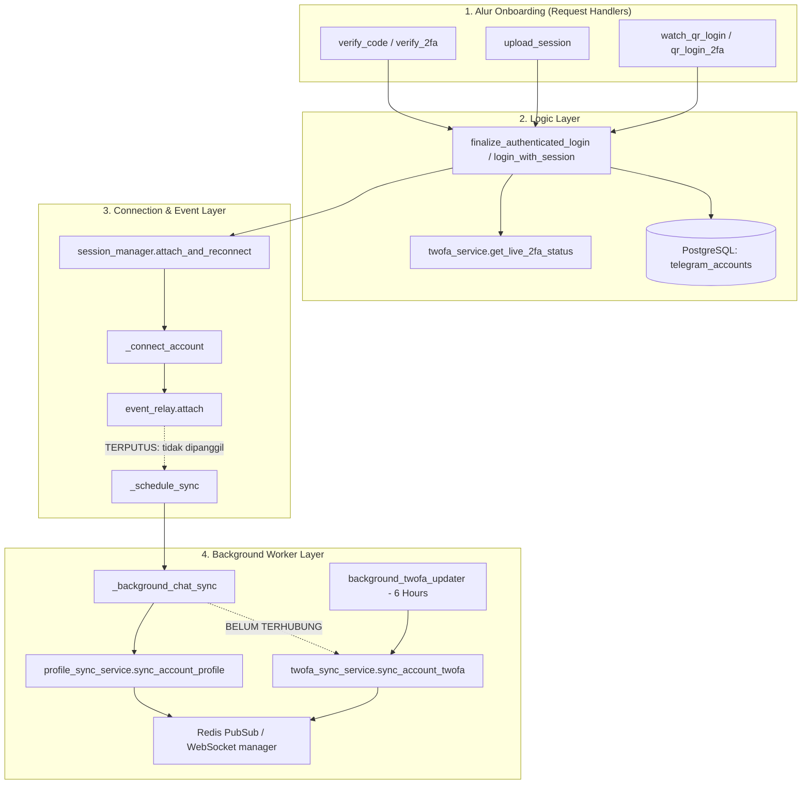

# Audit & Implementation Plan: Telegram Account Profile, 2FA, & Metadata Synchronization

> **Status:** Draft / Planned  
> **Target Subsystem:** Account Onboarding, Session Management, Profile Sync, 2FA Cache Sync  
> **Investigation Tools:** Static Code Analysis, Git History Review, Graphify Knowledge Graph  
> **Full Document:** Lihat juga di [docs/audit-profile-sync.md](file:///d:/PROJECT/Telegram/TeleBos/docs/audit-profile-sync.md)

---

## 1. Executive Summary

Saat pengguna menghubungkan (*connect*) atau menambahkan akun Telegram ke TeleBos (baik melalui verifikasi OTP, upload *session string*, maupun *QR login*), akun berhasil terdaftar namun mengalami **keterlambatan atau ketiadaan sinkronisasi data awal**:
1. **Foto profil (*Profile Picture*) tidak tampil** di UI (avatar hanya menampilkan inisial dan warna latar belakang).
2. **Status 2FA dan Login Recovery Email tidak tersinkron** (muncul tanda strip `"—"` atau seolah-olah 2FA belum aktif/tanpa recovery email).
3. **Detail profil lainnya (Bio/About, Accent Color ID, daftar chats, dan folder)** tidak langsung terisi.

Investigasi mendalam membuktikan bahwa masalah ini **bukan** karena kegagalan API Telegram, melainkan karena **tiga celah arsitektur internal di backend TeleBos**:
- Field metadata yang sudah diperoleh dari Telegram saat *handshake* login dibuang dan tidak disimpan ke kolom database.
- Fungsi background synchronizer (`_schedule_sync`) berstatus *orphaned* (terputus dari alur koneksi akibat refactoring masa lalu).
- Komponen frontend memiliki pengaman (*guard clause*) ketat yang membatalkan permintaan gambar jika indikator foto lokal bernilai *false*.

---

## 2. Arsitektur & Analisis Graphify

Berdasarkan analisis graf dependensi (`graphify explain` & `graphify query`), alur kerja dan relasi modul adalah sebagai berikut:



### Temuan Node Graphify Utama:
1. `backend_app_services_session_manager_schedule_sync`:
   - Memiliki **0 incoming call edges** dari luar. Fungsi ini membungkus `_background_chat_sync()`, tetapi tidak pernah dipanggil setelah `event_relay.attach()` berhasil.
2. `backend_app_services_twofa_service_get_live_2fa_status`:
   - Dipanggil oleh 4 titik login onboarding: `login_with_session()`, `finalize_authenticated_login()`, `watch_qr_login()`, dan `qr_login_2fa()`.
   - Mengembalikan payload lengkap (`enabled`, `has_recovery`, `hint`, `login_email_pattern`, `unconfirmed_email_pattern`).
   - Namun, consumer di atasnya hanya mengekstrak `status["enabled"]`.
3. `backend_app_services_twofa_sync_service_sync_account_twofa`:
   - Satu-satunya titik yang meng-update kolom `login_email_pattern` dan `twofa_has_recovery`.
   - Hanya dipanggil oleh `sync_due_accounts()`, yang berjalan setiap 6 jam sekali.

---

## 3. Investigasi Akar Masalah (Root Cause Analysis)

### Masalah A: Foto Profil Tidak Kelihatan
1. **Omission pada pembuatan model `TelegramAccount`:**
   - Di [account_service.py](file:///d:/PROJECT/Telegram/TeleBos/backend/app/services/account_service.py#L459-L472) dan [accounts.py](file:///d:/PROJECT/Telegram/TeleBos/backend/app/api/accounts.py#L141-L162), objek `me = await client.get_me()` memuat atribut `me.photo`.
   - Jika pengguna memiliki foto profil, `me.photo` adalah objek `UserProfilePhoto` dengan atribut integer `photo_id`.
   - Kode saat ini tidak membaca `me.photo.photo_id`, sehingga akun baru diinsert dengan:
     ```python
     profile_photo_id = None
     profile_photo_path = None
     photo_version = 0
     ```
2. **Guard Clause pada Frontend `AccountAvatar`:**
   - Properti model di [telegram_account.py](file:///d:/PROJECT/Telegram/TeleBos/backend/app/models/telegram_account.py#L98-L102):
     ```python
     @property
     def has_profile_photo(self) -> bool:
         return self.profile_photo_id is not None
     ```
   - Komponen frontend di [AccountAvatar.tsx](file:///d:/PROJECT/Telegram/TeleBos/frontend/src/components/accounts/account-avatar.tsx#L61):
     ```typescript
     const shouldRenderImage = (hasProfilePhoto ?? (photoVersion ?? 0) > 0) && isImageLoadable;
     ```
   - Karena `has_profile_photo: false` dan `photo_version: 0`, kondisi `shouldRenderImage` mengevaluasi ke `false`.
   - Browser **tidak pernah memanggil endpoint `/photo`**, melainkan langsung menampilkan avatar inisial nama.

### Masalah B: 2FA & Login Recovery Email Hilang / Tidak Sinkron
1. **Pembuangan metadata pada fungsi login:**
   - Di [account_service.py:421](file:///d:/PROJECT/Telegram/TeleBos/backend/app/services/account_service.py#L421):
     ```python
     live_twofa_status = await get_live_2fa_status(unauth_client)
     ```
     `live_twofa_status` berisi:
     ```python
     {
         "enabled": bool,
         "has_recovery": bool,
         "hint": str | None,
         "login_email_pattern": str | None, # contoh: u***@gmail.com
         "unconfirmed_email_pattern": str | None
     }
     ```
   - Namun, hanya `account.twofa_enabled` yang disimpan. Kolom `twofa_has_recovery`, `login_email_pattern`, `unconfirmed_email_pattern`, `twofa_hint`, dan `twofa_status_synced_at` dibiarkan bernilai `None`.
2. **Endpoint `/accounts/{id}/2fa` hanya membaca cache:**
   - [settings_service.py:189](file:///d:/PROJECT/Telegram/TeleBos/backend/app/services/settings_service.py#L189) sengaja tidak melakukan panggilan MTProto langsung (untuk menghindari *rate limiting* / memblokir *request path*). Endpoint mengembalikan field dari database.
   - Karena field database bernilai `None`, frontend di [AccountDetailPage](file:///d:/PROJECT/Telegram/TeleBos/frontend/src/app/%28dashboard%29/accounts/%5Bid%5D/page.tsx#L198) menampilkan `"—"`.
3. **Siklus pembaruan 2FA terisolasi:**
   - [twofa_sync_service.py](file:///d:/PROJECT/Telegram/TeleBos/backend/app/services/twofa_sync_service.py) memiliki background loop dengan interval 6 jam. Tidak ada pemicu *event-driven* saat akun baru terhubung.

### Masalah C: Bio, Accent Color, Chats, & Folders Tertunda
1. **Batasan Telegram `client.get_me()`:**
   - Method standar Telegram `client.get_me()` hanya mengembalikan nama, username, nomor HP, dan status premium.
   - Field `bio` (*about*) dan `color_id` (*profile accent color*) memerlukan RPC `client(GetFullUserRequest("me"))`.
2. **Pemanggilan `_schedule_sync()` yang hilang:**
   - Berdasarkan riwayat Git (`commit 8ec82c09`), refactoring koneksi asinkron memisahkan I/O Telegram dari session database caller.
   - Pemanggilan `asyncio.create_task(_background_chat_sync(str(account.id)))` diubah menjadi `_schedule_sync(account_id)`, tetapi baris pemanggilannya **tertinggal dan tidak pernah dipanggil** di dalam method `_connect_account`.

---

## 4. Invariant & Batasan Keamanan

Agar perbaikan ini bersih, tidak menimbulkan regresi (*clean code* & *rock-solid*), perubahan harus mematuhi batasan arsitektur berikut:

1. **Non-blocking Request Handlers:**
   - Endpoint HTTP login (`/verify-code`, `/verify-2fa`, `/upload-session`, `/qr-login`) tidak boleh memblokir respons pengguna untuk mengunduh foto profil atau mengambil dialog chat Telegram yang besar.
   - Pengunduhan foto profil berukuran penuh dan sinkronisasi chat harus dieksekusi secara asinkron di background melalui `_schedule_sync()`.
2. **Atomic In-Memory Metadata Persistence:**
   - Karena `live_twofa_status` dan `me.photo` sudah tersedia di memori saat login, menyimpannya ke database memiliki *overhead* 0 ms (tanpa penambahan network call MTProto).
3. **Database Session Isolation:**
   - `_background_chat_sync()` dan `sync_account_twofa()` harus selalu menggunakan session database mandiri (`async_session_factory()`), bukan mewarisi session dari request HTTP.
4. **Debounce & Concurrency Safety:**
   - Gunakan `_sync_semaphore` dan task tracker `_sync_tasks` yang sudah ada di `session_manager.py` untuk mencegah *race condition* jika pengguna membuka aplikasi dari multiple tab.
5. **Multi-process Event Relay:**
   - Event WebSocket (`profile_sync`, `twofa_status_sync`, `chats_synced`, `folders_synced`) harus dikirim baik via Redis dispatcher (`publish_ws_event`) maupun local WebSocket manager (`manager.broadcast`) agar sinkron di seluruh instance worker.

---

## 5. Rencana Perbaikan (Step-by-Step Remediation Plan)

### Langkah 1: Simpan Metadata Lengkap saat Inisialisasi Akun
Modifikasi [backend/app/services/account_service.py](file:///d:/PROJECT/Telegram/TeleBos/backend/app/services/account_service.py) pada fungsi:
- `finalize_authenticated_login()` (alur OTP dan 2FA)
- `login_with_session()` (alur Upload Session)

Modifikasi [backend/app/api/accounts.py](file:///d:/PROJECT/Telegram/TeleBos/backend/app/api/accounts.py) pada fungsi:
- `watch_qr_login()`
- `qr_login_2fa()`

**Implementasi Logic:**
```python
# Ekstraksi profile_photo_id
tg_photo_id = me.photo.photo_id if (getattr(me, "photo", None) and hasattr(me.photo, "photo_id")) else None

# Simpan ke akun baru atau perbarui akun yang sudah ada:
account.profile_photo_id = tg_photo_id
if live_twofa_status is not None:
    account.twofa_enabled = bool(live_twofa_status.get("enabled", False))
    account.twofa_has_recovery = live_twofa_status.get("has_recovery")
    account.twofa_hint = live_twofa_status.get("hint")
    account.login_email_pattern = live_twofa_status.get("login_email_pattern")
    account.unconfirmed_email_pattern = live_twofa_status.get("unconfirmed_email_pattern")
    account.twofa_status_synced_at = datetime.now(timezone.utc)
```

### Langkah 2: Hubungkan `_schedule_sync()` pada `session_manager.py`
Modifikasi [backend/app/services/session_manager.py](file:///d:/PROJECT/Telegram/TeleBos/backend/app/services/session_manager.py):
1. Di method `_connect_account()`, tepat setelah `event_relay.attach()` sukses:
   ```python
   success = await event_relay.attach(account_id_value, session_str)
   if success:
       logger.info("Account %s connected + event handlers attached", account_id_value)
       _schedule_sync(account_id_value)
   ```
2. Pastikan konversi UUID aman di `_background_chat_sync()`:
   ```python
   import uuid
   acc_uuid = uuid.UUID(str(account_id))
   result = await db.execute(
       select(TelegramAccount).where(TelegramAccount.id == acc_uuid)
   )
   ```
3. Di dalam `_background_chat_sync()`, integrasikan sinkronisasi 2FA:
   ```python
   # 4. Sync safe 2FA metadata and broadcast
   try:
       from app.services.twofa_sync_service import sync_account_twofa
       await sync_account_twofa(account_id)
   except Exception as twofa_exc:
       logger.warning("Error in background 2FA sync for account %s: %s", account_id, twofa_exc)
   ```

### Langkah 3: Perbaiki Property `has_profile_photo` & Fallback On-Demand Download
1. Di [backend/app/models/telegram_account.py](file:///d:/PROJECT/Telegram/TeleBos/backend/app/models/telegram_account.py):
   ```python
   @property
   def has_profile_photo(self) -> bool:
       """Whether Telegram reports a current profile photo for this account."""
       return self.profile_photo_id is not None or bool(self.profile_photo_path)
   ```
2. Di `download_and_cache_photo()` di [backend/app/services/account_service.py](file:///d:/PROJECT/Telegram/TeleBos/backend/app/services/account_service.py):
   Pastikan atribut `account.profile_photo_id` diperbarui saat foto diunduh secara on-demand jika sebelumnya masih `None`.

---

## 6. Matrix Pengujian & Verifikasi

| Skenario Uji | Komponen | Ekspektasi Sebelum Fix | Ekspektasi Setelah Fix |
| :--- | :--- | :--- | :--- |
| **Login Akun dengan Foto Profil** | Avatar UI & DB | `has_profile_photo: false`, avatar hanya inisial nama | `has_profile_photo: true`, foto profil terunduh dan tampil seketika |
| **Login Akun dengan 2FA & Recovery Email** | Security Details | `login_email_pattern: null`, UI menampilkan `"—"` | `login_email_pattern: "u***@..."`, UI menampilkan email tersensor |
| **Login Akun dengan Bio & Accent Color** | Account Details | `bio: null`, `color_id: null` | Bio dan Color ID terisi otomatis via WebSocket sync |
| **Upload Session String** | Sesi Import | Data foto dan 2FA tidak tersinkron | Data foto, 2FA, dan chat tersinkron via background task |
| **QR Code Login** | QR Flow | Sama seperti OTP | Foto dan 2FA langsung terisi di database |
| **Regression: Account Deletion** | Cleanup Cache | File foto dihapus | Berfungsi normal, tidak terganggu |

---

## 7. Rangkuman Tindakan Berikutnya

Setelah dokumen audit ini disetujui, eksekusi kode akan dilakukan dengan urutan:
1. Menambahkan persistensi `profile_photo_id` dan `live_twofa_status` di handler login.
2. Mengaktifkan pemanggilan `_schedule_sync()` di `session_manager.py` dan menambahkan step `sync_account_twofa()`.
3. Menjalankan rangkaian unit test backend (`pytest backend/tests/unit/test_twofa_service.py` dan `pytest backend/tests/unit/test_upload_photo.py`) untuk memverifikasi kompatibilitas.
4. Menjalankan `graphify update .` untuk memperbarui graf pengetahuan repositori.
